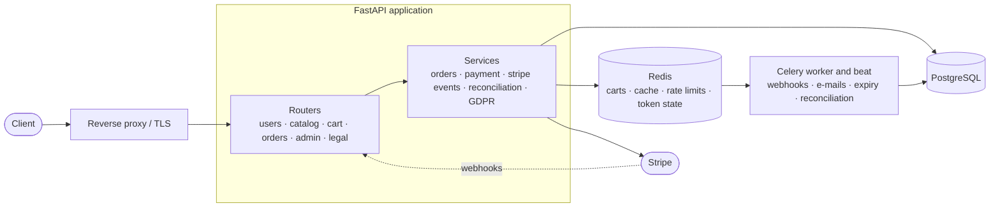

# FastAPI E-commerce Backend

[](https://github.com/nadeko0/fastapi_e-commerce_backend/actions/workflows/ci.yml)
[](https://github.com/nadeko0/fastapi_e-commerce_backend/releases)


[](LICENSE)


A backend for an online shop: catalog, carts, orders, Stripe payments, refunds and disputes, an admin API and GDPR tooling. It is a **foundation to build a store on**, not a demo: the catalog is product-neutral, and there is deliberately no frontend.

What makes it worth a look is less the feature list than how it was checked. Every release went through a test suite of about 5,200 tests on SQLite and PostgreSQL, and the final 4.0 line went through a full release campaign: fuzzing from the OpenAPI schema, end-to-end runs against Stripe's test mode, load and soak tests, chaos experiments (pull the plug on Redis, freeze PostgreSQL, kill a worker mid-payment), a DAST scan, mutation testing and a deployment on a real server. Everything that broke was fixed, and every report is in this repository.

## ✨ Features

- **Accounts:** registration with e-mail verification, JWT access tokens with rotating refresh tokens (reuse revokes the whole family), password reset, admin role, login lockout, NIST 800-63B password policy.
- **Catalog:** nested categories, products with variants (SKU, attributes, own price and stock), search, sorting, ETag and conditional requests, JSON Merge Patch for edits.
- **Carts and orders:** guest carts that merge on login, stock reserved under row locks, an order state machine, automatic expiry of unpaid orders.
- **Payments:** Stripe PaymentIntents and Checkout Sessions, 3-D Secure, refunds and disputes. Webhooks are stored first and processed by Celery with retries, and a daily reconciliation checks the books against Stripe. Idempotency-Key on every money-moving request.
- **API hygiene:** problem details (RFC 9457) for every error, correct status codes (201 + Location, 409 for conflicts, 503 with Retry-After), strict input, money as decimal strings, RateLimit headers, request ids and optional OpenTelemetry tracing.
- **Privacy:** GDPR export and erasure, consent records, retention jobs.

## 🧭 Architecture



The full picture, the payment flow, the order state machine and the reasoning behind the main design choices are in [docs/ARCHITECTURE.md](docs/ARCHITECTURE.md).

## 🚀 Quick start

```bash
git clone https://github.com/nadeko0/fastapi_e-commerce_backend.git
cd fastapi_e-commerce_backend
cp .env.example .env          # set ENVIRONMENT, passwords and secrets; see SETUP.md
docker compose up -d --build
docker compose --profile migrate run --rm migrate
```

The API listens on `http://localhost:8000`, with interactive docs at `/api/v1/docs` outside production. Payments use a built-in mock provider until you add Stripe test keys. Running without Docker, creating the first admin and wiring Stripe webhooks are covered in [SETUP.md](SETUP.md).

```bash
uv sync
uv run pytest tests/ -n 2 -m "not timing_sensitive"   # the fast local run
```

## 📚 Documentation

| Document | What you will find |
|---|---|
| [SETUP.md](SETUP.md) | Local development, Docker Compose, first admin, Stripe for development |
| [docs/ARCHITECTURE.md](docs/ARCHITECTURE.md) | Components, flows, state machine, design decisions |
| [docs/API.md](docs/API.md) | Conventions: errors, status codes, idempotency, money, pagination, caching |
| [docs/OPERATIONS.md](docs/OPERATIONS.md) | Production configuration, proxies, probes, logging, Celery, backups, time zones |
| [docs/TESTING.md](docs/TESTING.md) | Test strategy, how to run every suite, CI, coverage and mutation gates |
| [docs/PERFORMANCE.md](docs/PERFORMANCE.md) | Load and soak results, overload behaviour, tuning |
| [docs/RESILIENCE.md](docs/RESILIENCE.md) | What happens when Redis, PostgreSQL or a worker fails |
| [SECURITY.md](SECURITY.md) | Reporting a vulnerability, the security design, scan results |
| [docs/LIMITATIONS.md](docs/LIMITATIONS.md) | What it deliberately does not do, and known limitations |
| [CHANGELOG.md](CHANGELOG.md) | Every release from 1.0.0 to today |
| [docs/reports/](docs/reports/README.md) | The full test reports: every stage, every number, every fix |
| [docs/HOW-THIS-WAS-BUILT.md](docs/HOW-THIS-WAS-BUILT.md) | Who did what, where the decisions came from, what went wrong |

## 📊 At a glance (v4.0.3)

| | |
|---|---|
| Tests | about 5,200 on SQLite and PostgreSQL, 400 against Stripe test mode, 0 warnings |
| Coverage | 98.8 % overall, 100 % lines and branches on the payment layer (enforced in CI) |
| Mutation testing | 98.4 % of 3,165 mutants killed; every survivor reviewed as equivalent |
| CI | lint, tests, 7 time zones, PostgreSQL 15/16/18, real Redis, pip-audit, gitleaks, Trivy |
| Load (4 CPUs, 200 users) | p95 57 to 68 ms; overload answers fast 503s instead of stalling |
| Chaos | Redis or PostgreSQL down: 503 with Retry-After, recovery on its own, no webhook lost or applied twice |
| Security | ZAP and a manual OWASP API Top 10 review: no open high or medium issues |

Details and the conditions behind each number: [docs/reports/final-test-campaign.md](docs/reports/final-test-campaign.md).

## 🧱 Tech stack

Python 3.13 · FastAPI and Starlette · Pydantic 2 · SQLAlchemy 2 (async) and Alembic · PostgreSQL · Redis · Celery · Stripe · PyJWT and bcrypt · uv · pytest, Hypothesis, Schemathesis, mutmut · Docker · GitHub Actions.

## 📌 About this project

A learning and portfolio project, built with the help of AI coding agents (Claude, Gemini) under human review. The commit history and the reports show how the work was planned, checked and corrected, mistakes included; [docs/HOW-THIS-WAS-BUILT.md](docs/HOW-THIS-WAS-BUILT.md) tells the story in my own words.

## License

[MIT](LICENSE)
