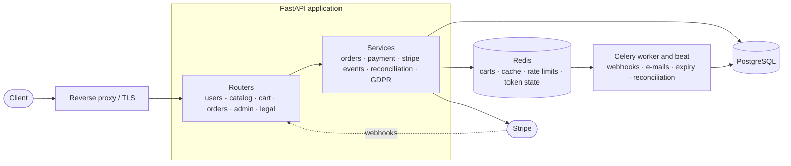

# FastAPI E-commerce Backend

[](https://github.com/nadeko0/fastapi_e-commerce_backend/actions/workflows/ci.yml)
[](https://github.com/nadeko0/fastapi_e-commerce_backend/releases)


[](LICENSE)


-98.7%25-brightgreen)

A backend for an online shop: catalog, carts, orders, Stripe payments, refunds and disputes, an admin API and GDPR tooling. It is a **foundation to build a store on**, not a demo: the catalog is product-neutral, and there is deliberately no frontend.

What makes it worth a look is less the feature list than how it was checked. The test suite runs 6,623 cases from 2,611 test functions on SQLite and PostgreSQL, and the final 4.0 line went through a full release campaign: fuzzing from the OpenAPI schema, end-to-end runs against Stripe's test mode, load and soak tests, chaos experiments (pull the plug on Redis, freeze PostgreSQL, kill a worker mid-payment), a DAST scan, mutation testing and a deployment on a real server. Defects found were fixed or are listed in docs/LIMITATIONS.md, and the reports are in this repository.

## ✨ Features

- **Accounts:** registration (name optional) with email verification and normalised email, JWT access tokens with rotating refresh tokens (reuse revokes the whole family), password reset evicting in-flight sessions, admin role, login lockout, a password policy after NIST 800-63B-4 (8-character minimum).
- **Catalog:** nested categories, products with variants (bought through a variant when active, SKU, attributes, own price and stock), search, sorting, ETag and conditional requests, JSON Merge Patch for edits.
- **Carts and orders:** guest carts that merge on login, stock reserved under FOR NO KEY UPDATE row locks, order total limit, MAX_PENDING_ORDERS_PER_USER cap, immutable line and shipping snapshots, an order state machine, automatic expiry of unpaid orders bounded by checkout session lifetime.
- **Payments:** Stripe PaymentIntents and Checkout Sessions, 3-D Secure, refunds and disputes. Admin payment queue and refunds for flagged attempts. Webhooks are stored first and processed by Celery with retries, and a daily reconciliation checks the books against Stripe. Idempotency-Key on every money-moving request.
- **API hygiene:** problem details (RFC 9457) for every error, correct status codes (201 + Location, 409 for conflicts, 503 with Retry-After), strict input, money as decimal strings, RateLimit headers, request ids and optional OpenTelemetry tracing.
- **Privacy:** GDPR export assembled and mailed inline as JSON, erasure with active order and dispute protections, consent records, retention jobs.

## 🧭 Architecture



The full picture, the payment flow, the order state machine and the reasoning behind the main design choices are in [docs/ARCHITECTURE.md](docs/ARCHITECTURE.md).

## 🚀 Quick start

```bash
git clone https://github.com/nadeko0/fastapi_e-commerce_backend.git
cd fastapi_e-commerce_backend
cp .env.example .env          # set ENVIRONMENT, POSTGRES_SERVER=db, REDIS_HOST=redis, passwords and secrets; see SETUP.md
docker compose up -d --build
docker compose --profile migrate run --rm migrate
```

The API listens on `http://localhost:8000`, with interactive docs at `/api/v1/docs` outside production. Payments use a built-in mock provider until you add Stripe test keys. Running without Docker, creating the first admin and wiring Stripe webhooks are covered in [SETUP.md](SETUP.md).

```bash
uv sync
uv run pytest tests/ -n 2 -m "not timing_sensitive"   # the fast local run
```

## 📚 Documentation

| Document | What you will find |
|---|---|
| [SETUP.md](SETUP.md) | Local development, Docker Compose, first admin, Stripe for development |
| [docs/ARCHITECTURE.md](docs/ARCHITECTURE.md) | Components, flows, state machine, design decisions |
| [docs/API.md](docs/API.md) | Conventions: errors, status codes, idempotency, money, pagination, caching |
| [docs/OPERATIONS.md](docs/OPERATIONS.md) | Production configuration, proxies, probes, logging, Celery, backups, time zones |
| [docs/TESTING.md](docs/TESTING.md) | Test strategy, how to run the suites, CI and coverage gates, mutation results |
| [docs/PERFORMANCE.md](docs/PERFORMANCE.md) | Load and soak results, overload behaviour, tuning |
| [docs/RESILIENCE.md](docs/RESILIENCE.md) | What happens when Redis, PostgreSQL or a worker fails |
| [SECURITY.md](SECURITY.md) | Reporting a vulnerability, the security design, scan results |
| [docs/LIMITATIONS.md](docs/LIMITATIONS.md) | What it deliberately does not do, and known limitations |
| [CHANGELOG.md](CHANGELOG.md) | Every release from 1.0.0 to today |
| [docs/reports/](docs/reports/README.md) | The test reports: each stage, its numbers and the fixes |
| [docs/HOW-THIS-WAS-BUILT.md](docs/HOW-THIS-WAS-BUILT.md) | Who did what, where the decisions came from, what went wrong |

## 📊 At a glance (v4.1.2)

| | |
|---|---|
| Tests | 6,623 cases from 2,611 test functions on SQLite and PostgreSQL, 54 live Stripe tests, 0 warnings |
| Coverage | 98.7 % overall, lines and branches combined; 100 % on the payment-layer files, the mock provider excluded (enforced in CI) |
| Mutation testing | 98.7 % of 3,434 mutants detected (3,119 killed, 272 timed out; measured on 4.1.1); the 43 survivors reviewed as equivalent |
| CI | lint (Ruff, mypy), sast (Bandit), benchmarks, migration-compat, tests, 7 time zones, PostgreSQL 15/16/18 with migration round-trip checks, real Redis, pip-audit, gitleaks, Trivy |
| Load (4-core host, app on 3 cores, 200 users, mock payments, rate limits raised, measured on 4.0.1) | p95 57 to 68 ms; overload answers fast 503s instead of stalling |
| Chaos (measured on 4.0.x) | Redis or PostgreSQL down: 503 with Retry-After, recovery on its own, no webhook lost or applied twice |
| Security (measured on 4.0.3) | ZAP and a manual OWASP API Top 10 review: no open high or medium issues |

Details and the conditions behind each number: [docs/reports/final-test-campaign.md](docs/reports/final-test-campaign.md).

## 🧱 Tech stack

Python 3.13 · FastAPI and Starlette · Pydantic 2 · SQLAlchemy 2 (async) and Alembic · PostgreSQL · Redis · Celery · Stripe · PyJWT and bcrypt · uv · pytest and Hypothesis in the suite; Schemathesis, mutmut and Locust for the release campaign · Docker · GitHub Actions.

## 📌 About this project

A learning and portfolio project, built with the help of AI coding agents (Claude, Gemini) under human review. The commit history and the reports show how the work was planned, checked and corrected, mistakes included; [docs/HOW-THIS-WAS-BUILT.md](docs/HOW-THIS-WAS-BUILT.md) tells the story in my own words.

## License

[MIT](LICENSE)
