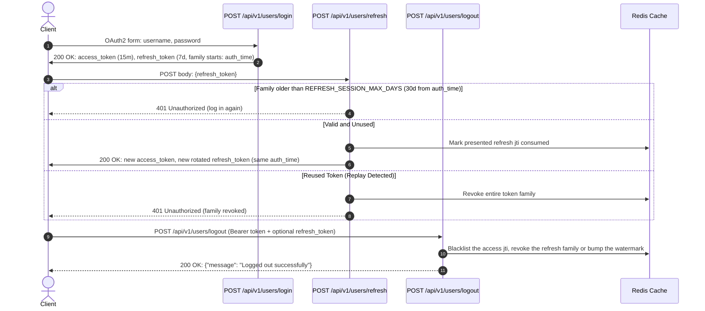
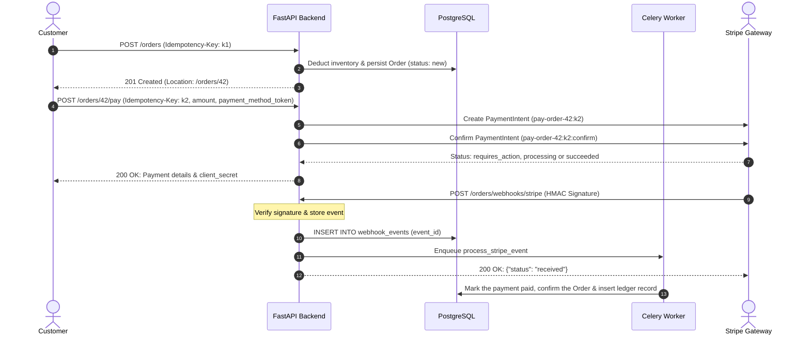

# REST API Reference and Conventions

Every API contract in release v6.1.0 is designed around standard HTTP semantics and deterministic data representations. Clients communicate with a uniform interface where resources, errors, authentication lifecycles, and caching rules follow RFC standards rather than framework idiosyncrasies.

Interactive OpenAPI documentation and Swagger UI are accessible at `/api/v1/docs` (with ReDoc at `/redoc` and OpenAPI JSON at `/api/v1/openapi.json`) in non-production environments. When `ENVIRONMENT=production`, all documentation endpoints answer 404 to avoid leaking internal route structures.

The OpenAPI document is written to generate typed clients. Operation ids are the handler names (`get_product`, not `get_product_api_v1_products__product_id__get`; a handler serving both PUT and PATCH gets the method as a suffix, for example `update_product_patch`), so a client generated from the spec names its methods after them; release 5.0.0 renamed 69 operation ids and no route, parameter or payload changed on the wire. The document publishes the closed value sets (enums such as order and payment status, dispute status and problem types) without validating them at runtime, the required fields of every schema, the `guest_cart` cookie (`Set-Cookie`) on the cart routes, the `ETag` header on product and variant responses, `X-Request-ID` on every response, `Retry-After` on 429 and 503, `RateLimit` and `RateLimit-Policy` on 429, and `WWW-Authenticate` on every 401. Where a route describes its own 400, 401 or 503, the description also names the causes every route shares (a body that is not JSON, a bad token, the in-flight limit). HEAD is answered on the health probes (see below) without being listed in the document. `tests/unit/test_openapi_contract.py` checks the operation ids and the promises of the response fields, and `tests/snapshots/openapi.json` pins the whole document (see TESTING.md).

## Base Path and Endpoint Overview

The API version prefix is mounted at `/api/v1` (configured via `settings.API_V1_STR`). The test suite validates 56 distinct paths comprising 69 endpoint operations across 6 routers plus the health probes.

| Router Tag | Operations | Scope and Primary Responsibilities |
|---|---|---|
| `admin` | 18 | Product catalog management, category creation, payment reconciliation, order review, statistics, listing and refunding flagged payments, and webhook event inspection or replay. |
| `cart` | 6 | Guest and account cart management, item mutations, live pricing checks, and stock validation. |
| `catalog` | 6 | Public read-only product listings, category trees, product detail retrieval, and catalog search by name and description. |
| `legal` | 7 | Consent state tracking, privacy policies, terms of service, cookie disclosures (each document carries a fixed version and effective date, `last_updated`, that change only with its text; the terms state prices in `STORE_CURRENCY`), data export delivered inline via email, and account erasure. |
| `orders` | 9 | Order creation, payment intent confirmation, Stripe Checkout sessions, payment history, cancellations, refunds, and Stripe webhook ingress. |
| `users` | 20 | Registration (name optional), login with email normalisation, token refresh, logout, password reset lifecycles, email verification, profile management, and address book CRUD. |
| `health` / probes | 3 | Operational health checks (`/health`), Kubernetes liveness probe (`/livez`), and readiness probe (`/readyz`). |

## Authentication and Token Lifecycle

Authentication implements the OAuth2 password flow using Bearer tokens signed with JSON Web Signatures (RFC 7519).



- **Login (`POST /api/v1/users/login`):** Expects standard application/x-www-form-urlencoded credentials (`username`, `password`). Returns `{access_token, token_type: "bearer", refresh_token}`.
- **Bearer Authorization:** Protected endpoints require the header `Authorization: Bearer <access_token>`.
- **Refresh Token Rotation & Reuse Detection:** `POST /api/v1/users/refresh` exchanges a single-use refresh token for a fresh token pair. If an already-rotated token is presented again, the server detects token theft and revokes the entire token family (`family` claim), terminating the compromised session chain. A family lasts at most `REFRESH_SESSION_MAX_DAYS` (30 by default) from its login, however often it is rotated: each rotated token expires after `REFRESH_TOKEN_EXPIRE_DAYS` (7) or at the family's end, whichever is first, and a refresh after the end is refused with the same 401 as an expired token, so the client logs in again.
- **Logout (`POST /api/v1/users/logout`):** Requires Bearer authentication. When a `refresh_token` is provided in the body, its family is marked revoked first and the active access token's `jti` is blacklisted with its TTL rounded up. When called without a body, the user's revocation watermark in Redis is updated and all refresh families are revoked, immediately invalidating all tokens issued for that account across all devices. If Redis is unreachable during logout, the request fails closed with HTTP 503 (`Retry-After: 5`).
- **Password Reset (`POST /api/v1/users/password/reset/confirm`):** Setting a new password records a watermark, commits the change, sets a second watermark to evict in-flight logins and token rotations, and ends all refresh families for the account.

## Response Shapes

API responses avoid arbitrary wrappers:
- **Single Resources:** Returned directly at the top level (e.g. `GET /api/v1/products/1` returns the product JSON directly, without `{"data": ...}` or `{"success": true}`).
- **Page Objects:** Paginated lists return an object with exact pagination metadata:
  ```json
  {
    "items": [...],
    "total": 142,
    "page": 1,
    "size": 20,
    "has_more": true
  }
  ```
- **Confirmation Responses:** Operations with no returned resource body return `{"message": "..."}`.
- **Order Shipping Address:** An order's `shipping_address` is the copy taken when the order was placed; editing, deleting or re-defaulting the address book entry does not change it. In the copy, `is_default` is always `false` and `created_at` and `updated_at` are the order's `created_at`.
- **Request Tracking:** Every HTTP response carries the `X-Request-ID` header for log tracing: a well-formed incoming value is kept, otherwise one is generated (a UUID4 in hex form). A browser client may send it: CORS allows the request header.

## Error Handling (RFC 9457 Problem Details)

All error responses use the standard `application/problem+json` media type (RFC 9457). Every problem payload includes:
- `type`: Stable URI identifying the problem class, or `"about:blank"` when the status code fully describes the condition.
- `title`: Short, human-readable summary of the problem type (constant for a given `type`).
- `status`: HTTP status code matching the response header.
- `detail`: Occurrence-specific description for debugging (omitted on internal 500 errors to avoid leaking implementation details).
- `instance`: Percent-encoded request URI path (query parameters stripped to protect tokens and privacy).
- Extension members: `request_id` (matching `X-Request-ID`), `errors` (on 422 errors, listing sanitized `{type, loc, msg, ctx}` entries without echoing user input), and `retry_after` (on 429 and 503 responses, matching `Retry-After`).

### Problem Types Reference

The complete catalog of typed problems declared in `app/core/errors.py`:

| Problem Type Identifier (URI suffix) | HTTP Status | Trigger Condition and Semantics |
|---|---|---|
| `validation-error` | 422 | Schema validation failure, forbidden unknown field, out-of-bounds parameter, or unparseable Unicode. |
| `malformed-request` | 400 | Request body cannot be parsed as JSON syntax or cannot be decoded as UTF-8 text. |
| `unsupported-media-type` | 415 | Request payload submitted with unsupported `Content-Type`. Carries `Accept: application/json`. |
| `body-too-large` | 413 | Request body exceeds configured `MAX_REQUEST_BODY_BYTES` (default 1 MiB). |
| `rate-limited` | 429 | Rate limit budget exhausted. Carries `Retry-After` seconds and draft RateLimit headers. |
| `service-overloaded` | 503 | Worker reached `MAX_IN_FLIGHT_REQUESTS` capacity. Sheds request with `Retry-After: 1`. |
| `idempotency-key-missing` | 400 | Mutating order, payment, or refund route missing mandatory `Idempotency-Key` header (or key length not 8 to 255 chars). |
| `idempotency-key-reused` | 422 | Stored `Idempotency-Key` reused with a differing request body or parameter payload. |
| `idempotency-key-in-use` | 409 | Identical `Idempotency-Key` currently undergoing active processing by a concurrent worker. |
| `payment-declined` | 422 | Payment provider refused the transaction (e.g. card declined, insufficient funds, expired card). |
| `insufficient-stock` | 409 | Requested quantity exceeds available inventory during cart operations or order placement. |
| `account-inactive` | 403 | The token is valid but the account is deactivated. (An unverified email blocks `POST /orders` with a plain 403, type `about:blank`.) |

## HTTP Status Codes

The API strictly adheres to RFC 9110 status code semantics:
- **201 Created + Location:** Returned by POST endpoints that instantiate persistent resources (`POST /api/v1/orders`, `POST /api/v1/users/addresses`, `POST /api/v1/admin/products`, `POST /api/v1/admin/products/{product_id}/variants`, `POST /api/v1/admin/categories`). The `Location` header points to the newly created resource path; CORS exposes it to browser clients.
- **202 Accepted:** Returned by `POST /api/v1/users/register`. The server accepts the registration request asynchronously regardless of whether the email is already registered, completely preventing account enumeration.
- **204 No Content:** Deleting an address (`DELETE /api/v1/users/addresses/{id}`) or a product (`DELETE /api/v1/admin/products/{id}`). Contains no body. `DELETE /api/v1/cart` and `DELETE /api/v1/cart/items/{product_id}` return 200 with the updated cart.
- **400 vs 409 vs 422:**
  - `400 Bad Request`: Syntactically invalid payloads (non-JSON body, unreadable text), missing or invalid `Idempotency-Key` format, or invalid Stripe signature HMAC.
  - `409 Conflict`: Request conflicts with current resource or inventory state (`insufficient-stock`, `idempotency-key-in-use`, an invalid order status transition, cancelling an order that is paid or no longer new (or, with `Retry-After: 60`, one whose payment attempt is still in progress), replaying a webhook event that has not failed). Also returned for ordering a variant-enabled product without selecting a variant, exceeding `MAX_PENDING_ORDERS_PER_USER`, a new payment attempt (`/pay` or `/checkout-session` with a new `Idempotency-Key`) on an order placed more than `UNPAID_ORDER_EXPIRE_MINUTES` ago (a retry with the key of an earlier attempt is still served), retrying an admin refund on a settled payment (also the loser of two concurrent refunds of a flagged payment, whose whole amount the other one took: `detail` "This payment has already been fully refunded"), attempting to refund a disputed payment, when `/pay` cannot apply a payment success, when the last active administrator requests erasure, when a new or changed address equals another active address of the user, or when another request made a different address the default at the same time.
  - `422 Unprocessable Content`: Syntactically well-formed JSON violating domain constraints (unknown properties, negative prices, order total exceeding 21,474,836.47 or below Stripe's minimum charge for the store currency (0.50 USD, 0.50 EUR, 0.30 GBP and others; `MINIMUM_CHARGE` in `app/core/currencies.py`), non-finite numbers, JSON depth exceeding 64, failed regex, `idempotency-key-reused`, or declined cards).
- **401 vs 403:**
  - `401 Unauthorized`: Missing, invalid, expired, or revoked Bearer token, or invalid login credentials. Includes `WWW-Authenticate: Bearer` challenge.
  - `403 Forbidden`: Authenticated identity lacks permission (non-admin accessing `/admin`), or account is inactive (`account-inactive`).
- **413 Content Too Large:** Payload exceeds size ceiling.
- **415 Unsupported Media Type:** Sent with `Accept` header specifying accepted types (`application/json`, or `application/merge-patch+json, application/json` for PATCH). A PATCH request submitting a `+json` media type other than merge-patch returns 415.
- **429 Too Many Requests:** Rate limit exhausted. Response includes `Retry-After: <seconds>` and IETF draft `RateLimit` / `RateLimit-Policy` headers.
- **503 Service Unavailable:** Overload shedding (`Retry-After: 1`), Redis outage during token/login checks (`Retry-After: 30`), Redis outage during cart reads or mutations, logout or password reset (`Retry-After: 5`), a payment provider timeout (`Retry-After: 5`), or database unavailability (`Retry-After: 5`).

## Idempotency Controls (`Idempotency-Key`)

Financial and mutating order endpoints enforce the IETF draft `Idempotency-Key` specification (`draft-ietf-httpapi-idempotency-key-header`):

- **Enforced Routes:** `POST /api/v1/orders`, `POST /api/v1/orders/{order_id}/pay`, `POST /api/v1/orders/{order_id}/checkout-session`, `POST /api/v1/orders/{order_id}/refund`, and `POST /api/v1/admin/payments/{payment_id}/refund`.
- **Format Requirements:** A string of 8 to 255 characters (a UUID is a good choice). Missing or out-of-range headers immediately receive 400 `idempotency-key-missing`.
- **Payload Fingerprinting:** On `POST /orders`, `/pay` and `/checkout-session`, a canonical SHA-256 fingerprint is generated from validated payload fields. Replaying the identical key with different payload parameters triggers 422 `idempotency-key-reused`. The two refund routes store no fingerprint: Stripe compares the parameters, and a key it has already seen with different refund parameters gives 409 `idempotency-key-in-use`. `/pay` and `/checkout-session` answer the same 409 when Stripe reports such a key conflict. A key whose request died before the provider answered (its attempt left "processing") is answered 409 with `Retry-After` for `PAYMENT_ATTEMPT_STALE_AFTER_MINUTES`; after that, on both routes, the retry is sent to Stripe again with the same provider key.
- **Cancelling an order:** an admin's cancellation (`PUT /orders/{id}/status`) and the customer's (`POST /orders/{id}/cancel`) close the order's open payment attempts at Stripe after the commit (a Checkout Session is expired, a PaymentIntent cancelled), so a cancelled order whose stock is back on sale can no longer be paid.
- **Placing an order:** two `POST /orders` of one account run one after the other (a lock on the user's row), so requests with different keys no longer place several orders from one cart or pass `MAX_PENDING_ORDERS_PER_USER`.
- **Concurrent In-Flight Locks:** If a request arrives while an identical key is already being processed, the server yields 409 `idempotency-key-in-use`.
- **Retention and TTL:**
  - Order creation keys are retained in PostgreSQL for `IDEMPOTENCY_KEY_TTL_HOURS` (default 24 hours). Periodic Celery cleanup tasks clear expired keys to allow reuse while preserving order history.
  - Payment-attempt keys are stored with the attempt and never expire locally; forwarded to Stripe as `pay-order-{order_id}:{key}` / `checkout-order-{order_id}:{key}`. Refund keys are not stored; Stripe honours them for at least 24 hours.

## Strict Input Validation

The API enforces strict data hygiene on all inputs:
- **Unknown Field Rejection:** All request models inherit `RequestBody` with Pydantic `extra="forbid"`. Submitting unrecognized JSON keys yields 422 with type `extra_forbidden`.
- **Monetary Precision:** Monetary amounts are accepted and returned as exact decimal strings with ASCII digits only (e.g. `"19.99"`), never floating-point numbers. Currencies are validated against ISO 4217 uppercase alpha-3 codes (`settings.STORE_CURRENCY`, e.g. `"USD"`). Order totals are capped at 21,474,836.47 to match payment column limits.
- **Free-Form JSON Constraints:** Free-form JSON payloads enforce a maximum nesting depth of 64 levels and reject non-finite numbers (NaN, Infinity) with 422. Price filter parameters are bounded.
- **Timezone Awareness:** Timestamps must be ISO 8601 strings with explicit UTC offsets (`UTCDatetime`). Database records are stored in UTC.
- **Character Sanitization:** NUL bytes (`\x00`) and lone Unicode surrogates (`\ud800` through `\udfff`) are rejected with 422 across request bodies, URL paths, query parameters, and form fields before touching PostgreSQL.

## Pagination and Sorting

Collection endpoints consume standardized query parameters:
- `page`: Page index (1-based integer, default 1, bounded to 32-bit signed integer).
- `size`: Items per page (default 20, minimum 1, maximum 100).
- `GET /api/v1/products` filters: `in_stock=true` lists a product that has an active variant only when an active variant has stock (the product's own stock is ignored then), and a product without an active variant when its own stock is above zero; `in_stock=false` does not filter. `characteristics` is a JSON object of name to value, e.g. `{"color": "red", "waterproof": true}`; strings, numbers and booleans match the stored value.
- `sort_by`, `sort_order`: on the account lists, categories, admin payments, webhook events and discrepancies, `sort_by` is a field name and `sort_order` is `asc` (default when `sort_by` is given) or `desc`; without `sort_by`, or with an unknown field, each list keeps its own default order (newest first for orders, payments and webhook events; by id for addresses and categories; oldest detected first for discrepancies). `GET /api/v1/products` takes one combined `sort_by` (`name_asc`, `name_desc`, `price_asc`, `price_desc`, `created_at_asc`, `created_at_desc`), and any other value is 422. `GET /api/v1/admin/orders` also takes one combined `sort_by`, `<field>_asc` or `<field>_desc` with the field one of `id`, `created_at`, `updated_at`, `total_amount`, `status`, `payment_status` (`sort_order` is ignored there); any other value is 422, and without it the list is newest first.

## Limits and Rules a Client Must Handle

Each operation in the OpenAPI document lists every status it can answer and the rule behind it (the description of the response, or the paragraph of the operation); the defaults below are those of `app/core/config.py`.

| Area | Rule (setting, default) | Outcome |
|---|---|---|
| Rate limits | `RATE_LIMIT_DEFAULT` 300/minute; `RATE_LIMIT_SEARCH` 60/minute (`GET /products/search`); `RATE_LIMIT_CHECKOUT` 10/minute per user (`POST /orders`, `/pay`, `/checkout-session`); `RATE_LIMIT_AUTH` 20/minute per client address (register, login, password reset and token check, email verification and its resend, `POST /legal/data-request`); `RATE_LIMIT_GUEST_CART` 100/hour per address (new guest carts); `RATE_LIMIT_CONSENT` 10/hour per user | 429 with `Retry-After` |
| Failed logins | `RATE_LIMIT_LOGIN_FAILURES_PER_EMAIL_AND_ADDRESS` 10 per 15 minutes, `RATE_LIMIT_LOGIN_FAILURES_PER_EMAIL` 100/hour; also counted for the password check of a deletion request | 429 with `Retry-After`, even for the right password; 503 (`Retry-After: 30`) while Redis cannot count them |
| Cart | At most `CART_MAX_LINES` (100) different lines; a line's quantity cannot exceed the stock; a product with variants needs `variant_id`; an account cart lives `REDIS_CART_TTL_DAYS` (30), a guest cart `REDIS_GUEST_CART_TTL_DAYS` (7) | 409 (`insufficient-stock` for stock); 503 with `Retry-After: 5` when the cart store is down |
| Placing an order | Verified email, full name and phone; an active address of the user; `MAX_PENDING_ORDERS_PER_USER` (10) unpaid orders at most; total between `MINIMUM_CHARGE` of the store currency (0.50 USD) and 21,474,836.47 | 403, 400, 404, 409, 422 as listed on `POST /orders` |
| Addresses | No two active addresses of a user with the same street, city, state, postal code and country (on create and on update); at most one default: the first address, one sent with `is_default: true` (the previous default is unset), or, when the default is deleted, the newest remaining one; `is_default: false` on the default leaves the user without one; of two requests that change the default at the same time, the later is refused | 409 |
| Unpaid orders | Cancelled, and their stock returned, `UNPAID_ORDER_EXPIRE_MINUTES` (30) after they were placed; a new payment attempt after that is 409 | 409 |
| Payment attempts | One open attempt per order; another is 409 for up to `PAYMENT_ATTEMPT_STALE_AFTER_MINUTES` (5); a Checkout Session expires `CHECKOUT_SESSION_EXPIRE_MINUTES` (60) after the attempt, and until then the customer cannot cancel the order | 409 (`Retry-After` where the attempt is still being processed, 60 on the cancel) |
| Tokens in emails | Verification link `EMAIL_VERIFICATION_TOKEN_EXPIRE_HOURS` (48); reset link `PASSWORD_RESET_TOKEN_EXPIRE_MINUTES` (60) and single use | 400 |
| Data requests | `request_type` is `export` or `deletion`, anything else is 422; the mails of both are sent after the response; an export is sent by email; a deletion deactivates the account at once, cancels its new, unpaid orders (stock returned, open payment attempts closed at the provider; paid orders are kept) and anonymises it after `DATA_DELETION_GRACE_PERIOD_DAYS` (1); the only active administrator cannot be erased | 409 |
| Admin statistics | `GET /admin/stats` is cached 5 minutes | stale by up to 5 minutes |
| Payment reconciliation | A run (daily, or queued by `POST /admin/reconciliation/run`) compares at most `RECONCILIATION_MAX_PAYMENTS` (200) payments of the last `RECONCILIATION_WINDOW_DAYS` (7) days, those compared longest ago (or never) first, so the rest of the window comes round on the next runs; with `order_id` it compares that order's payments whatever their age, under the same cap, and answers the result | `truncated: true` in the result: more payments than the cap, the rest wait for a later run |

## Caching and Conditional Requests (ETag)

Entity tags provide strong cache validation (SHA-256 digest of response model JSON):
- **Read Validation (`If-None-Match`):** Supported by `GET /api/v1/products/{product_id}` and `GET /api/v1/admin/products/{product_id}/variants/{variant_id}`. If the client holds a matching tag, the server responds with 304 Not Modified without a response body. A product's ETag covers what its response shows, so it changes with a variant's creation or update, and with stock moved by an order, a cancellation or the expiry task. `GET /products/{id}` returns `has_variants` and the active `variants` (id, sku, attributes, price, currency, stock_quantity); `GET /products` and `GET /products/search` carry `has_variants` on each item. For a product with variants the `price` and `stock_quantity` of the parent are not the purchasable values: adding it to the cart without a `variant_id` is answered 409, and each variant carries its own price and stock. The admin `PUT` and `PATCH` of a product check `If-Match` against the same tag as the detail `GET` (a product with variants is hashed together with them), so the tag read from `GET /products/{id}` is the one to send back.
- **Optimistic Concurrency (`If-Match`):** Supported by `PUT` and `PATCH` endpoints for products and variants. If the submitted `If-Match` tag does not match the current database state, the mutation is refused with 412 Precondition Failed, returning the latest ETag (the `PUT` and the `PATCH` both list the 412 and its `ETag` header in the document). The header matches `*` only alone; a malformed field matches nothing and returns 412.

## JSON Merge Patch (RFC 7396)

Partial updates on `PATCH /api/v1/users/me`, `PATCH /api/v1/users/addresses/{id}`, `PATCH /api/v1/admin/products/{id}`, and `PATCH /api/v1/admin/products/{id}/variants/{id}` implement RFC 7396 semantics:
- Request headers must declare `Content-Type: application/merge-patch+json` or `application/json`. Submitting any other `+json` media type returns 415.
- Properties included in the patch replace stored values.
- Merging is one level deep: an object value (`characteristics`, `attributes`) replaces the stored one whole; send the complete object. This is a deliberate difference from RFC 7396's recursive merge.
- Explicit `null` clears nullable fields (attempting to set a required, non-nullable field to `null` yields 422).
- Properties omitted from the payload remain completely unmodified.
- `PATCH /api/v1/users/me` records timestamped consent audit entries when marketing consent changes. Consent changes (these and `POST /api/v1/legal/consent`) are limited per user by `RATE_LIMIT_CONSENT` (default `10/hour`), answering 429 over the limit; the stored `user_agent` is truncated to 512 characters.

## HEAD Method Semantics

Per RFC 9110 sections 9.1 and 9.3.2, every GET endpoint transparently supports `HEAD` via `HeadMiddleware`. The server executes identical routing, authentication, dependencies, rate limits, and ETag checks, returning matching headers (including accurate `Content-Length`) while stripping the body bytes. The `Allow` response header on 405 Method Not Allowed errors includes `HEAD` whenever `GET` is supported.

## Rate Limiting Headers

Rate limits are evaluated atomically per route template using Redis Lua scripts:
- Keyed by user ID for authenticated requests, or client IP address (evaluating `settings.TRUSTED_PROXIES` from right to left, and grouping IPv6 traffic into `/64` subnets).
- Every counted response, whatever its status (2xx, 4xx such as 401, 404 and 422, and 429), includes draft IETF RateLimit headers:
  - `RateLimit-Policy: "<policy_name>";q=<quota>;w=<window_seconds>` (e.g. `"default";q=300;w=60`)
  - `RateLimit: "<policy_name>";r=<remaining>;t=<seconds_to_replenish>`
- Exceeded limits trigger HTTP 429 with `Retry-After` matching the remaining window seconds.
- A login refused for too many failed attempts (429) names the failed-login policy that refused it, `login_failures_per_email_and_address` or `login_failures_per_email`, instead of the route's `auth` policy.

## Frontend Contract for E-mail Links

Verification and password-reset workflows follow the OWASP Forgot Password Cheat Sheet:
- The backend dispatches emails with URLs pointing to the configured `FRONTEND_URL`:
  - Email verification: `https://<frontend>/verify-email?token=<url_encoded_token>`
  - Password reset: `https://<frontend>/reset-password?token=<url_encoded_token>`
- **Security Requirement:** Frontend web applications hosting these paths must serve `Referrer-Policy: no-referrer` to prevent query tokens from leaking across outbound links or third-party asset requests.
- The frontend extracts the token from the query string and submits it in the JSON body of `POST /api/v1/users/verify-email` or `POST /api/v1/users/password/reset/confirm`. The backend exposes no GET route accepting credential tokens.

## Stripe Webhook and Checkout Flow

Webhook processing operates via an asynchronous transactional outbox to ensure zero dropped payment events.



The webhook endpoint (`POST /api/v1/orders/webhooks/stripe`) operates without Bearer authentication. It verifies payload authenticity via the `Stripe-Signature` header and HMAC-SHA256 secret. Valid events are inserted into the `webhook_events` database table. Duplicate event deliveries are acknowledged with 200 OK (`{"status": "already_processed"}`). An asynchronous Celery task executes state reconciliation and updates the payment ledger. Each stored delivery writes one log line, `Stripe event <id> (<type>) stored`, carrying the request id.

The handled event types are `payment_intent.succeeded`, `payment_intent.payment_failed`, `payment_intent.canceled`, `checkout.session.completed`, `checkout.session.async_payment_succeeded`, `checkout.session.async_payment_failed`, `checkout.session.expired`, `refund.created`, `refund.updated`, `refund.failed`, `charge.refunded` and the five `charge.dispute.*` events (`created`, `updated`, `closed`, `funds_withdrawn`, `funds_reinstated`).

### Paying with a PaymentIntent

`POST /orders/{id}/pay` takes `amount` (the order total), an optional `currency` (the order's) and a required `payment_method_token`, the PaymentMethod id collected by Stripe.js or Elements. The order is the one in the path and every charge goes through Stripe, so the body names neither: a body without the token, or one that still sends `order_id` or `payment_method`, is a 422.

### Checkout payments

`POST /orders/{id}/checkout-session` puts `order_id` and `payment_id` in the metadata of the session, and the live provider copies it onto the session's PaymentIntent. A `payment_intent.succeeded` event therefore finds its attempt even before `checkout.session.completed` has stored the PaymentIntent id, and alone settles the order; `checkout.session.completed` arriving afterwards changes nothing (the same holds in the other order). Both ids in the metadata must agree with one attempt that still holds the placeholder id, so the metadata alone is not trusted. A `payment_intent.payment_failed` for a Checkout attempt (a decline on the hosted page) is only logged: the customer can retry on the same open session, so the attempt and the order stay untouched until the session itself completes or expires.

### Refunds

`POST /orders/{id}/refund` records its refund with source `admin` even when the refund webhook is processed first (the webhook records it as `provider`, and the admin call corrects it; a webhook never changes the source of an existing row). Error text from Stripe is not passed to clients on `/pay`, `/checkout-session`, `/refund` and `POST /admin/payments/{payment_id}/refund`: the response carries a fixed message (for an amount above what is left, the refundable amount of the payment taken from our own records) and the provider's text goes to the log.

### Disputes

Orders carry `dispute_status`, the status of the latest dispute on any of their payments, `null` when there is none. It appears in `GET /orders/{id}`, in the order history and in `GET /admin/orders`. `GET /admin/orders?has_dispute=true` lists the orders whose dispute is open or lost, `false` those without one. One log line is written when a dispute is first seen and each time its status changes. A lost dispute only flags the order (its `payment_status` becomes `refunded`): it is not cancelled and its stock is not returned. The manager corrects stock by hand with `PUT` or `PATCH /admin/products/{id}` (`stock_quantity`) or `/admin/products/{id}/variants/{variant_id}`.

A dispute's `status` may also be `appeal_needs_response` or `appeal_under_review` (a chargeback being appealed); both count as open. `GET /orders/{order_id}/payments` (admin) shows each dispute's `evidence`, what the last `charge.dispute.*` event reported: `due_by`, `has_evidence`, `past_due`, `submission_count` and `submission_method` (`manual`, `smart_disputes`, `not_submitted`; Stripe may add values). It is `null` until an event carried it. Evidence itself is submitted in the Stripe Dashboard.

See also: [SECURITY.md](../SECURITY.md), [ARCHITECTURE.md](ARCHITECTURE.md), [PERFORMANCE.md](PERFORMANCE.md), [RESILIENCE.md](RESILIENCE.md), [reports/T3-schemathesis.md](reports/T3-schemathesis.md).
