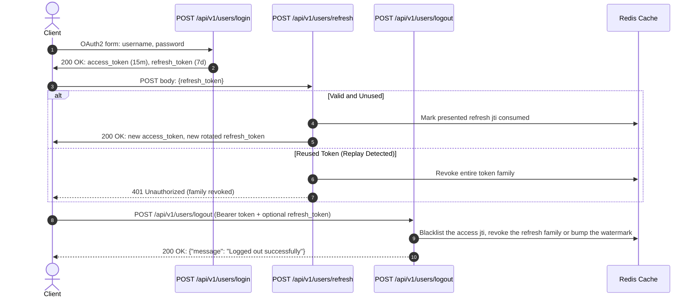
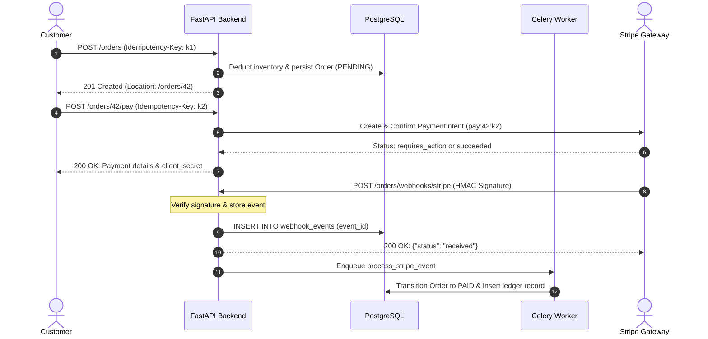

# REST API Reference and Conventions

Every API contract in release v4.0.3 is designed around standard HTTP semantics and deterministic data representations. Clients communicate with a uniform interface where resources, errors, authentication lifecycles, and caching rules follow RFC standards rather than framework idiosyncrasies.

Interactive OpenAPI documentation and Swagger UI are accessible at `/api/v1/docs` (with ReDoc at `/redoc` and OpenAPI JSON at `/api/v1/openapi.json`) in non-production environments. When `ENVIRONMENT=production`, all documentation endpoints answer 404 to avoid leaking internal route structures.

## Base Path and Endpoint Overview

The API version prefix is mounted at `/api/v1` (configured via `settings.API_V1_STR`). The test suite validates 54 distinct paths comprising 67 endpoint operations across 7 domain routers.

| Router Tag | Operations | Scope and Primary Responsibilities |
|---|---|---|
| `admin` | 16 | Product catalog management, category creation, inventory reconciliation, order review, and webhook event inspection or replay. |
| `cart` | 6 | Guest and account cart management, item mutations, live pricing checks, and stock validation. |
| `catalog` | 6 | Public read-only product listings, category trees, product detail retrieval, and full-text catalog search. |
| `Legal & GDPR` | 7 | Consent state tracking, privacy policies, terms of service, cookie disclosures, data export, and account erasure. |
| `orders` | 9 | Order creation, payment intent confirmation, Stripe Checkout sessions, payment history, cancellations, refunds, and Stripe webhook ingress. |
| `users` | 20 | Registration, OAuth2 login, token refresh, logout, password reset lifecycles, email verification, profile management, and address book CRUD. |
| `health` / probes | 3 | Operational health checks (`/health`), Kubernetes liveness probe (`/livez`), and readiness probe (`/readyz`). |

## Authentication and Token Lifecycle

Authentication implements the OAuth2 password flow using Bearer tokens signed with JSON Web Signatures (RFC 7519).



- **Login (`POST /api/v1/users/login`):** Expects standard application/x-www-form-urlencoded credentials (`username`, `password`). Returns `{access_token, token_type: "bearer", refresh_token}`.
- **Bearer Authorization:** Protected endpoints require the header `Authorization: Bearer <access_token>`.
- **Refresh Token Rotation & Reuse Detection:** `POST /api/v1/users/refresh` exchanges a single-use refresh token for a fresh token pair. If an already-rotated token is presented again, the server detects token theft and revokes the entire token family (`family` claim), terminating the compromised session chain.
- **Logout (`POST /api/v1/users/logout`):** Requires Bearer authentication. When a `refresh_token` is provided in the body, its specific family is revoked and the active access token's `jti` is blacklisted. When called without a body, the user's revocation watermark in Redis is updated to the current millisecond timestamp, immediately invalidating all tokens issued for that account across all devices. If Redis is unreachable during logout, the request fails closed with HTTP 503 (`Retry-After: 5`).

## Response Shapes

API responses avoid arbitrary wrappers:
- **Single Resources:** Returned directly at the top level (e.g. `GET /api/v1/products/1` returns the product JSON directly, without `{"data": ...}` or `{"success": true}`).
- **Page Objects:** Paginated lists return an object with exact pagination metadata:
  ```json
  {
    "items": [...],
    "total": 142,
    "page": 1,
    "size": 20,
    "has_more": true
  }
  ```
- **Confirmation Responses:** Operations with no returned resource body return `{"message": "..."}`.
- **Request Tracking:** Every HTTP response carries the `X-Request-ID` header, generated as an opaque UUID for distributed log tracing.

## Error Handling (RFC 9457 Problem Details)

All error responses use the standard `application/problem+json` media type (RFC 9457). Every problem payload includes:
- `type`: Stable URI identifying the problem class, or `"about:blank"` when the status code fully describes the condition.
- `title`: Short, human-readable summary of the problem type (constant for a given `type`).
- `status`: HTTP status code matching the response header.
- `detail`: Occurrence-specific description for debugging (omitted on internal 500 errors to avoid leaking implementation details).
- `instance`: Percent-encoded request URI path (query parameters stripped to protect tokens and privacy).
- Extension members: `request_id` (matching `X-Request-ID`), `errors` (on 422 errors, listing sanitized `{type, loc, msg, ctx}` entries without echoing user input), and `retry_after` (on 429 and 503 responses, matching `Retry-After`).

### Problem Types Reference

The complete catalog of typed problems declared in `app/core/errors.py`:

| Problem Type Identifier (URI suffix) | HTTP Status | Trigger Condition and Semantics |
|---|---|---|
| `validation-error` | 422 | Schema validation failure, forbidden unknown field, out-of-bounds parameter, or unparseable Unicode. |
| `malformed-request` | 400 | Request body cannot be parsed as JSON syntax or cannot be decoded as UTF-8 text. |
| `unsupported-media-type` | 415 | Request payload submitted with unsupported `Content-Type`. Carries `Accept: application/json`. |
| `body-too-large` | 413 | Request body exceeds configured `MAX_REQUEST_BODY_BYTES` (default 1 MiB). |
| `rate-limited` | 429 | Rate limit budget exhausted. Carries `Retry-After` seconds and draft RateLimit headers. |
| `service-overloaded` | 503 | Worker reached `MAX_IN_FLIGHT_REQUESTS` capacity. Sheds request with `Retry-After: 1`. |
| `idempotency-key-missing` | 400 | Mutating order, payment, or refund route missing mandatory `Idempotency-Key` header (or key length not 8 to 255 chars). |
| `idempotency-key-reused` | 422 | Stored `Idempotency-Key` reused with a differing request body or parameter payload. |
| `idempotency-key-in-use` | 409 | Identical `Idempotency-Key` currently undergoing active processing by a concurrent worker. |
| `payment-declined` | 422 | Payment provider refused the transaction (e.g. card declined, insufficient funds, expired card). |
| `insufficient-stock` | 409 | Requested quantity exceeds available inventory during cart operations or order placement. |
| `account-inactive` | 403 | Authenticated credentials are valid, but user account is unverified, deactivated, or suspended. |

## HTTP Status Codes

The API strictly adheres to RFC 9110 status code semantics:
- **201 Created + Location:** Returned by POST endpoints that instantiate persistent resources (`POST /api/v1/orders`, `POST /api/v1/users/addresses`, `POST /api/v1/admin/products`, `POST /api/v1/admin/categories`). The `Location` header points to the newly created resource path.
- **202 Accepted:** Returned by `POST /api/v1/users/register`. The server accepts the registration request asynchronously regardless of whether the email is already registered, completely preventing account enumeration.
- **204 No Content:** Returned on successful deletion (`DELETE /api/v1/cart`, `DELETE /api/v1/users/addresses/{id}`). Contains no body. Subsequent deletion of an absent entity returns 404.
- **400 vs 409 vs 422:**
  - `400 Bad Request`: Syntactically invalid payloads (non-JSON body, unreadable text), missing or invalid `Idempotency-Key` format, or invalid Stripe signature HMAC.
  - `409 Conflict`: Request conflicts with current resource or inventory state (`insufficient-stock`, `idempotency-key-in-use`, deleting a default address, or cancelling an already-shipped order).
  - `422 Unprocessable Content`: Syntactically well-formed JSON violating domain constraints (unknown properties, negative prices, failed regex, `idempotency-key-reused`, or declined cards).
- **401 vs 403:**
  - `401 Unauthorized`: Missing, invalid, expired, or revoked Bearer token, or invalid login credentials. Includes `WWW-Authenticate: Bearer` challenge.
  - `403 Forbidden`: Authenticated identity lacks permission (non-admin accessing `/admin`), or account is inactive (`account-inactive`).
- **413 Content Too Large:** Payload exceeds size ceiling.
- **415 Unsupported Media Type:** Sent with `Accept` header specifying accepted types (`application/json`, or `application/merge-patch+json, application/json` for PATCH).
- **429 Too Many Requests:** Rate limit exhausted. Response includes `Retry-After: <seconds>` and IETF draft `RateLimit` / `RateLimit-Policy` headers.
- **503 Service Unavailable:** Overload shedding (`Retry-After: 1`), Redis outage during token/login checks (`Retry-After: 30`), or database unavailability (`Retry-After: 5`).

## Idempotency Controls (`Idempotency-Key`)

Financial and mutating order endpoints enforce the IETF draft `Idempotency-Key` specification (`draft-ietf-httpapi-idempotency-key-header`):

- **Enforced Routes:** `POST /api/v1/orders`, `POST /api/v1/orders/{order_id}/pay`, `POST /api/v1/orders/{order_id}/checkout-session`, and `POST /api/v1/orders/{order_id}/refund`.
- **Format Requirements:** Printable ASCII string between 8 and 255 characters. Missing or out-of-range headers immediately receive 400 `idempotency-key-missing`.
- **Payload Fingerprinting:** A canonical SHA-256 fingerprint is generated from validated payload fields. Replaying the identical key with different payload parameters triggers 422 `idempotency-key-reused`.
- **Concurrent In-Flight Locks:** If a request arrives while an identical key is already being processed, the server yields 409 `idempotency-key-in-use`.
- **Retention and TTL:**
  - Order creation keys are retained in PostgreSQL for `IDEMPOTENCY_KEY_TTL_HOURS` (default 24 hours). Periodic Celery cleanup tasks clear expired keys to allow reuse while preserving order history.
  - Payment and refund idempotency keys are namespaced (e.g. `pay:{order_id}:{client_key}`) and passed directly to Stripe, where provider-side deduplication guarantees 24-hour protection.

## Strict Input Validation

The API enforces strict data hygiene on all inputs:
- **Unknown Field Rejection:** All request models inherit `RequestBody` with Pydantic `extra="forbid"`. Submitting unrecognized JSON keys yields 422 with type `extra_forbidden`.
- **Monetary Precision:** Monetary amounts are accepted and returned as exact decimal strings (e.g. `"19.99"`), never floating-point numbers. Currencies are validated against ISO 4217 uppercase alpha-3 codes (`settings.STORE_CURRENCY`, e.g. `"USD"`).
- **Timezone Awareness:** Timestamps must be ISO 8601 strings with explicit UTC offsets (`UTCDatetime`). Database records are stored in UTC.
- **Character Sanitization:** NUL bytes (`\x00`) and lone Unicode surrogates (`\ud800` through `\udfff`) are rejected with 422 across request bodies, URL paths, query parameters, and form fields before touching PostgreSQL.

## Pagination and Sorting

Collection endpoints consume standardized query parameters:
- `page`: Page index (1-based integer, default 1, bounded to 32-bit signed integer).
- `size`: Items per page (default 20, minimum 1, maximum 100).
- `sort_by`: Target model attribute allowlisted per endpoint (e.g. `price`, `created_at`, `name`). Submitting an unrecognized sort field falls back safely to default ordering.
- `sort_order`: Direction string, either `asc` (default) or `desc`.

## Caching and Conditional Requests (ETag)

Entity tags provide strong cache validation (SHA-256 digest of response model JSON):
- **Read Validation (`If-None-Match`):** Supported by `GET /api/v1/products/{product_id}` and `GET /api/v1/admin/products/{product_id}/variants/{variant_id}`. If the client holds a matching tag, the server responds with 304 Not Modified without a response body.
- **Optimistic Concurrency (`If-Match`):** Supported by `PUT` and `PATCH` endpoints for products and variants. If the submitted `If-Match` tag does not match the current database state, the mutation is refused with 412 Precondition Failed, returning the latest ETag.

## JSON Merge Patch (RFC 7396)

Partial updates on `PATCH /api/v1/users/me`, `PATCH /api/v1/users/addresses/{id}`, `PATCH /api/v1/admin/products/{id}`, and `PATCH /api/v1/admin/products/{id}/variants/{id}` implement RFC 7396 semantics:
- Request headers must declare `Content-Type: application/merge-patch+json` or `application/json`.
- Properties included in the patch replace stored values.
- Explicit `null` clears nullable fields (attempting to set a required, non-nullable field to `null` yields 422).
- Properties omitted from the payload remain completely unmodified.

## HEAD Method Semantics

Per RFC 9110 sections 9.1 and 9.3.2, every GET endpoint transparently supports `HEAD` via `HeadMiddleware`. The server executes identical routing, authentication, dependencies, rate limits, and ETag checks, returning matching headers (including accurate `Content-Length`) while stripping the body bytes. The `Allow` response header on 405 Method Not Allowed errors includes `HEAD` whenever `GET` is supported.

## Rate Limiting Headers

Rate limits are evaluated atomically per route template using Redis Lua scripts:
- Keyed by user ID for authenticated requests, or client IP address (evaluating `settings.TRUSTED_PROXIES` from right to left, and grouping IPv6 traffic into `/64` subnets).
- Responses include draft IETF RateLimit headers:
  - `RateLimit-Policy: "<policy_name>";q=<quota>;w=<window_seconds>` (e.g. `"default";q=300;w=60`)
  - `RateLimit: "<policy_name>";r=<remaining>;t=<seconds_to_replenish>`
- Exceeded limits trigger HTTP 429 with `Retry-After` matching the remaining window seconds.

## Frontend Contract for E-mail Links

Verification and password-reset workflows follow the OWASP Forgot Password Cheat Sheet:
- The backend dispatches emails with URLs pointing to the configured `FRONTEND_URL`:
  - Email verification: `https://<frontend>/verify-email?token=<url_encoded_token>`
  - Password reset: `https://<frontend>/reset-password?token=<url_encoded_token>`
- **Security Requirement:** Frontend web applications hosting these paths must serve `Referrer-Policy: no-referrer` to prevent query tokens from leaking across outbound links or third-party asset requests.
- The frontend extracts the token from the query string and submits it in the JSON body of `POST /api/v1/users/verify-email` or `POST /api/v1/users/password/reset/confirm`. The backend exposes no GET route accepting credential tokens.

## Stripe Webhook and Checkout Flow

Webhook processing operates via an asynchronous transactional outbox to ensure zero dropped payment events.



The webhook endpoint (`POST /api/v1/orders/webhooks/stripe`) operates without Bearer authentication. It verifies payload authenticity via the `Stripe-Signature` header and HMAC-SHA256 secret. Valid events are inserted into the `webhook_events` database table. Duplicate event deliveries are acknowledged with 200 OK (`{"status": "already_processed"}`). An asynchronous Celery task executes state reconciliation and updates the payment ledger.

See also: [SECURITY.md](../SECURITY.md), [ARCHITECTURE.md](ARCHITECTURE.md), [PERFORMANCE.md](PERFORMANCE.md), [RESILIENCE.md](RESILIENCE.md), [reports/T3-schemathesis.md](reports/T3-schemathesis.md).
