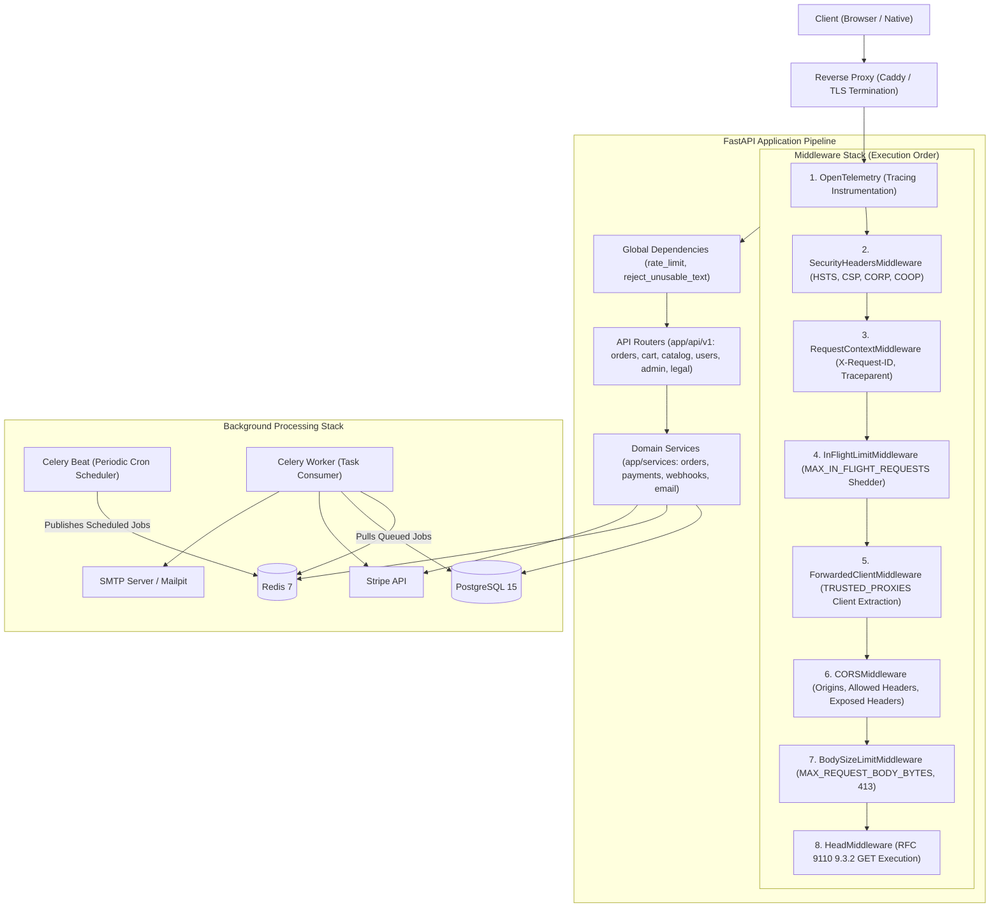
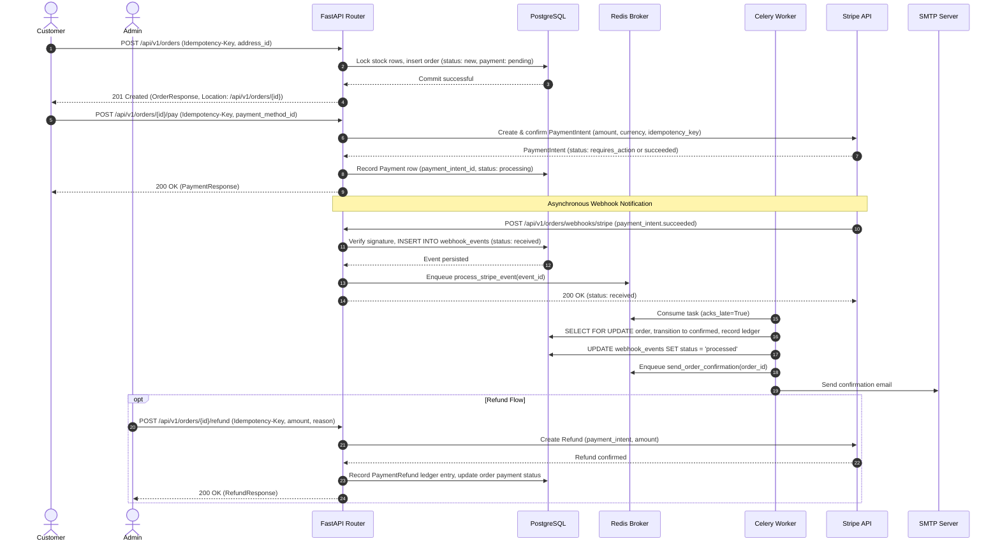
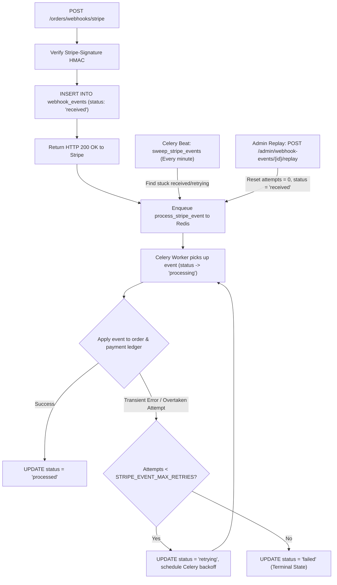
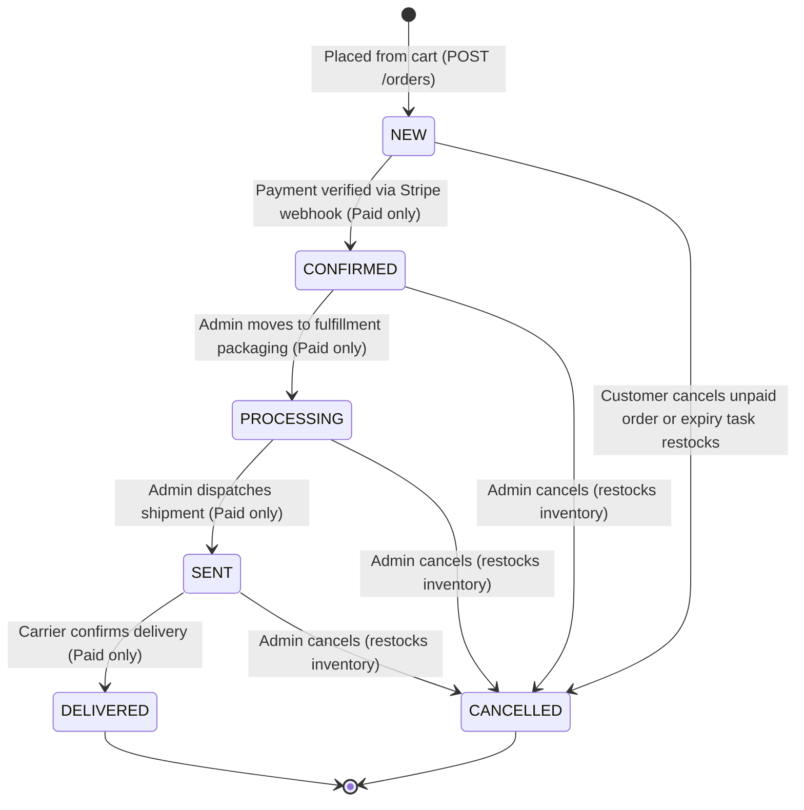

# Architecture and System Design

Architecture is the art of deciding which trade-offs you would prefer to defend at 3 a.m. This document describes the structural boundaries, data flows, and design principles of the FastAPI e-commerce backend in release v4.0.3.

## System Overview and Boundaries

The platform is a headless, production-ready e-commerce backend exposing a uniform REST API. The codebase intentionally contains no frontend user interface; customer web shops and administrative tools integrate externally via JSON endpoints over TLS. The core system boundary comprises an asynchronous FastAPI web application running on Uvicorn, backed by PostgreSQL 15 for relational ACID persistence and Redis 7 for caching, rate limiting, and task queues. Asynchronous background jobs, scheduled maintenance, and webhook ingestion run through Celery workers and a Celery beat daemon. External third-party boundaries are confined to Stripe (for card payments, payment intents, checkout sessions, refunds, and webhooks) and an SMTP relay (for transactional customer and administrative email notifications).

## Component and Container Architecture

Incoming client requests pass through a reverse proxy terminating TLS before reaching the FastAPI ASGI application stack. Middlewares execute in the reverse order of their registration in `app/main.py` (Starlette wraps each middleware around the previous stack, executing the outermost layer first):

## Order and Payment Flow

Order placement and payment execution enforce strict transactional boundaries and prevent double-charging through unique idempotency keys and asynchronous webhook reconciliation:

## Webhook Durability Flow

Webhooks represent critical financial state updates and cannot rely solely on the availability of in-memory brokers. Every event is persisted to PostgreSQL before acknowledging receipt to Stripe:

## Order Status State Machine

Order statuses transition deterministically according to `ORDER_STATUS_TRANSITIONS` defined in `app/services/orders.py`. Under the business rules, forward transitions into fulfilled states require verified card payment (`PAID_ONLY_STATUSES`):

## Code Layout

The project follows a modular layered architecture separating transport, domain logic, persistence, and automated verification:

| Directory | Primary Architectural Scope and Responsibilities |
|---|---|
| `app/api/v1` | HTTP transport controllers, route endpoints, dependency injection, and OpenAPI operation schemas across 7 domain modules. |
| `app/core` | Application lifecycle, settings, database engines, security primitives, custom middlewares, and telemetry. |
| `app/services` | Domain business logic (orders, restock, payment adapters, Stripe webhook handling, reconciliation, and Redis clients). |
| `app/models` | Declarative SQLAlchemy 2.0 database models defining relational tables, foreign key constraints, and indices. |
| `app/schemas` | Pydantic v2 schemas for strict input parsing (`RequestBody`), response serialization, and RFC 9457 error details. |
| `migrations` | Alembic migration scripts supporting sequential forward upgrades, schema rollbacks, and offline SQL generation. |
| `tests` | Automated test suite covering unit tests, integration suites, property tests (Hypothesis), contract suites, and chaos runs. |

## Key Architectural Decisions

Because computers excel at arithmetic until asked to add 0.1 and 0.2, and time zones are best left to other people, every technical design decision balances developer ergonomics against strict financial consistency.

### 1. Asynchronous Routes on AsyncSession with Synchronous Celery Code
- **Decision:** HTTP endpoints use `async def` with SQLAlchemy `AsyncSession` and `AsyncRedisService`. Core domain logic (stock locking, payment settlement) is authored as synchronous functions and invoked from routes via `db.run_sync()`, while Celery workers invoke them directly.
- **Alternatives:** Maintaining duplicated async and sync domain services; running async Celery workers; executing all HTTP routes synchronously in Starlette's threadpool.
- **Reason:** Synchronous database operations in async routes block the event loop (measured in load testing: 5 concurrent requests degraded from 0.30 s to 1.91 s). Dual implementations cause business logic divergence. Reusing synchronous domain functions via `run_sync` provides a single authoritative codebase across HTTP and worker tiers.
- **Consequence:** Async routes must await queries and declare eager loading (`selectinload`/`joinedload`) upfront to prevent `MissingGreenlet` exceptions during serialization.

### 2. UTC Everywhere (`timestamptz`, RFC 3339 `Z`)
- **Decision:** All database timestamp columns use `TIMESTAMP WITH TIME ZONE` (`timestamptz`). Application datetimes are timezone-aware UTC via `app.core.clock.utc_now()`. Wire representations require trailing `Z` suffixes, and date filters reject naive inputs (`AwareDatetime`).
- **Alternatives:** Storing naive UTC datetimes; relying on PostgreSQL `timestamp without time zone`; storing raw Unix epoch integers.
- **Reason:** Naive datetimes produce subtle bugs across daylight saving time (DST) shifts and server migrations. PostgreSQL documentation warns explicitly against `timestamp without time zone`. Wire timestamps ending in `Z` eliminate client-side timezone ambiguity.
- **Consequence:** Clients submitting naive date strings receive HTTP 422. SQLite test harnesses require custom `TypeDecorator` mappings to enforce consistent UTC semantics.

### 3. Money as Decimal and Decimal Strings on the Wire
- **Decision:** Prices and monetary balances are stored as `Numeric(10, 2)`, handled in Python strictly as `decimal.Decimal` (rounded via `ROUND_HALF_UP`), and serialized or deserialized across HTTP boundaries as formatted decimal strings (e.g. `"19.99"`). Raw JSON numbers like `19.99` are rejected.
- **Alternatives:** IEEE 754 binary floating-point numbers; raw integer cents across all API schemas; loose string-or-float coercion.
- **Reason:** Binary floating-point arithmetic introduces precision loss (`0.1 + 0.2 = 0.30000000000000004`) that causes ledger imbalance. String serialization preserves exact decimal representations across disparate client programming languages.
- **Consequence:** Requests passing numeric JSON literals for monetary fields receive HTTP 422. Schema validation uses custom `BeforeValidator` annotations (`Money`, `NonNegativeMoney`, `PositiveMoney`).

### 4. No Response Envelope (AIP-131 Resource Root)
- **Decision:** Successful responses return resource representations directly at the JSON root. List endpoints return page objects (`items`, `total`, `page`, `size`, `has_more`). Global wrapper envelopes (`{success, data, error}`) were removed in v4.0.0.
- **Alternatives:** Wrapping responses in `{data: ...}`; adopting the JSend specification; returning bare JSON arrays for list endpoints.
- **Reason:** Envelopes duplicate standard HTTP protocol semantics (HTTP status codes indicate success; `X-Request-ID` supplies tracing). Google Cloud AIP-131, Microsoft REST Guidelines, and Stripe API standards recommend returning the resource directly. Page objects prevent bare array vulnerabilities and allow backward-compatible metadata expansion (Zalando Guidelines #110 and #248).
- **Consequence:** Client SDKs parse standard HTTP headers and domain models directly without unpacking boilerplate outer objects.

### 5. RFC 9457 Problem Details (`application/problem+json`)
- **Decision:** All HTTP errors (4xx and 5xx) return the standard `application/problem+json` media type containing `type`, `title`, `status`, `detail`, `instance`, and `request_id`. Validation failures include an `errors` array omitting reflected input values.
- **Alternatives:** Custom error dictionaries; plain text responses on HTTP 500; default unformatted FastAPI validation handlers.
- **Reason:** Pre-4.0.0 architectures suffered from inconsistent error envelopes. RFC 9457 establishes machine-readable error contracts. Stable URI identifiers (`ProblemType`) allow programmatic error branching without string parsing. Omitting raw user input prevents accidental reflection of passwords or secrets.
- **Consequence:** Centralized exception handlers rewrite all exceptions and translate OpenAPI schema responses to `application/problem+json`.

### 6. Idempotency-Key with Request Fingerprints
- **Decision:** Mutation endpoints (`POST /orders`, `POST /orders/{id}/pay`, `/checkout-session`, `/refund`) require an `Idempotency-Key` header. Requests are stored with a SHA-256 fingerprint of the user ID, URL, and normalized JSON payload.
- **Alternatives:** Key-only storage without body fingerprinting; client-supplied database nonces; volatile in-memory idempotency caches.
- **Reason:** Network retries or double-submissions must never duplicate payments or inventory decrements. Payload fingerprinting prevents reuse of identical keys with mutated request bodies (returning HTTP 409 `idempotency-key-reused`).
- **Consequence:** Concurrent requests with the same key while the first is in flight receive HTTP 409 with `Retry-After: 5` (`idempotency-key-in-use`).

### 7. Store-Then-Process Webhooks with Reconciliation
- **Decision:** Incoming Stripe webhooks are verified via HMAC signature and persisted to `webhook_events` (`status: received`) before returning HTTP 200 to Stripe. Processing runs asynchronously in Celery (`process_stripe_event`). Daily scheduled jobs reconcile local ledgers against the Stripe API.
- **Alternatives:** Synchronous webhook execution inside the route handler; transient Redis queue ingestion without database persistence; relying entirely on external provider retries.
- **Reason:** Webhook routes must respond within seconds to avoid provider timeouts. Synchronous execution risks event loop stalls. Persisting to PostgreSQL guarantees zero event loss during broker downtime. Daily reconciliation detects drift from unhandled edge events or administrative portal adjustments.
- **Consequence:** Financial confirmation is eventually consistent. Webhook processing must handle race conditions where an event arrives before the API finishes recording the payment attempt.

### 8. Fail-Closed Token Revocation in Redis Answering HTTP 503
- **Decision:** When Redis is unreachable, token blacklist verification cannot complete. The API refuses authenticated requests with HTTP 503 Service Unavailable (`Retry-After: 30`) rather than HTTP 401 Unauthorized or failing open.
- **Alternatives:** Failing open (trusting the unexpired JWT signature); returning HTTP 401 Unauthorized; returning generic HTTP 500 errors.
- **Reason:** Failing open permits revoked or logged-out tokens to execute actions (violating security review finding F-06). Returning 401 misleads client applications into purging stored credentials and logging users out during transient cache hiccups (RFC 9110 §15.5.2 vs §15.6.4).
- **Consequence:** Redis outages temporarily degrade authenticated operations while preserving client sessions and public catalog access.

### 9. In-Flight Concurrency Limiting (`InFlightLimitMiddleware`)
- **Decision:** `InFlightLimitMiddleware` enforces `MAX_IN_FLIGHT_REQUESTS` per worker process. Surging requests receive an immediate HTTP 503 with `Retry-After: 1` before invoking route handlers or acquiring database connections.
- **Alternatives:** Unbounded Uvicorn socket queues; expanding connection pool sizes indefinitely; relying solely on reverse proxy rate limits.
- **Reason:** When concurrency exceeds database connection pool capacity, async event loops stall waiting for connections that blocked loops cannot release, resulting in 30-second complete process outages. Load shedding maintains low latency and high availability for admitted requests.
- **Consequence:** Traffic spikes shed cleanly with standard retry guidance without destabilizing the application or exhausting database memory.

### 10. Strict Input Parsing (`extra = "forbid"`)
- **Decision:** All 27 request body models inherit from `RequestBody` with `model_config = ConfigDict(extra="forbid")`. Any undeclared field in request payloads triggers an HTTP 422 validation failure with error type `extra_forbidden`.
- **Alternatives:** Permissive parsing (`extra="ignore"`); ad-hoc manual validation in service layers; applying strict configuration to response models.
- **Reason:** Silently ignoring misspelled fields (e.g. `"pirce": 10.00`) causes clients to assume values were accepted when they were ignored. Strict rejection also prevents mass-assignment vulnerabilities (such as injecting `role: "admin"`). Response models remain permissive to preserve backward compatibility.
- **Consequence:** Client requests must strictly conform to documented schemas. Input and output schemas must be decoupled where request and response structures differ.

### 11. Hermetic Local Tests with Multi-Service CI Validation
- **Decision:** Local and unit tests run hermetically without external dependencies (mocked Stripe, isolated SQLite/Redis with `REDIS_PORT=1`). CI matrix workflows validate integration and chaos suites against real container services: PostgreSQL 15, 16, 18, real Redis, and live Stripe test mode across 7 timezones.
- **Alternatives:** Executing all tests solely against SQLite in CI; mocking database engines universally; relying on shared remote staging environments.
- **Reason:** SQLite ignores foreign keys by default and does not support PostgreSQL row-level locks (`SELECT ... FOR UPDATE`). Real-service CI jobs identified 13 critical defects undetected by SQLite, including deadlocks and pool recovery behavior. Hermetic local defaults prevent test contamination of developer services.
- **Consequence:** Rapid local development feedback (sub-minute unit runs) combined with exhaustive multi-environment CI validation (~5 minutes across 16 parallel workflows).

### 12. Dependency Pinning and Two-Week Age Rule
- **Decision:** All external dependencies, base container image digests, and security tooling must be at least two weeks old prior to adoption. Packages are locked to exact hashes (`uv.lock`, Docker image SHA digests). Urgent zero-day security updates require an explicit, documented security exception.
- **Alternatives:** Floating version ranges; immediate adoption of latest releases; pinning versions without cryptographic digest verification.
- **Reason:** Protects against supply chain attacks, poisoned dependencies, and newly published zero-day regressions by providing a buffer for community review and vulnerability disclosure. Digest pinning guarantees reproducible, immutable container builds.
- **Consequence:** Upgrades require systematic dependency audits and recorded vulnerability justifications (such as `govulncheck` reachability proofs and the Redis 7.4.11 exception in v4.0.1).

## See Also

- [API Reference and Conventions](API.md): Base paths, endpoint catalog, authentication lifecycle, and problem details.
- [Resilience and Fault Recovery](RESILIENCE.md): Chaos test matrix, fail-closed semantics, and database reachability mapping.
- [Operations and Runbooks](OPERATIONS.md): Deployment configuration, health probes, monitoring, and administrative procedures.
- [Testing Strategy and Test Matrix](TESTING.md): Unit, integration, property-based, and mutation testing methodologies.
- [Performance and Capacity](PERFORMANCE.md): Benchmark results, concurrency tuning, and load shedding characteristics.
- [Known Limitations and Compromises](LIMITATIONS.md): Deliberate design boundaries and trade-offs.
- [v4.0.0 Architecture Redesign Report](reports/release-4.0.0.md): Comprehensive log of the v4.0.0 architectural transition.

See also: [API.md](API.md), [RESILIENCE.md](RESILIENCE.md), [OPERATIONS.md](OPERATIONS.md), [TESTING.md](TESTING.md), [PERFORMANCE.md](PERFORMANCE.md), [LIMITATIONS.md](LIMITATIONS.md), [reports/release-4.0.0.md](reports/release-4.0.0.md).
