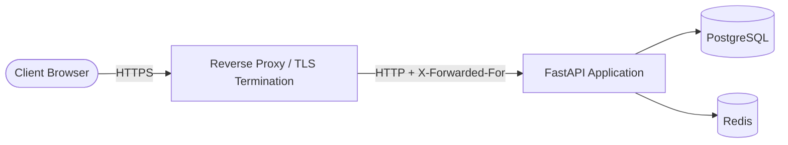

# Production Operations and Runbook

Running this e-commerce backend in production requires strict adherence to Twelve-Factor operational principles: configuration via the environment, stateless process lifecycles, structured logging to standard streams, and explicit isolation between database schema administration and runtime query execution.

## Production Configuration and Startup Validation

Setting `ENVIRONMENT=production` (or `staging`) activates fail-closed deployment validation in `Settings.check_deployment_settings` (`app/core/config.py`). If any constraint fails, the application aborts startup immediately with a descriptive error:

- **Log Level:** `LOG_LEVEL` must not be `DEBUG`. Verbose debugging exposes sensitive payload internals that outlive the HTTP request.
- **Password Hashing Cost:** `BCRYPT_ROUNDS` must be at least 12. Test suites lower this cost factor to 4 for execution speed, but production forbids cheap hashes to resist offline brute-force attacks.
- **Payment Provider:** `PAYMENT_PROVIDER` must be set to `stripe`. The in-process `mock` provider marks orders as paid without moving funds and is prohibited outside development and test environments.
- **Cryptographic Secrets and Placeholders:** Secrets must not contain default placeholders (`change-me`, `changeme`, `placeholder`, or test-mock prefixes) and must meet strict minimum byte lengths:
  - `JWT_SECRET_KEY`: Minimum length determined by `JWT_ALGORITHM` (32 bytes for HS256, 48 bytes for HS384, 64 bytes for HS512; RFC 7518 §3.2).
  - `STRIPE_SECRET_KEY`: Must be defined and non-placeholder.
  - `STRIPE_WEBHOOK_SECRET`: At least 32 bytes.
  - `POSTGRES_PASSWORD`: At least 16 bytes.
  - `REDIS_PASSWORD`: At least 16 bytes.
  - `SMTP_PASSWORD`: Must be defined and non-placeholder.
- **Frontend Origin:** `FRONTEND_URL` must start with `https://`. Customers returning from Stripe Checkout Sessions and email verification links are strictly redirected to this origin.
- **API Documentation Exposure:** Interactive OpenAPI documentation (`/api/v1/docs`, `/redoc`, and `/api/v1/openapi.json`) is automatically disabled in `production`, returning HTTP 404 to avoid exposing schema internals.

## Reverse Proxy and Network Edge

Deploy the application behind a reverse proxy (such as Nginx, Caddy, or an AWS ALB) that terminates TLS.



### Trusted Proxies and Client Resolution

- **`TRUSTED_PROXIES`:** Configure comma-separated IP addresses or CIDR blocks (e.g. `TRUSTED_PROXIES=10.0.0.0/8,172.16.0.0/12`).
- **IP Resolution:** `ForwardedClientMiddleware` (`app/core/forwarded.py`) evaluates incoming `X-Forwarded-For` headers from right to left, selecting the rightmost non-trusted address as the client IP.
- **Spoofing Defense:** When `TRUSTED_PROXIES` is empty, `X-Forwarded-For` is ignored completely and the socket peer address is used. In `main.py`, Uvicorn is launched with `proxy_headers=False` so Starlette middleware retains sole authority over client identity.
- **Proxy Configuration:** The upstream proxy must append the peer address to `X-Forwarded-For` (e.g. `proxy_set_header X-Forwarded-For $proxy_add_x_forwarded_for;` in Nginx).

### Body Size Limits and Cookies

- **Request Body Ceiling:** `MAX_REQUEST_BODY_BYTES` (default 1 MiB / 1,048,576 bytes) is enforced by `BodySizeLimitMiddleware` (`app/core/body_limit.py`). Payloads exceeding this threshold receive an immediate HTTP 413 (Payload Too Large) without the body being read into memory. The reverse proxy must enforce an equal or smaller limit (e.g. `client_max_body_size 1m;`).
- **Cookie Security:** In production, `GUEST_CART_COOKIE_SECURE=true` ensures the guest cart cookie is transmitted with the `Secure` attribute, `SameSite=Lax`, `HttpOnly`, and under the `__Host-guest_cart` prefix.

## Health Probes and Container Orchestration

Health probe routes are defined in `app/core/probes.py`. All probes respond to GET and HEAD, include `Cache-Control: no-store`, and are exempt from rate limiting and in-flight request limits:

| Probe Endpoint | Purpose | Checks Performed | HTTP Response |
|---|---|---|---|
| `/livez` | Liveness | Process is running and accepting event loop tasks. | Always 200 OK (`{"status": "ok"}`). Touches no dependencies to prevent cascading restarts during database or cache blips. |
| `/readyz` | Readiness | Dependencies respond within `READINESS_TIMEOUT_SECONDS` (2.0 s). | 200 OK (`{"status": "ok", "checks": {"database": "ok", "redis": "ok"}}`) or 503 Service Unavailable with `Retry-After: 5` (`{"status": "fail", ...}`). Removes unready instances from load balancer rotation without killing them. |
| `/health` | Legacy Combined | Combined liveness and dependency readiness for Docker healthchecks. | 200 OK if both database and Redis respond; 503 with `Retry-After: 5` if degraded. |

## Structured Logging

Logging is configured in `app/core/logging_config.py` following Twelve-Factor App rule XI:

- **JSON to stdout:** Log records are serialized as single-line JSON via `JSONFormatter` to standard output. Container runtimes and log aggregators (e.g. FluentBit, Datadog) collect stdout directly.
- **Trace and Request Correlation:** Log entries include `timestamp` (RFC 3339 in UTC with millisecond precision), `level`, `logger`, `message`, `request_id`, and `trace_id` (propagated from incoming W3C `traceparent` headers or OpenTelemetry spans).
- **Log Levels:** `LOG_LEVEL` sets the threshold for `app.*` loggers (`INFO`, `WARNING`, `ERROR`, `CRITICAL`). Third-party loggers default to `WARNING` in production to reduce noise.
- **Optional File Rotation:** Setting `LOG_FILE` enables a secondary `RotatingFileHandler` (100 MB per file, 5 backup generations). If unset or empty, file logging is disabled.

## OpenTelemetry Distributed Tracing

Distributed tracing is implemented in `app/core/telemetry.py` using standard OpenTelemetry SDK specifications:

- **Packaging:** Tracing dependencies are packaged in the optional `telemetry` extra. In Docker builds, pass `--build-arg INSTALL_TELEMETRY=true` to include them.
- **Zero Overhead When Inactive:** Tracing is disabled by default. If no exporter endpoint is configured or `OTEL_SDK_DISABLED=true`, no OpenTelemetry libraries are loaded.
- **Enabling Tracing:** Set `OTEL_EXPORTER_OTLP_ENDPOINT` (e.g. `http://otel-collector:4318`) with `OTEL_EXPORTER_OTLP_PROTOCOL=http/protobuf`. Only HTTP protobuf transport is supported.
- **Container Identification:** Assign `OTEL_SERVICE_NAME` per container (e.g. `ecommerce-api` for the web service and `ecommerce-worker` for Celery).
- **Instrumented Layers:** FastAPI endpoints (excluding health probes), SQLAlchemy synchronous and asynchronous engines, Redis commands, Celery task publication and consumption, and outbound HTTP requests via the Stripe SDK.

## Celery Background Workers and Scheduler

Background tasks and periodic maintenance are managed by Celery (`app/tasks.py`):

- **Worker Execution:** `celery -A app.tasks worker --loglevel=info`. Configure container managers with `stop_grace_period: 330s` (SIGTERM initiates warm shutdown; Celery tasks enforce `task_time_limit=300s` and `task_soft_time_limit=240s`).
- **Scheduler Execution:** `celery -A app.tasks beat --loglevel=info --schedule=/tmp/celerybeat-schedule`.
- **Reliability Invariants:** Configured with `task_acks_late=True`, `task_reject_on_worker_lost=True`, `worker_cancel_long_running_tasks_on_connection_loss=True`, and `broker_transport_options['visibility_timeout']=3600`.
- **Deduplication:** Tasks retried after transient database errors (`OperationalError`) verify Redis markers (`email_sent:*`, 7-day TTL) using `RedisService.mark_once` to prevent sending duplicate order confirmation emails.

### Celery Beat Schedule (All Times in UTC)

All recurring jobs run strictly on UTC clocks:

| Task Name | Registered Task | Schedule | Purpose |
|---|---|---|---|
| `cleanup-inactive-accounts` | `cleanup_inactive_accounts` | Daily at 02:30 UTC | Executes GDPR Art. 17 erasures past `DATA_DELETION_GRACE_PERIOD_DAYS`. |
| `update-product-stats` | `update_product_stats` | Every 1 hour | Recalculates product sales velocity and view statistics. |
| `check-low-stock` | `check_low_stock` | Every 4 hours | Dispatches low-inventory notification emails to `ADMIN_EMAIL`. |
| `cancel-expired-unpaid-orders` | `cancel_expired_unpaid_orders` | Every 5 minutes | Cancels orders unpaid after `UNPAID_ORDER_EXPIRE_MINUTES` (default 30 min) and returns reserved inventory. |
| `check-payment-reconciliation` | `check_payment_reconciliation` | Daily at 03:15 UTC | Reconciles local payment records against the Stripe API for discrepancy detection. |
| `sweep-stripe-events` | `sweep_stripe_events` | Every 5 minutes | Re-publishes unhandled webhook events stranded by transient broker outages (`STRIPE_EVENT_SWEEP_AFTER_MINUTES`). |
| `cleanup-expired-retention` | `cleanup_expired_retention` | Daily at 02:45 UTC | Anonymises deactivated accounts past `USER_DATA_RETENTION_DAYS` (GDPR Art. 5(1)(e)). |
| `cleanup-expired-idempotency-keys` | `cleanup_expired_idempotency_keys` | Daily at 03:00 UTC | Clears expired order idempotency keys older than `IDEMPOTENCY_KEY_TTL_HOURS`. |

## PostgreSQL Database Operations

### Schema Ownership and Role Separation

PostgreSQL enforces strict privilege boundaries via `docker/postgres/initdb/10-app-role.sh`:
- **`POSTGRES_USER` (Schema Owner):** Superuser role that owns database tables, sequences, and schemas. Executes migrations.
- **`APP_DB_USER` (Application Runtime):** Unprivileged role utilized by the API and Celery workers. Holds DML privileges (SELECT, INSERT, UPDATE, DELETE) and sequence permissions, but zero DDL rights (cannot CREATE, ALTER, or DROP tables).
- **Executing Migrations:** Run migrations exclusively through the dedicated `migrate` profile:
  ```bash
  docker compose --profile migrate run --rm migrate
  ```

### Connection Pooling and Timeouts

Each API worker maintains two connection pools (synchronous and asynchronous):
- Default pool size: `DB_POOL_SIZE=10`, `DB_MAX_OVERFLOW=5`, `DB_POOL_TIMEOUT=30`.
- Size PostgreSQL `max_connections` to support peak worker concurrency: `WORKERS * 2 * (DB_POOL_SIZE + DB_MAX_OVERFLOW) + Celery`. With 4 workers, this requires at least 120 connections; `docker-compose.yml` configures `max_connections=200`.
- Connections enforce `idle_in_transaction_session_timeout=30s` and `statement_timeout=30s` to prevent leaked locks from stalling the database.

### Backups, Restores, and Downgrades

Backup and restore fidelity was proven during Stage T5 verification ([reports/T5-migrations-backup.md](reports/T5-migrations-backup.md)):

```bash
# Create custom-format compressed backup
docker compose exec db pg_dump -U "$POSTGRES_USER" -Fc ecommerce > backup_$(date +%Y%m%d_%H%M%S).dump

# Restore into target database
docker compose exec -T db pg_restore -U "$POSTGRES_USER" -d ecommerce --exit-on-error --no-owner < backup.dump
```

> [!IMPORTANT]
> **Mandatory Downgrade Rule:** Always execute a full `pg_dump` backup before performing an Alembic downgrade. Downgrade scripts drop tables and columns by design, resulting in irreversible data loss. Continuous point-in-time recovery (PITR) is not configured (`wal_level=replica`, `archive_mode=off`).

## Redis Configuration and Failure Modes

Redis serves as the Celery message broker, token revocation store, password-change watermark tracker, rate limit window engine, and shopping cart cache:

- **Persistence Configuration:** Redis runs with Append-Only File persistence (`--appendonly yes`, `--appendfsync everysec`) alongside RDB snapshots.
- **Memory Ceiling:** Memory is capped via `REDIS_MAXMEMORY` (default 256 MB) with `--maxmemory-policy noeviction`. When full, Redis refuses writes rather than evicting keys. Evicting volatile keys would invalidate token blacklists and password watermarks, resurrecting revoked sessions.
- **Resilience Under Outage:** When Redis is unavailable, public catalog browsing succeeds (200 OK) and rate limiting fails open. Authenticated routes and cart writes fail closed with HTTP 503 (`Retry-After: 30` and `Retry-After: 5`). See [RESILIENCE.md](RESILIENCE.md) for chaos test recovery profiles.

## Time, DST, and GDPR Retention

- **Universal UTC:** Timestamps in PostgreSQL use `TIMESTAMP WITH TIME ZONE` (`timestamptz`). API payloads format datetimes as ISO-8601 UTC strings ending with `Z`. Celery operates under `timezone="UTC"` and `enable_utc=True`.
- **Daylight Saving Time (DST):** Because all scheduling and relative deadlines use UTC and monotonic deltas, autumn and spring clock shifts never duplicate or skip scheduled jobs ([reports/daylight-saving-time.md](reports/daylight-saving-time.md)).
- **GDPR Deletion Grace Periods:** The `cleanup_inactive_accounts` task purges accounts with requested deletion after `DATA_DELETION_GRACE_PERIOD_DAYS` (default 1 day). Personal information is scrubbed and addresses are redacted, while order records are preserved for tax compliance (GDPR Art. 17(3)(b)).
- **Storage Limitation:** The `cleanup_expired_retention` task anonymises deactivated accounts (`is_active=False`) that have been inactive for `USER_DATA_RETENTION_DAYS` (default 365 days). Active customer accounts are never touched.

## Capacity and Scaling Knobs

Tune the following settings in `.env` based on instance resources:

| Configuration Setting | Default Value | Operational Purpose |
|---|---|---|
| `WORKERS` | `4` | Number of Uvicorn worker processes. |
| `MAX_IN_FLIGHT_REQUESTS` | `None` (set to `15` in benchmarks) | Per-worker concurrency ceiling. Excess requests receive immediate HTTP 503 to prevent pool exhaustion. |
| `DB_POOL_SIZE` | `10` | SQLAlchemy pool connections per engine. |
| `DB_MAX_OVERFLOW` | `5` | Maximum overflow connections above pool size. |
| `REDIS_POOL_SIZE` | `50` | Maximum connections in the Redis connection pool. |
| `REDIS_POOL_TIMEOUT` | `20` | Timeout in seconds waiting for an available Redis connection. |
| `BCRYPT_MAX_CONCURRENCY` | `None` (default `4 * CPU`) | Semaphore bounding concurrent password hashes per worker to prevent CPU starvation. |
| `RATE_LIMIT_DEFAULT` | `"300/minute"` | Baseline rate limit applied to general API routes. |
| `RATE_LIMIT_SEARCH` | `"60/minute"` | Limit on catalog search queries. |
| `RATE_LIMIT_AUTH` | `"20/minute"` | Limit on registration, login, and password-reset endpoints per IP. |
| `RATE_LIMIT_CHECKOUT` | `"10/minute"` | Limit on order placement and payment execution per user. |
| `RATE_LIMIT_LOGIN_FAILURES_PER_EMAIL_AND_ADDRESS` | `"10/15 minutes"` | Hard lockout for a specific IP attempting to authenticate against an email. |
| `RATE_LIMIT_LOGIN_FAILURES_PER_EMAIL` | `"100/hour"` | Distributed guessing backstop locking an account across all IPs. |
| `RATE_LIMIT_GUEST_CART` | `"100/hour"` | Limit on new guest cart creation per IP address. |

See [PERFORMANCE.md](PERFORMANCE.md) for load test saturation curves, latency percentiles, and overload shedding benchmarks.

See also: [PERFORMANCE.md](PERFORMANCE.md), [RESILIENCE.md](RESILIENCE.md), [LIMITATIONS.md](LIMITATIONS.md), [reports/T5-migrations-backup.md](reports/T5-migrations-backup.md), [reports/daylight-saving-time.md](reports/daylight-saving-time.md).
