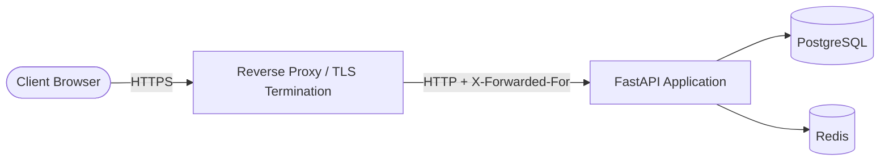

# Production Operations and Runbook

Running this e-commerce backend in production requires strict adherence to Twelve-Factor operational principles: configuration via the environment, stateless process lifecycles, structured logging to standard streams, and explicit isolation between database schema administration and runtime query execution.

## Production Configuration and Startup Validation

Setting `ENVIRONMENT=production` (or `staging`) activates fail-closed deployment validation in `Settings.check_deployment_settings` (`app/core/config.py`). If any constraint fails, the application aborts startup immediately with a descriptive error:

- **Log Level:** `LOG_LEVEL` must not be `DEBUG`. Verbose debugging exposes sensitive payload internals that outlive the HTTP request.
- **Password Hashing Cost:** `BCRYPT_ROUNDS` must be at least 12. Test suites lower this cost factor to 4 for execution speed, but production forbids cheap hashes to resist offline brute-force attacks.
- **Payment Provider:** `PAYMENT_PROVIDER` must be set to `stripe`. The in-process `mock` provider marks orders as paid without moving funds and is prohibited outside development and test environments.
- **Email Provider:** `EMAIL_PROVIDER` must be `smtp`. The `logging` provider drops every email (verification and password-reset links included) while reporting success.
- **Message Format:** Each email is `multipart/alternative` with a plain-text part (generated from the HTML) before the HTML part, and carries `Date` (UTC) and a `Message-ID` in the domain of `EMAILS_FROM_EMAIL`.
- **SMTP TLS:** The connection is upgraded with STARTTLS (use port 587; port 465 is not supported) and the server certificate is verified against the system CAs. `SMTP_TLS_VERIFY` must stay `true` (it may be `false` only in development and test, for a mail catcher with a self-signed certificate). A relay with a private CA is trusted by setting the standard `SSL_CERT_FILE` (or `SSL_CERT_DIR`) environment variable for the api and worker processes.
- **Cryptographic Secrets and Placeholders:** Secrets must not contain default placeholders (`change-me`, `changeme`, `placeholder`, or test-mock prefixes) and must meet strict minimum byte lengths:
  - `JWT_SECRET_KEY`: Minimum length determined by `JWT_ALGORITHM` (32 bytes for HS256, 48 bytes for HS384, 64 bytes for HS512; RFC 7518 §3.2).
  - `STRIPE_SECRET_KEY`: Must be defined and non-placeholder.
  - `STRIPE_WEBHOOK_SECRET`: At least 32 bytes.
  - `POSTGRES_PASSWORD`: At least 16 bytes.
  - `REDIS_PASSWORD`: At least 16 bytes.
  - `SMTP_PASSWORD`: Must be defined and non-placeholder.
- **Frontend Origin:** `FRONTEND_URL` must start with `https://`. Customers returning from Stripe Checkout Sessions and email verification links are strictly redirected to this origin.
- **API Documentation Exposure:** Interactive OpenAPI documentation (`/api/v1/docs`, `/redoc`, and `/api/v1/openapi.json`) is automatically disabled in `production`, returning HTTP 404 to avoid exposing schema internals.

## Reverse Proxy and Network Edge

Deploy the application behind a reverse proxy (such as Nginx, Caddy, or an AWS ALB) that terminates TLS.



- **Published address:** compose publishes the API on `${DOCKER_API_BIND:-0.0.0.0}:${DOCKER_API_PORT:-8000}`. Set `DOCKER_API_BIND=127.0.0.1` when the proxy runs on the same host so the API cannot be reached around it; leave the default when the proxy is on another host.
- **Shutdown:** on SIGTERM uvicorn waits `timeout_graceful_shutdown=90` s (root `main.py`) for requests in flight; compose gives the `api` container `stop_grace_period: 100s`. The longest wait is a Stripe call, 76.5 s worst case with default `STRIPE_*` settings ((5 s connect + 20 s read) x 3 tries + 1.5 s backoff). That bound is reached only by a Stripe that completes every TLS handshake and then sends nothing; in the November 2026 audit a hung or silent provider failed calls after about 16 s (each new connection hung in the TLS handshake, counted against the 5 s connect timeout) or about 31 s when the first try reused a kept-alive connection. Raising `STRIPE_READ_TIMEOUT_SECONDS` or `STRIPE_MAX_NETWORK_RETRIES` means raising both values, keeping grace period > graceful-shutdown timeout > longest provider wait.

### Trusted Proxies and Client Resolution

- **`TRUSTED_PROXIES`:** Configure comma-separated IP addresses or CIDR blocks (e.g. `TRUSTED_PROXIES=10.0.0.0/8,172.16.0.0/12`).
- **IP Resolution:** `ForwardedClientMiddleware` (`app/core/forwarded.py`) evaluates incoming `X-Forwarded-For` headers from right to left, selecting the rightmost non-trusted address as the client IP.
- **Spoofing Defense:** When `TRUSTED_PROXIES` is empty, `X-Forwarded-For` is ignored completely and the socket peer address is used. In `main.py`, Uvicorn is launched with `proxy_headers=False` so Starlette middleware retains sole authority over client identity.
- **Proxy Configuration:** The upstream proxy must append the peer address to `X-Forwarded-For` (e.g. `proxy_set_header X-Forwarded-For $proxy_add_x_forwarded_for;` in Nginx).

### Body Size Limits and Cookies

- **Request Body Ceiling:** `MAX_REQUEST_BODY_BYTES` (default 1 MiB / 1,048,576 bytes) is enforced by `BodySizeLimitMiddleware` (`app/core/body_limit.py`). Payloads exceeding this threshold receive an immediate HTTP 413 (Payload Too Large) without the body being read into memory. The reverse proxy must enforce an equal or smaller limit (e.g. `client_max_body_size 1m;`).
- **Cookie Security:** In production, `GUEST_CART_COOKIE_SECURE=true` ensures the guest cart cookie is transmitted with the `Secure` attribute, `SameSite=Lax`, `HttpOnly`, and under the `__Host-guest_cart` prefix.

## Health Probes and Container Orchestration

`/livez` and `/readyz` are defined in `app/core/probes.py`, `/health` in `app/main.py`. All probes respond to GET and HEAD, include `Cache-Control: no-store`, and are exempt from rate limiting and in-flight request limits:

| Probe Endpoint | Purpose | Checks Performed | HTTP Response |
|---|---|---|---|
| `/livez` | Liveness | Process is running and accepting event loop tasks. | Always 200 OK (`{"status": "ok"}`). Touches no dependencies to prevent cascading restarts during database or cache blips. |
| `/readyz` | Readiness | Dependencies respond within `READINESS_TIMEOUT_SECONDS` (2.0 s). | 200 OK (`{"status": "ok", "checks": {"database": "ok", "redis": "ok"}}`) or 503 Service Unavailable with `Retry-After: 5` (`{"status": "fail", ...}`). Removes unready instances from load balancer rotation without killing them. |
| `/health` | Legacy Combined | Combined liveness and dependency readiness for Docker healthchecks. | 200 OK if both database and Redis respond; 503 with `Retry-After: 5` if degraded. |

All three answer `HEAD` with the status and headers of the `GET`, `Content-Length` included, and no body.

A `"fail"` check means the dependency did not answer this instance within 2 s, not that the dependency is down. The 2 s include waiting for a pooled connection and for the event loop, so a saturated instance can fail one probe while PostgreSQL is healthy: in the November 2026 audit, `/readyz` reported the database down once at 100 % CPU, and 16 times during a Redis freeze, likely because requests waiting on Redis held their pooled connections ([report](reports/load-chaos-audit-2026-11.md#23-seventy-five-seconds-of-frozen-redis-f-chaos-1)). Take an instance out of rotation only after several consecutive failures (Kubernetes `failureThreshold` defaults to 3; with `periodSeconds: 5` that is 15 s), so one slow probe does not move load onto the remaining instances.

## Structured Logging

Logging is configured in `app/core/logging_config.py` following Twelve-Factor App rule XI:

- **JSON to stdout:** Log records are serialized as single-line JSON via `JSONFormatter` to standard output. Container runtimes and log aggregators (e.g. FluentBit, Datadog) collect stdout directly.
- **Trace and Request Correlation:** Log entries include `timestamp` (RFC 3339 in UTC with millisecond precision), `level`, `logger`, `message`, `request_id`, and `trace_id` (propagated from incoming W3C `traceparent` headers or OpenTelemetry spans).
- **Access Log:** Every HTTP request writes one line from the `app.access` logger (`app/core/access_log.py`), with `request_id`, and in `extra`: `method`, `path` (without the query string), `route` (the matched route template, or null), `status`, `duration_ms` and `client_ip` (the client as resolved by `TRUSTED_PROXIES`; a request shed by the in-flight limit shows the peer's address). No query string and no header is logged. uvicorn's own plain-text access log is off (`access_log=False` in `main.py`). The line is written at `INFO`, so it follows `LOG_LEVEL`.
- **Log Levels:** `LOG_LEVEL` sets the threshold for `app.*` loggers (`INFO`, `WARNING`, `ERROR`, `CRITICAL`). Third-party loggers default to `WARNING` in production to reduce noise. Celery's own loggers follow the `--loglevel` of the worker and beat commands (`info` in `docker-compose.yml`), so task received/succeeded/failed lines and beat's "Sending due task" lines are written, as JSON like the rest.
- **Optional File Rotation:** Setting `LOG_FILE` enables a secondary `RotatingFileHandler` (100 MB per file, 5 backup generations). If unset or empty, file logging is disabled.

## OpenTelemetry Distributed Tracing

Distributed tracing is implemented in `app/core/telemetry.py` using standard OpenTelemetry SDK specifications:

- **Packaging:** Tracing dependencies are packaged in the optional `telemetry` extra. In Docker builds, pass `--build-arg INSTALL_TELEMETRY=true` to include them.
- **Zero Overhead When Inactive:** Tracing is disabled by default. It starts when an exporter endpoint is configured or `OTEL_SDK_DISABLED=false` is set (then with the default endpoint `localhost:4318`). Otherwise no OpenTelemetry libraries are loaded, and `OTEL_SDK_DISABLED=true` always turns it off.
- **Enabling Tracing:** Set `OTEL_EXPORTER_OTLP_ENDPOINT` (e.g. `http://otel-collector:4318`) with `OTEL_EXPORTER_OTLP_PROTOCOL=http/protobuf`. Only HTTP protobuf transport is supported.
- **Container Identification:** Assign `OTEL_SERVICE_NAME` per container (e.g. `ecommerce-api` for the web service and `ecommerce-worker` for Celery).
- **Instrumented Layers:** FastAPI endpoints (excluding health probes), SQLAlchemy synchronous and asynchronous engines, Redis commands, Celery task publication and consumption, and outbound HTTP requests via the Stripe SDK.

## Celery Background Workers and Scheduler

Background tasks and periodic maintenance are managed by Celery (`app/tasks.py`):

- **Worker Execution:** `celery -A app.tasks worker --loglevel=info`. Configure container managers with `stop_grace_period: 330s` (SIGTERM initiates warm shutdown; Celery tasks enforce `task_time_limit=300s` and `task_soft_time_limit=240s`).
- **Scheduler Execution:** `celery -A app.tasks beat --loglevel=info --schedule=/tmp/celerybeat-schedule`.
- **Reliability Invariants:** Configured with `task_acks_late=True`, `task_reject_on_worker_lost=True`, `worker_cancel_long_running_tasks_on_connection_loss=True`, and `broker_transport_options['visibility_timeout']=3600`.
- **Order and GDPR Emails:** Order confirmation emails and the mails of data requests (export, deletion) are dispatched in-process via `BackgroundTasks`, after the transaction commits and after the response is sent. They are not retried; an application process crash after commit loses the email.

### Celery Beat Schedule (All Times in UTC)

All recurring jobs run strictly on UTC clocks:

| Task Name | Registered Task | Schedule | Purpose |
|---|---|---|---|
| `cleanup-inactive-accounts` | `cleanup_inactive_accounts` | Daily at 02:30 UTC | Executes GDPR Art. 17 erasures past `DATA_DELETION_GRACE_PERIOD_DAYS`. |
| `check-low-stock` | `check_low_stock` | Every 4 hours | Dispatches low-inventory notification emails to `ADMIN_EMAIL`. |
| `cancel-expired-unpaid-orders` | `cancel_expired_unpaid_orders` | Every 5 minutes | Cancels orders unpaid after `UNPAID_ORDER_EXPIRE_MINUTES` (default 30 min) whose attempts have aged past `CHECKOUT_SESSION_EXPIRE_MINUTES`, closes older attempts at Stripe, and returns reserved inventory. An attempt Stripe refuses to close is read back: if it is paid or being paid (its webhook late or failed), the order is left for the webhook and for reconciliation. |
| `check-payment-reconciliation` | `check_payment_reconciliation` | Daily at 03:15 UTC | Reconciles local payment records against the Stripe API for discrepancy detection. Compares at most `RECONCILIATION_MAX_PAYMENTS` (200) payments of the last `RECONCILIATION_WINDOW_DAYS` (7) days per run, those compared longest ago first (`payments.reconciled_at`, never-compared first); a payment is stamped when it was compared and recorded, not when Stripe could not answer for it. Above the cap the result says `truncated: true` and the rest of the window comes round on the following runs. |
| `sweep-stripe-events` | `sweep_stripe_events` | Every minute | Re-publishes webhook events whose task message was lost. An event the webhook route or an admin replay could not publish (broker down) is marked in `last_error` ("Not enqueued: ...") and taken on the next run, so a payment it confirms reaches its order within about a minute of the broker's return; any other event still `received` or `retrying` is taken after `STRIPE_EVENT_SWEEP_AFTER_MINUTES` (default 20, longer than the longest retry backoff), so events waiting in a long queue get no duplicate messages. |
| `cleanup-expired-retention` | `cleanup_expired_retention` | Daily at 02:45 UTC | Anonymises deactivated accounts past `USER_DATA_RETENTION_DAYS` (GDPR Art. 5(1)(e)). |
| `cleanup-expired-idempotency-keys` | `cleanup_expired_idempotency_keys` | Daily at 03:00 UTC | Clears expired order idempotency keys older than `IDEMPOTENCY_KEY_TTL_HOURS`. |

## PostgreSQL Database Operations

### Schema Ownership and Role Separation

PostgreSQL enforces strict privilege boundaries via `docker/postgres/initdb/10-app-role.sh`:
- **`POSTGRES_USER` (Schema Owner):** Superuser role that owns database tables, sequences, and schemas. Executes migrations.
- **`APP_DB_USER` (Application Runtime):** Unprivileged role utilized by the API and Celery workers. Holds DML privileges (SELECT, INSERT, UPDATE, DELETE) and sequence permissions, but zero DDL rights (cannot CREATE, ALTER, or DROP tables).
- **Executing Migrations:** Run migrations exclusively through the dedicated `migrate` profile:
  ```bash
  docker compose --profile migrate run --rm migrate
  ```

### Connection Pooling and Timeouts

Each API worker maintains two connection pools (synchronous and asynchronous):
- Default pool size: `DB_POOL_SIZE=10`, `DB_MAX_OVERFLOW=5`, `DB_POOL_TIMEOUT=30`.
- Size PostgreSQL `max_connections` to support peak worker concurrency: `WORKERS * 2 * (DB_POOL_SIZE + DB_MAX_OVERFLOW) + Celery`. With 4 workers, this requires at least 120 connections; `docker-compose.yml` configures `max_connections=200`.
- Connections enforce `idle_in_transaction_session_timeout=30s`, `statement_timeout=60s`, and `connect_timeout=5s` to prevent stalled connections and leaked locks.
- SQLAlchemy engines configure `hide_parameters=True` outside SQL debugging to prevent sensitive parameters from leaking in logs and statement errors. Database credentials in `DATABASE_URI` are safely encoded via `URL.create`.
- Celery background workers install structured JSON logging to standard output matching the web tier.

### Backups, Restores, and Downgrades

Backup and restore fidelity was proven during Stage T5 verification ([reports/T5-migrations-backup.md](reports/T5-migrations-backup.md)):

```bash
# Create custom-format compressed backup
docker compose exec -T db sh -c 'pg_dump -U "$POSTGRES_USER" -d "$POSTGRES_DB" -Fc' > backup_$(date +%Y%m%d_%H%M%S).dump

# Restore into a new, empty database: the live one already has its tables
docker compose exec -T db sh -c 'createdb -U "$POSTGRES_USER" restored'
docker compose exec -T db sh -c 'pg_restore -U "$POSTGRES_USER" -d restored --exit-on-error --no-owner' < backup.dump
```

> [!IMPORTANT]
> **Mandatory Downgrade Rule:** Always execute a full `pg_dump` backup before performing an Alembic downgrade. Downgrade scripts drop tables and columns by design, resulting in irreversible data loss. Continuous point-in-time recovery (PITR) is not configured (`wal_level=replica`, `archive_mode=off`).

CI checks every migration's downgrade and upgrade against the PostgreSQL catalogs, and runs the newest tagged release's database tests of orders, payments, checkout, carts, refunds, users and addresses on the new migrations. A rolling deploy (migrate first, then roll the app) relies on that old code keeping working on the new schema; those tests are the evidence for it, as far as they reach.

### Upgrading the Schema to 6.0.0

Take a backup first (above), then run the `migrate` service. Revision `f180919aaf3b` adds `ck_payment_attempt_status` (a CHECK on `payments.status`), `uix_user_default_address` (a partial unique index: one active default address per user), `payments.reconciled_at` and `idx_order_new_created_at` (a partial index on new orders for the expiry sweep).

- If an existing `payments` row has a status outside the allowed set, the migration stops before changing anything and names the number of rows; correct them and run it again.
- Users who already have several active default addresses are fixed without asking: the newest default stays, the others stop being default. The downgrade does not bring them back.
- The indexes are built in the migration's own transaction and block writes to `orders` and `addresses` while they build, which is short at the size of a shop.

### PostgreSQL Major Upgrades (PostgreSQL 15 to 18)

PostgreSQL 16, 17 and 18 are supported: CI runs the database-sensitive tests on all three, and the whole suite on 18, the version Compose deploys. PostgreSQL 15 is no longer tested. Since 6.0.0 `docker-compose.yml` builds the database from `docker/postgres/Dockerfile` (`postgres:18.6-alpine` with Alpine security updates) and mounts the `postgres_data` volume on `/var/lib/postgresql`. The official 18 image keeps cluster data in `/var/lib/postgresql/18/docker` (PGDATA) and declares `/var/lib/postgresql` as its volume; 15 used `/var/lib/postgresql/data`. A volume created by a 15 container is refused at start (the entrypoint reports the old layout), so an existing deployment moves its data with a logical dump and restore:

1. With the 5.x stack still running: `docker compose exec db pg_dumpall -U "$POSTGRES_USER" > backup.sql`.
2. `docker compose down`, then remove the old volume (`docker volume rm <DOCKER_NETWORK_NAME>-postgres-data`, `ecommerce-postgres-data` by default) once the dump is checked.
3. Start the 6.x stack (`docker compose up -d --build db`): the 18 container initialises an empty cluster and runs `docker/postgres/initdb` (it creates `APP_DB_USER`).
4. Restore: `docker compose exec -T db psql -U "$POSTGRES_USER" -d postgres < backup.sql` (the role already created by the init script makes `pg_dumpall`'s CREATE ROLE for it fail harmlessly), then start the rest.

A later major (18 to 19) can use `pg_upgrade --link` inside the one volume, which is what the new layout is for.

## Redis Configuration and Failure Modes

Redis serves as the Celery message broker, token revocation store, password-change watermark tracker, rate limit window engine, and shopping cart cache:

- **Supported Versions:** Redis 7.2 to 8.8, the range the redis-py 8.1 client lists as supported. Compose builds 8.8 from `docker/redis/Dockerfile` (the official `redis:8.8-alpine`, pinned by digest, with `apk upgrade`); CI runs the Redis-semantics tests on the same base image.
- **Persistence Configuration:** Redis runs with Append-Only File persistence (`--appendonly yes`, `--appendfsync everysec`) alongside RDB snapshots.
- **Memory Ceiling:** Memory is capped via `REDIS_MAXMEMORY` (default 256 MB) with `--maxmemory-policy noeviction`. When full, Redis refuses writes rather than evicting keys. Evicting volatile keys would invalidate token blacklists and password watermarks, resurrecting revoked sessions.
- **Key Lifetimes:** Each key family expires on its own TTL; nothing sweeps them.

  | Key | TTL |
  |---|---|
  | `category:tree` (category tree cache) | `REDIS_PRODUCT_CACHE_TTL_HOURS` (1 hour); deleted when a category changes |
  | `product:{id}` (product detail cache) | 5 minutes (`PRODUCT_CACHE_TTL` in `app/services/redis_codec.py`); deleted on writes |
  | `pwd_changed:{user_id}` (revocation watermark) | `REFRESH_TOKEN_EXPIRE_DAYS` (7 days) from the password change or logout |
  | `refresh_user:{user_id}` (the user's refresh families) | `REFRESH_TOKEN_EXPIRE_DAYS` (7 days), renewed at each login and refresh |
  | `blacklist:{jti}` (revoked access token) | The token's remaining lifetime, rounded up |
  | Carts | `REDIS_CART_TTL_DAYS` (30) for an account, `REDIS_GUEST_CART_TTL_DAYS` (7) for a guest, from the last write |
- **Resilience Under Outage:** When Redis is unavailable, public catalog browsing succeeds (200 OK) and rate limiting fails open. Authenticated routes and cart writes fail closed with HTTP 503 (`Retry-After: 30` and `Retry-After: 5`). See [RESILIENCE.md](RESILIENCE.md) for chaos test recovery profiles.

## Going Live with Stripe

Development setup (test keys, Stripe CLI) is in [SETUP.md](../SETUP.md#real-stripe-development). For live mode, `PAYMENT_PROVIDER=stripe` is already required by startup validation; the rest is configuration on the Stripe side.

- **Restricted API key.** Put a restricted key (`rk_live_...`, see [Stripe: restricted API keys](https://docs.stripe.com/keys/restricted-api-keys)) in `STRIPE_SECRET_KEY` instead of an unrestricted secret key. The application calls only these Stripe endpoints (all in `app/services/payment/live_stripe_provider.py`, through one `StripeClient`):
  - PaymentIntents: create, confirm, cancel and retrieve;
  - Checkout Sessions: create, retrieve and expire;
  - Refunds: create and list.

  Grant Write on those three resources and no permission on anything else (no Customers, Payouts, Disputes or account settings). A call the key may not make fails with a Stripe permission error, which the provider answers as a 503 and logs at critical level ("Stripe refused our API key"). Try the exact key set in test mode first (an `rk_test_` key with the same permissions: place an order, pay, refund, run the reconciliation) and read Stripe's request logs for 403 responses before switching to live keys. The key needs no permission to receive webhooks: they are verified with `STRIPE_WEBHOOK_SECRET` only.
- **Provider failures on `/pay` and `/checkout-session`.** When Stripe cannot be reached or answers with an error that leaves the outcome open (a dropped connection, a 429, a 5xx), the client gets 503 with `Retry-After: 5` and the attempt is left `unknown`. One WARNING line from `app.api.v1.orders` ("Payment attempt ... left unknown") records it, with `extra` fields `flow`, `order_id`, `payment_id`, `error_class` (the Stripe SDK error class, such as `RateLimitError` or `APIConnectionError`), `stripe_request_id` (search it in the Dashboard's request logs), `http_status`, `provider_code` and `idempotency_key_sha256` (the first 16 hex digits of the SHA-256 of the provider idempotency key, which matches the retries of one attempt; the key itself is not logged).
- **Unconfirmed PaymentIntents after a lost answer.** If Stripe created the PaymentIntent but its answer was lost (for example a connection reset) and the client never retries with the same `Idempotency-Key`, the application does not learn the PaymentIntent's id. The attempt stays `unknown` until the expiry sweep cancels the unpaid order, but it cannot cancel that PaymentIntent and the reconciliation does not see it. It takes no money: it stays in `requires_confirmation`, and only the application's secret key could confirm it (the client never received its `client_secret`). To clean such leftovers up, search PaymentIntents in the Dashboard by `metadata['order_id']` for orders cancelled by expiry and cancel those still in `requires_confirmation`. Found in the November 2026 audit: 3 of 61 unretried attempts during injected connection resets.
- **Rotating the API key.** Rotate in the Dashboard with a delayed expiry (Stripe keeps the old key valid for up to 7 days), put the new value in `STRIPE_SECRET_KEY` in `.env` and recreate the services that read it, `docker compose up -d --force-recreate api celery-worker` (a plain `restart` does not re-read `.env`), then confirm in Stripe's request logs that the old key is idle before it expires.
- **Rotating the webhook secret.** The signing secret belongs to one webhook endpoint and is separate from the API key. Use "Roll secret" on the endpoint in the Dashboard with a delayed expiry: until then Stripe signs each delivery with both secrets, so deliveries keep verifying while you set the new `STRIPE_WEBHOOK_SECRET` and recreate `api`. Live and test mode have different secrets. The value must pass the deployment check (at least 32 bytes, not a placeholder).
- **Webhook events.** Register the endpoint `https://<your-host>/api/v1/orders/webhooks/stripe` and subscribe to exactly the 16 event types listed in [SETUP.md](../SETUP.md#real-stripe-development); the application handles no other type, so subscribing to more only adds load. Stripe retries a failed delivery for up to three days; the stored-first design means a 503 from the application during an outage is retried, not lost (see [RESILIENCE.md](RESILIENCE.md)).
- **Webhook API version.** Stripe writes each event in the API version of the endpoint that receives it: the version given when the endpoint was created (`api_version` on the create call), otherwise the account's default version. The application's own API calls use the version pinned by the Stripe SDK in `uv.lock` (stripe-python 16.1.0: `2026-10-28.endive`, since 6.1.0; 6.0.0 used 16.0.1 and `2026-09-30.endive`, which differ only by additions). Tested in the November 2026 audit on 6.0.0: the events of a test series (payments, a declined card and retry, a partial refund) in `2024-11-20.acacia` (an account default) and in `2026-10-28.endive` (`stripe listen --latest`) were all processed, with the same order and payment states in the end. The endive payloads only lack fields the acacia ones have (for example `invoice` on charges and PaymentIntents). Other event types, `checkout.session.*` and the dispute events among them, were not compared across versions. Create the endpoint with the SDK's version (`2026-10-28.endive`, the version of the endive events tested above) so events and API responses have the same shape, and test in test mode before moving the endpoint to another version.
- **Dispute evidence in the admin.** `GET /api/v1/orders/{order_id}/payments` (admin only) shows each dispute's `evidence`: the deadline (`due_by`), whether evidence is staged, whether the deadline passed, how often it was submitted and how. It is what the last `charge.dispute.*` event reported (`Dispute.evidence_details`), not a live read from Stripe. Stripe includes `submission_method` in these events from API version `2026-10-28.endive`; an endpoint on an older version leaves it null. Evidence itself is still submitted in the Stripe Dashboard.
- **Optional: restrict the webhook route to Stripe's addresses.** Stripe lists the addresses it sends webhooks from at <https://docs.stripe.com/ips> and recommends allowing only those, in addition to signature verification. The application does not enforce this; do it at the reverse proxy for `POST /api/v1/orders/webhooks/stripe` only, taking the ranges from that page (they can change, so keep them in configuration you can update; the signature check stays the authority either way). Behind a proxy, check the address Stripe connects from, not an `X-Forwarded-For` value a client could send.

## Time, DST, and GDPR Retention

- **Universal UTC:** Timestamps in PostgreSQL use `TIMESTAMP WITH TIME ZONE` (`timestamptz`). API payloads format datetimes as ISO-8601 UTC strings ending with `Z`. Celery operates under `timezone="UTC"` and `enable_utc=True`.
- **Daylight Saving Time (DST):** Because all scheduling and relative deadlines use UTC and monotonic deltas, autumn and spring clock shifts never duplicate or skip scheduled jobs ([reports/daylight-saving-time.md](reports/daylight-saving-time.md)).
- **GDPR Deletion Grace Periods:** Erasure requests via `POST /api/v1/legal/data-request` are accepted for all users except the last active administrator (409). Accepting one deactivates the account and, in the same transaction, cancels its new, unpaid orders and returns their stock; after the commit their open Checkout Sessions are expired and PaymentIntents cancelled at the provider (an attempt the provider will not close is logged as a warning, and a payment that still completes is flagged for manual review, not applied). Paid orders are left as they are. Account PII is scrubbed and anonymised by `cleanup_inactive_accounts` after `DATA_DELETION_GRACE_PERIOD_DAYS` (default 1 day), using one bcrypt hash computation per account batch. On orders of an erased account, the shipping address snapshot (`ship_to_*`) is kept while a payment dispute is open, or while the order is confirmed, processing or sent and less than 30 days old; any other order (new, delivered or cancelled) has it scrubbed at once (the project's reading of Art. 17(3), not legal advice). Deletion completion emails are sent after commit only to unredacted addresses. Webhook events associated with erased users are redacted when processed.
- **GDPR Data Portability:** Data export requests assemble user profile data, addresses, orders, and payment records into JSON format and email the file inline to the account address.
- **Storage Limitation:** The `cleanup_expired_retention` task anonymises deactivated accounts (`is_active=False`) that have been inactive for `USER_DATA_RETENTION_DAYS` (default 365 days). Active customer accounts are never touched.

## Capacity and Scaling Knobs

Tune the following settings in `.env` based on instance resources. The defaults are the code's; `.env.example` sets `MAX_IN_FLIGHT_REQUESTS=15`, so a `.env` copied from it has that limit. With `ENVIRONMENT=development`, `WORKERS` is forced to 1 and `DB_POOL_SIZE` and `DB_MAX_OVERFLOW` are halved (at least 5 each).

| Configuration Setting | Default Value | Operational Purpose |
|---|---|---|
| `WORKERS` | `4` | Number of Uvicorn worker processes. |
| `MAX_IN_FLIGHT_REQUESTS` | `None` (set to `15` in benchmarks) | Per-worker concurrency ceiling. Excess requests receive immediate HTTP 503 to prevent pool exhaustion. |
| `DB_POOL_SIZE` | `10` | SQLAlchemy pool connections per engine. |
| `DB_MAX_OVERFLOW` | `5` | Maximum overflow connections above pool size. |
| `REDIS_POOL_SIZE` | `50` | Maximum connections in the Redis connection pool. |
| `REDIS_POOL_TIMEOUT` | `20` | Timeout in seconds waiting for an available Redis connection. |
| `REDIS_SOCKET_TIMEOUT` | `1.0` | Seconds a Redis command waits for its answer before failing (both application clients; not the Celery broker). |
| `REDIS_SOCKET_CONNECT_TIMEOUT` | `1.0` | Seconds to open a Redis connection before failing. |
| `BCRYPT_MAX_CONCURRENCY` | `None` (default `4 * CPU`) | Semaphore bounding concurrent password hashes per worker to prevent CPU starvation. |
| `RATE_LIMIT_DEFAULT` | `"300/minute"` | Baseline rate limit applied to general API routes. |
| `RATE_LIMIT_SEARCH` | `"60/minute"` | Limit on catalog search queries. |
| `RATE_LIMIT_AUTH` | `"20/minute"` | Limit on registration, login, and password-reset endpoints per IP. |
| `RATE_LIMIT_CHECKOUT` | `"10/minute"` | Limit on order placement and payment execution per user. |
| `RATE_LIMIT_CONSENT` | `"10/hour"` | Limit on consent changes per user: every `POST /legal/consent` and every `PATCH`/`PUT /users/me` that changes `marketing_consent` share one count. |
| `RATE_LIMIT_LOGIN_FAILURES_PER_EMAIL_AND_ADDRESS` | `"10/15 minutes"` | Hard lockout for a specific IP attempting to authenticate against an email. |
| `RATE_LIMIT_LOGIN_FAILURES_PER_EMAIL` | `"100/hour"` | Distributed guessing backstop locking an account across all IPs. |
| `RATE_LIMIT_GUEST_CART` | `"100/hour"` | Limit on new guest cart creation per IP address. |

See [PERFORMANCE.md](PERFORMANCE.md) for load test saturation curves, latency percentiles, and overload shedding benchmarks.

See also: [PERFORMANCE.md](PERFORMANCE.md), [RESILIENCE.md](RESILIENCE.md), [LIMITATIONS.md](LIMITATIONS.md), [reports/T5-migrations-backup.md](reports/T5-migrations-backup.md), [reports/daylight-saving-time.md](reports/daylight-saving-time.md).
