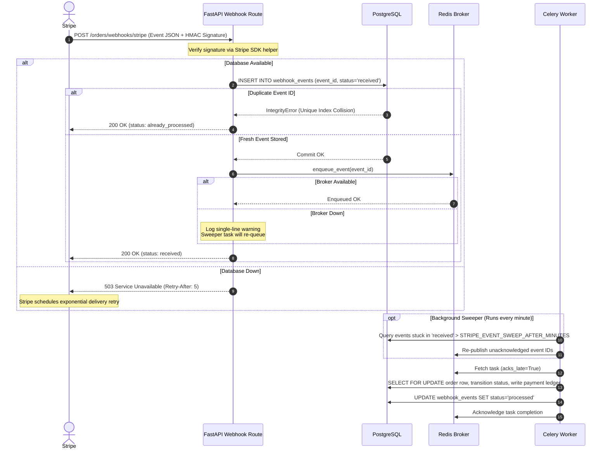

# System Resilience and Fault Recovery

In a transactional e-commerce platform, network blips and process restarts are inevitable. Resilience means failures degrade gracefully, clients receive accurate HTTP status codes and retry advice, and financial transactions are never dropped or double-charged.

## Dependency Failure Matrix

Resilience was verified during Stage T8 chaos engineering experiments under a sustained background load of 200 virtual users.

| Dependency Failure | Client Impact & Status | Health Probes | Measured Recovery | Data Integrity Guarantees |
|---|---|---|---|---|
| **Redis Down** (stopped) | Authenticated requests and login return 503 (`Retry-After: 30`). Cart mutations return 503 (`Retry-After: 5`). Public catalog reads succeed (200 OK). Rate limiter fails open. | `/livez`: 200 OK `/readyz`: 503 (in 5.8 s) | 26.24 s to `/readyz` 200; 69.01 s to full throughput | Webhooks persist to database; broker failure logs a single warning; sweeper queues tasks upon broker recovery. |
| **Redis Frozen** (paused) | Identical to Redis down: 503 with `Retry-After: 30` on auth/token checks, 503 on cart writes. | `/livez`: 200 OK `/readyz`: 503 (in 2.0 s) | 1.20 s to `/readyz` 200; 19.00 s to full throughput | No corrupted Redis state; in-flight limit sheds stalled connections. |
| **PostgreSQL Down** (stopped) | All database routes return 503 Service Unavailable (`Retry-After: 5`). Stripe webhooks receive 503 so Stripe automatically retries. | `/livez`: 200 OK `/readyz`: 503 (in 4.3 s) | 8.30 s to `/readyz` 200; 20.00 s to full throughput | Connection pool self-heals using `pool_pre_ping`. Zero lost webhooks. |
| **PostgreSQL Frozen** (paused) | In-flight limiter sheds backlog with 503 (`Retry-After: 1`). Existing in-flight requests wait until socket timeout. | `/livez`: 200 OK `/readyz`: 503 (in 1.6 s) | 0.70 s to `/readyz` 200; 10.00 s to full throughput | Zero transactions committed in half-written state; WAL maintains consistency. |
| **Celery Worker Killed** (SIGKILL mid-burst) | API response unaffected (100% 200 OK). | `/livez`: 200 OK `/readyz`: 200 OK | 6.00 s to drain queue after worker restart | Tasks configured with `acks_late=True` and `reject_on_worker_lost=True`. 50/50 events processed, 0 duplicates. |
| **Celery Beat Stopped** (3 minutes) | API response unaffected (100% 200 OK). Periodic cleanup tasks delayed. | `/livez`: 200 OK `/readyz`: 200 OK | Immediate upon process restart | Sweeper catches up on missed intervals; schedule state restored from persistent schedule. |
| **Database Latency** (+200 ms via Toxiproxy) | p95 latency rises; in-flight limiter sheds 26 requests via 503 to prevent pool starvation; remaining 4092 succeed. | `/livez`: 200 OK `/readyz`: 200 OK | Immediate upon removing latency proxy | Zero database deadlocks or connection leaks; pool checkout timeout enforces boundary. |

## Webhook Durability Architecture

Stripe webhook processing uses a persistent outbox pattern with database-backed idempotency:

### Guarantees
- **Storage First:** Webhooks are committed to PostgreSQL before returning an acknowledgment to Stripe.
- **Worker Crash Safety:** Celery tasks run with `acks_late=True` and `reject_on_worker_lost=True`. If a worker dies mid-task, the broker requeues the task immediately.
- **Autonomous Recovery (Sweeper):** The periodic `sweep_stripe_events` Celery beat task scans for events remaining in `received` or `retrying` status and re-queues them.
- **Idempotency:** Replaying identical event payloads returns `200 already_processed` with zero ledger duplicate entries.

## Fail-Closed Token Semantics: Why 503 and Not 401

When Redis is unavailable, the application cannot inspect the token blacklist or verify revocation state:

- **Fail-Closed Rule:** The request must be refused. Allowing an unverified token to proceed would permit access to accounts that have been logged out or revoked (decision F-06 of the 3.0.0 security review).
- **Why 503 and not 401:** Returning 401 during a Redis blip was an efficient way to panic client applications into deleting stored tokens and logging users out prematurely.
  - **RFC 9110 §15.5.2 (401 Unauthorized):** Indicates that the request "lacks valid authentication credentials" and invites the client to retry with new credentials.
  - **RFC 6750 §3.1 (invalid_token):** Reserved for tokens that are expired, revoked, malformed, or invalid.
  - **RFC 9110 §15.6.4 (503 Service Unavailable):** Applies when the server is "currently unable to handle the request due to a temporary overload or scheduled maintenance, which will likely be alleviated after some delay".
  - The client presented a valid, unexpired token. The server cannot verify revocation status due to an infrastructure outage. Therefore, the API returns HTTP 503 with problem details type `service-unavailable` and `Retry-After: 30`, instructing the client to retry without discarding session credentials.

## Database Error Mapping (503 vs 500)

Shipped in release v4.0.2 (fix X9) following chaos experiment E3:

- **The Problem:** In earlier releases, database connection loss caused `get_async_db` to catch `SQLAlchemyError` and return a generic HTTP 500 Internal Server Error without a `Retry-After` header.
- **The 4.0.2 Rule:** `is_database_unavailable_error()` in `app/core/database.py` inspects the exception chain for transient reachability issues:
  - Connection refused (`ConnectionRefusedError`, `OperationalError`)
  - Connection dropped or reset (`ConnectionResetError`, `DisconnectionError`)
  - Pool checkout exhaustion (`SATimeoutError`)
  - Stale invalidated connections (`DBAPIError.connection_invalidated`)
- **Outcome:** Reachability failures return HTTP 503 with problem details and `Retry-After: 5`. Genuine application bugs or unhandled constraint violations (including `QueryCanceled` from `statement_timeout`) remain HTTP 500 without leaking query contents or parameters.

See also: [reports/T8-chaos.md](reports/T8-chaos.md), [reports/fixes-4.0.x.md](reports/fixes-4.0.x.md), [TESTING.md](TESTING.md), [PERFORMANCE.md](PERFORMANCE.md).
