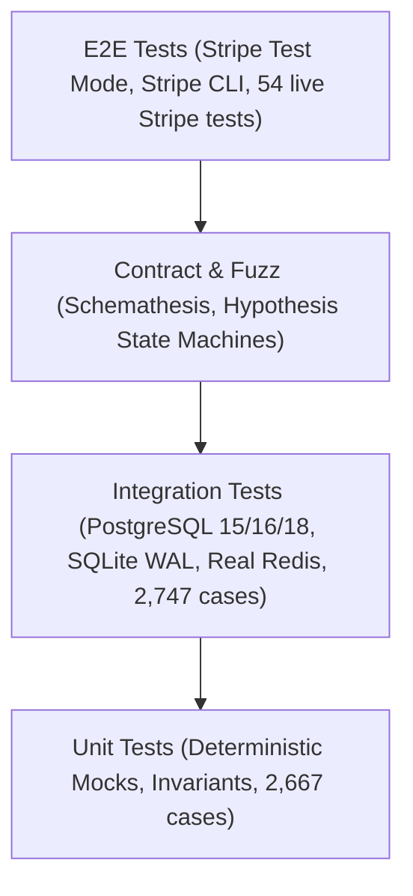
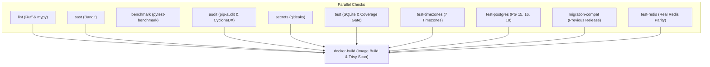

# Testing Strategy and Test Suite

Software that processes money cannot rely on good intentions or manual smoke testing. The testing strategy follows a rigorous pyramid: thousands of deterministic unit tests at the base, real database and service integration in the middle, property and contract fuzzing to explore edge cases, and mutation testing to prove that the tests actually catch bugs.

## Test Pyramid



1. **Unit Tests:** Fast, isolated tests covering models, services, schema serialization, and money calculations. All external I/O (Stripe, Redis, SMTP) is mocked deterministically.
2. **Integration Tests:** Executed across SQLite (local development) and PostgreSQL 15, 16, and 18 (CI). Tests verify row locking in payment paths, database CHECK constraints, lower(email) unique indexes, and Alembic migrations.
3. **Property and State-Machine Tests:** Hypothesis generates pseudo-random inputs to find boundary bugs. Stateful tests (`PaymentChain`) exercise arbitrary sequences of orders, payments, cancellations, and refunds. One property test discovered that normalizing the German letter "ß" expands "0ß" into two characters ("0SS"), quietly invalidating ISO country code length invariants.
4. **Contract and Fuzz Testing:** Schemathesis was run against the 4.0.0 OpenAPI document (54 paths), outside this suite. It uncovered unhandled 500 errors on NUL bytes (`\x00`) and lone surrogates, prompting global input sanitization.
5. **E2E Tests (Stripe Test Mode):** Black-box tests driven against real Stripe test-mode endpoints (`api.stripe.com`) with webhook forwarding via the Stripe CLI.
6. **Mutation Testing:** Automated fault injection with `mutmut 3.8.0` across the payment, webhook, reconciliation, idempotency, order, rate-limit and error modules, run on 4.0.2 and 4.0.3 (see reports/T10-mutation.md) and again on 4.1.1. On 4.1.1: 3,434 mutants, 3,088 killed and 272 timed out on the first run, 74 survived; 31 of those were gaps in the tests and are now killed by named tests (tests/unit/test_mutants_4_1.py, tests/unit/test_payment_mutants.py, tests/integration/test_reconciliation.py), each proven by rerunning its mutant; the other 43 are equivalent (log wording, messages of assertions that cannot fail, join conditions inferred from the foreign key, defaults every caller overrides). Mutation testing runs by hand, not in CI: one run takes about 90 minutes on four cores.

## Continuous Integration Pipeline

GitHub Actions runs 19 job instances on ubuntu-latest: 11 jobs, expanded by 7 time zones and 3 PostgreSQL versions.



- **lint:** Runs Ruff across `app` and `tests`, and static type checking with `mypy`.
- **sast:** Runs Bandit offline (`-r app --severity-level medium`) for static application security testing.
- **benchmark:** Measures hot execution paths with `pytest-benchmark`, comparing against the latest baseline from `main` and failing on regressions over 80%.
- **audit:** Exports locked dependencies to check against the PyPI Advisory Database using `pip-audit`, producing a CycloneDX SBOM.
- **secrets:** Scans git history for exposed credentials using `gitleaks`.
- **test:** Executes the primary suite in parallel on SQLite, runs timing-sensitive tests sequentially, and enforces coverage gates.
- **test-timezones:** Matrix testing payment and order logic across 7 timezones (including UTC, Pacific/Kiritimati, Pacific/Pago_Pago, Asia/Kathmandu, America/St_Johns, Europe/Bratislava, America/New_York).
- **test-postgres:** Tests database-sensitive suites against PostgreSQL 15, 16, and 18 containers, including schema round-trip tests (`tests/integration/test_postgres_migration_roundtrip.py`) across every revision.
- **migration-compat:** Runs the newest tagged release's database tests of orders, payments, checkout, carts, refunds, users and addresses against the current migrations on PostgreSQL 15 (`.github/scripts/migration_compat.sh`); that release's tests about the migrations themselves are left out. It ends at once when `migrations/` is unchanged since the tag.
- **test-redis:** Tests Redis Lua scripts, token revocation, and concurrency on a real Redis 7 container.
- **docker-build:** Builds the production container image and runs Trivy vulnerability scanning across the app and compose images.

## Test Markers and Isolation

Configuration in `pyproject.toml` and `tests/conftest.py` ensures hermetic, reproducible execution:

- `timing_sensitive`: Tests asserting elapsed wall-clock time or event-loop latency. Deselected during parallel runs (`-m "not timing_sensitive"`) to prevent CPU contention flakes, then executed sequentially.
- `db_sensitive`: Tests dependent on PostgreSQL features (row locks, constraints, migrations). Selected automatically by filename pattern in `tests/conftest.py`.
- `real_redis`: Tests executed against a live Redis instance when `REAL_REDIS_URL` is set.

### Conftest Hermetic Behaviour

- **Redis:** `fakeredis` backs `RedisService` and async clients on a shared `FakeServer`. `REDIS_PORT=1` is set in the test environment so unmocked network calls fail immediately.
- **Payments and Email:** `PAYMENT_PROVIDER=mock` and `EMAIL_PROVIDER=logging` prevent external network traffic.
- **Password Hashing:** `BCRYPT_ROUNDS=4` minimizes CPU time during mass user creation.
- **Database Isolation:** For SQLite, each worker uses a dedicated file database in WAL mode (`PRAGMA journal_mode=WAL`, `synchronous=OFF`). For PostgreSQL, each test session creates a unique database (`ecom_pgtests_<epoch>_<hex>`), runs `alembic upgrade head`, and drops the database on exit. The throwaway databases of the migration tests are named the same way. Test startup removes stale temporary databases older than one day left by aborted runs on both SQLite (`ecommerce-tests-*`) and PostgreSQL (`ecom_pgtests_*`).
- **Random Test Order:** `pytest-randomly` is enabled by default to run tests in randomized order. Each run prints its seed in the header (`Using --randomly-seed=N`) and, because `-q` hides the header, again at the end (`random order seed: rerun with --randomly-seed=N`). Reproduce an exact execution order with `pytest --randomly-seed=N`, or disable randomization with `-p no:randomly`.
- **Network Blocking:** `pytest-socket` in addopts blocks outbound socket calls (`--allow-hosts=127.0.0.1,::1,localhost --allow-unix-socket`). It intercepts Python's `socket.connect` (blocking unmocked HTTP and SMTP clients). It does not intercept libpq (PostgreSQL's C client) or DNS lookups. Running against a `TEST_DATABASE_URL` on another host requires adding that host to `--allow-hosts`. Live Stripe integration tests are explicitly marked with `enable_socket`.
- **Specialized Test Suites:** The suite includes regression suites in `tests/torture_suite`, `tests/strict_domain_audit`, and `tests/audit_verification`. Setting `TORTURE_FULL=1` enables exhaustive property and concurrency exploration.
- **Table Cleanup:** An engine hook (`Engine.before_cursor_execute`) tracks dirty tables during each test. The autouse fixture `_reset_database` issues fast SQL deletes and sequence resets only for modified tables before each test.

## Execution Commands

### Fast Local Execution
Run the full test suite in parallel using pytest-xdist, followed by timing tests:
```bash
uv run pytest tests/ -q -n 2 --dist worksteal -m "not timing_sensitive"
uv run pytest tests/ -q -m timing_sensitive
```

### PostgreSQL Integration Suite
Execute tests against a live PostgreSQL server (requires `CREATEDB` privilege):
```bash
TEST_DATABASE_URL=postgresql+psycopg://ci:ci@localhost:5432/ci uv run pytest tests/ -m "not timing_sensitive" -q -n 2 --dist worksteal
TEST_DATABASE_URL=postgresql+psycopg://ci:ci@localhost:5432/ci uv run pytest tests/ -m "db_sensitive and timing_sensitive" -q
```

### Real Redis Parity Suite
Validate Redis Lua scripts, token TTLs, and concurrency against a real server:
```bash
REAL_REDIS_URL=redis://localhost:6379/0 uv run pytest tests/ -m real_redis -q
```

### Live Stripe Integration Tests
Live tests make real network calls to `api.stripe.com` in Stripe test mode. They are skipped unless the `STRIPE_SECRET_KEY` environment variable contains a valid test key (not a placeholder) or `.env.test` is provided:
```bash
STRIPE_SECRET_KEY=<your Stripe test secret key> uv run pytest tests/integration/test_payment_live_stripe.py tests/integration/test_checkout_session_live_stripe.py tests/integration/test_payment_live_journey.py tests/integration/test_reconciliation_live_stripe.py
```

### Hypothesis Profiles
Select property testing budgets using `HYPOTHESIS_PROFILE`:
- `dev`: 100 examples, 200 ms deadline (default).
- `ci`: 200 examples, derandomized, deadlines disabled, `print_blob=True`.
- `explore`: 200 examples with randomized seeds to uncover novel failure modes:
```bash
HYPOTHESIS_PROFILE=explore uv run pytest tests/integration/test_payment_state_machine.py
```

### OpenAPI Contract Snapshot
Prevent accidental API contract drift against `tests/snapshots/openapi.json`:
```bash
# Verify schema matches snapshot:
uv run pytest tests/unit/test_openapi_snapshot.py

# Update snapshot after intended schema changes:
UPDATE_OPENAPI_SNAPSHOT=1 uv run pytest tests/unit/test_openapi_snapshot.py
```

### Coverage and Payment Layer Gate
CI enforces an overall 85% coverage gate and a strict 100% line and branch gate on the financial core:
```bash
# Measure combined coverage:
uv run pytest tests/ -q -n auto --dist worksteal -m "not timing_sensitive" --cov=app --cov-report= --cov-fail-under=0
uv run pytest tests/ -q -m timing_sensitive --cov=app --cov-append --cov-report=term-missing --cov-report=xml

# Enforce 100% payment layer gate:
uv run coverage report --fail-under=100 \
  --include="app/api/v1/orders.py,app/services/orders.py,app/services/payment/*.py,app/schemas/order.py,app/models/order.py,app/models/order_items.py,app/models/payment.py,app/models/payment_ledger.py,app/tasks.py,app/services/email/messages.py,app/services/stripe_events.py,app/services/reconciliation.py,app/models/payment_discrepancy.py,app/schemas/webhook_event.py" \
  --omit="app/services/payment/stripe_provider.py"
```

### Type Checking
Run static type verification with mypy across `app/`:
```bash
uv run mypy
```

### Local Benchmarks
Run performance benchmarks for hot execution paths:
```bash
uv run pytest tests/benchmarks --benchmark-enable --benchmark-only
```

## Verified Metrics for Release v4.1.1

Verification results on release v4.1.1; a row measured on an earlier release says which:

| Metric | Measured Value | Standard / Target |
|---|---|---|
| SQLite Test Suite | 6,416 passed, 68 skipped without their services (+ 30 timing), random order | 0 failures, 0 warnings |
| PostgreSQL Test Suite (v4.1.0) | 6,362 passed on 15 (+ 103 timing); 4,061 database-sensitive on 16 and 18 | Full migration and constraint parity |
| Migration Round Trip | every revision on PostgreSQL 15, 16 and 18; v4.0.3 tests on the current migrations: 1,795 passed | Previous release keeps working on the new schema |
| Live Stripe Test Suite (v4.1.0) | 52 passed, 2 skipped | api.stripe.com sandbox |
| Payment Layer Coverage | 100.0% line and branch on the listed payment-layer files (the mock provider file is excluded) | Zero uncovered branches in financial path |
| Overall Coverage (lines and branches combined) | 98.7% (source: `app`) | Fail-under gate set to 85% |
| Mutation Score (mutmut 3.8.0) | 98.7% of 3,434 mutants detected (3,119 killed, 272 timed out) | The 43 survivors reviewed as equivalent |
| CI Execution Time | ~10 minutes across 19 jobs | Fully automated GitHub Actions workflow |

## Campaign Reports

Detailed test methodologies, logs, and remediation records live in the reports directory:
- [Final Test Campaign Overview](reports/final-test-campaign.md): Exit criteria, process, and results.
- [Stage T1: Supply Chain & Static Security](reports/T1-supply-chain.md): Trivy, gitleaks, pip-audit.
- [Stage T2: Test Polygon Environment](reports/T2-test-environment.md): Staging setup and core isolation.
- [Stage T3: Contract and Fuzz Testing](reports/T3-schemathesis.md): Schemathesis contract validation.
- [Stage T4: End-to-End Black-Box Verification](reports/T4-e2e.md): Stripe CLI and webhook flows.
- [Stage T5: Migrations and Disaster Recovery](reports/T5-migrations-backup.md): Schema diffs and backup restore.
- [Stage T6: Dynamic Security Testing](reports/T6-dast-owasp.md): OWASP ZAP and vulnerability remediation.
- [Stage T7: Load and Soak Testing](reports/T7-load.md): Locust load benchmarks and resource trends.
- [Stage T8: Chaos and Resilience](reports/T8-chaos.md): Fault injection and autonomous recovery.
- [Stage T9: Live Server Verification](reports/T9-live-server.md): Shared VPS deployment over SSH tunnel.
- [Stage T10: Mutation Testing](reports/T10-mutation.md): Fault injection with mutmut 3.8.0.
- [Daylight Saving Time Verification](reports/daylight-saving-time.md): Clock shift simulations across timezones.
- [Remediated Defects (fixes-4.0.x)](reports/fixes-4.0.x.md): Root cause analysis and commits for fixes X1 to X10.

See also: [PERFORMANCE.md](PERFORMANCE.md), [RESILIENCE.md](RESILIENCE.md), [ARCHITECTURE.md](ARCHITECTURE.md), [API.md](API.md).
