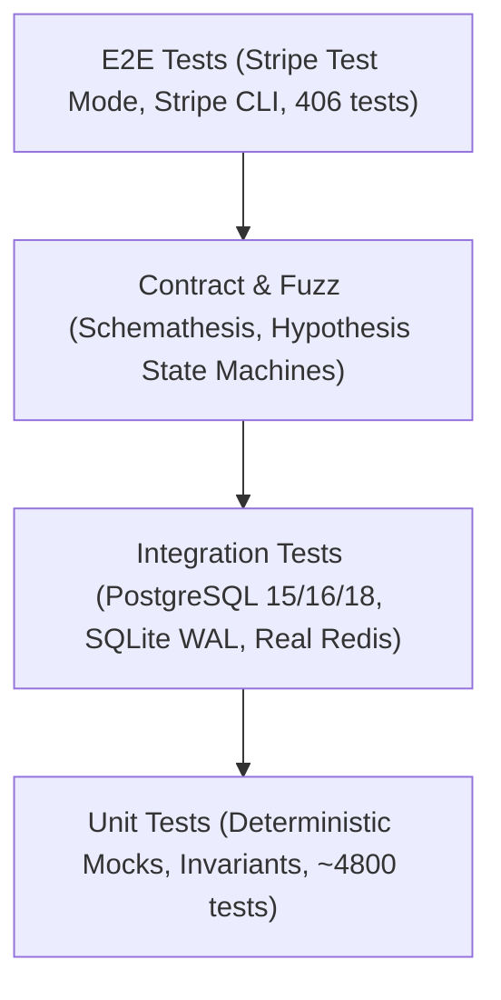
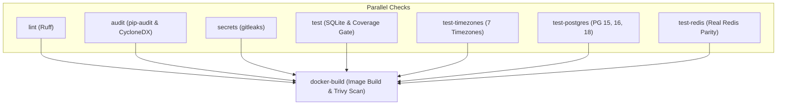

# Testing Strategy and Test Suite

Software that processes money cannot rely on good intentions or manual smoke testing. The testing strategy follows a rigorous pyramid: thousands of deterministic unit tests at the base, real database and service integration in the middle, property and contract fuzzing to explore edge cases, and mutation testing to prove that the tests actually catch bugs.

## Test Pyramid



1. **Unit Tests:** Fast, isolated tests covering models, services, schema serialization, and money calculations. All external I/O (Stripe, Redis, SMTP) is mocked deterministically.
2. **Integration Tests:** Executed across SQLite (local development) and PostgreSQL 15, 16, and 18 (CI). Tests verify row locking in payment paths, database CHECK constraints, lower(email) unique indexes, and Alembic migrations.
3. **Property and State-Machine Tests:** Hypothesis generates pseudo-random inputs to find boundary bugs. Stateful tests (`PaymentChain`) exercise arbitrary sequences of orders, payments, cancellations, and refunds. One property test discovered that normalizing the German letter "ß" expands "0ß" into two characters ("0SS"), quietly invalidating ISO country code length invariants.
4. **Contract and Fuzz Testing:** Schemathesis validates all API endpoints against the OpenAPI specification. It uncovered unhandled 500 errors on NUL bytes (`\x00`) and lone surrogates, prompting global input sanitization.
5. **E2E Tests (Stripe Test Mode):** Black-box tests driven against real Stripe test-mode endpoints (`api.stripe.com`) with webhook forwarding via the Stripe CLI.
6. **Mutation Testing:** Automated fault injection with `mutmut 3.8.0` across all financial and security modules ensures assertions fail when logic is altered.

## Continuous Integration Pipeline

GitHub Actions runs 16 jobs across multiple platforms, timezones, and database engines.



- **lint:** Runs Ruff across `app` and `tests`.
- **audit:** Exports locked dependencies to check against the PyPI Advisory Database using `pip-audit`, producing a CycloneDX SBOM.
- **secrets:** Scans git history for exposed credentials using `gitleaks`.
- **test:** Executes the primary suite in parallel on SQLite, runs timing-sensitive tests sequentially, and enforces coverage gates.
- **test-timezones:** Matrix testing payment and order logic across 7 timezones (including UTC, Pacific/Kiritimati, Pacific/Pago_Pago, Asia/Kathmandu, America/St_Johns, Europe/Bratislava, America/New_York).
- **test-postgres:** Tests database-sensitive suites against PostgreSQL 15, 16, and 18 containers.
- **test-redis:** Tests Redis Lua scripts, token revocation, and concurrency on a real Redis 7 container.
- **docker-build:** Builds the production container image and runs Trivy vulnerability scanning across the app and compose images.

## Test Markers and Isolation

Configuration in `pyproject.toml` and `tests/conftest.py` ensures hermetic, reproducible execution:

- `timing_sensitive`: Tests asserting elapsed wall-clock time or event-loop latency. Deselected during parallel runs (`-m "not timing_sensitive"`) to prevent CPU contention flakes, then executed sequentially.
- `db_sensitive`: Tests dependent on PostgreSQL features (row locks, constraints, migrations). Selected automatically by filename pattern in `tests/conftest.py`.
- `real_redis`: Tests executed against a live Redis instance when `REAL_REDIS_URL` is set.

### Conftest Hermetic Behaviour

- **Redis:** `fakeredis` backs `RedisService` and async clients on a shared `FakeServer`. `REDIS_PORT=1` is set in the test environment so unmocked network calls fail immediately.
- **Payments and Email:** `PAYMENT_PROVIDER=mock` and `EMAIL_PROVIDER=logging` prevent external network traffic.
- **Password Hashing:** `BCRYPT_ROUNDS=4` minimizes CPU time during mass user creation.
- **Database Isolation:** For SQLite, each worker uses a dedicated file database in WAL mode (`PRAGMA journal_mode=WAL`, `synchronous=OFF`). For PostgreSQL, each test session creates a unique database (`ecom_pgtests_<uuid>`), runs `alembic upgrade head`, and drops the database on exit.
- **Table Cleanup:** An engine hook (`Engine.before_cursor_execute`) tracks dirty tables during each test. The autouse fixture `_reset_database` issues fast SQL deletes and sequence resets only for modified tables before each test.

## Execution Commands

### Fast Local Execution
Run the full test suite in parallel using pytest-xdist, followed by timing tests:
```bash
uv run pytest tests/ -q -n 2 --dist worksteal -m "not timing_sensitive"
uv run pytest tests/ -q -m timing_sensitive
```

### PostgreSQL Integration Suite
Execute tests against a live PostgreSQL server (requires `CREATEDB` privilege):
```bash
TEST_DATABASE_URL=postgresql+psycopg://ci:ci@localhost:5432/ci uv run pytest tests/ -m "not timing_sensitive" -q -n 2 --dist worksteal
TEST_DATABASE_URL=postgresql+psycopg://ci:ci@localhost:5432/ci uv run pytest tests/ -m "db_sensitive and timing_sensitive" -q
```

### Real Redis Parity Suite
Validate Redis Lua scripts, token TTLs, and concurrency against a real server:
```bash
REAL_REDIS_URL=redis://localhost:6379/0 uv run pytest tests/ -m real_redis -q
```

### Live Stripe Integration Tests
Live tests make real network calls to `api.stripe.com` in Stripe test mode. They are skipped unless the `STRIPE_SECRET_KEY` environment variable contains a valid test key (not a placeholder) or `.env.test` is provided:
```bash
STRIPE_SECRET_KEY=<your Stripe test secret key> uv run pytest tests/integration/test_payment_live_stripe.py tests/integration/test_checkout_session_live_stripe.py tests/integration/test_payment_live_journey.py tests/integration/test_reconciliation_live_stripe.py
```

### Hypothesis Profiles
Select property testing budgets using `HYPOTHESIS_PROFILE`:
- `dev`: 100 examples, 200 ms deadline (default).
- `ci`: 200 examples, derandomized, deadlines disabled, `print_blob=True`.
- `explore`: 200 examples with randomized seeds to uncover novel failure modes:
```bash
HYPOTHESIS_PROFILE=explore uv run pytest tests/integration/test_payment_state_machine.py
```

### OpenAPI Contract Snapshot
Prevent accidental API contract drift against `tests/snapshots/openapi.json`:
```bash
# Verify schema matches snapshot:
uv run pytest tests/unit/test_openapi_snapshot.py

# Update snapshot after intended schema changes:
UPDATE_OPENAPI_SNAPSHOT=1 uv run pytest tests/unit/test_openapi_snapshot.py
```

### Coverage and Payment Layer Gate
CI enforces an overall 85% coverage gate and a strict 100% line and branch gate on the financial core:
```bash
# Measure combined coverage:
uv run pytest tests/ -q -n auto --dist worksteal -m "not timing_sensitive" --cov=app --cov-report= --cov-fail-under=0
uv run pytest tests/ -q -m timing_sensitive --cov=app --cov-append --cov-report=term-missing --cov-report=xml

# Enforce 100% payment layer gate:
uv run coverage report --fail-under=100 \
  --include="app/api/v1/orders.py,app/services/orders.py,app/services/payment/*.py,app/schemas/order.py,app/models/order.py,app/models/order_items.py,app/models/payment.py,app/models/payment_ledger.py,app/tasks.py,app/services/email/messages.py,app/services/stripe_events.py,app/services/reconciliation.py,app/models/payment_discrepancy.py,app/schemas/webhook_event.py"
```

## Verified Metrics for Release v4.0.3

Verification results on release v4.0.3:

| Metric | Measured Value | Standard / Target |
|---|---|---|
| SQLite Test Suite | 5,214 passed | 0 failures, 0 warnings |
| PostgreSQL Test Suite | 5,259 passed (+ 21 timing) | Full migration and constraint parity |
| Live Stripe Test Suite | 406 passed | api.stripe.com sandbox |
| Payment Layer Coverage | 100.0% line and branch | Zero uncovered branches in financial path |
| Overall Branch Coverage | 98.9% (source: `app`) | Fail-under gate set to 85% |
| Mutation Score (mutmut 3.8.0) | 98.4% (3,113 killed / 3,165) | 100% of 52 survivors proven equivalent |
| CI Execution Time | ~5 minutes across 16 jobs | Fully automated GitHub Actions workflow |

## Campaign Reports

Detailed test methodologies, logs, and remediation records live in the reports directory:
- [Final Test Campaign Overview](reports/final-test-campaign.md): Exit criteria, process, and results.
- [Stage T1: Supply Chain & Static Security](reports/T1-supply-chain.md): Trivy, gitleaks, pip-audit.
- [Stage T2: Test Polygon Environment](reports/T2-test-environment.md): Staging setup and core isolation.
- [Stage T3: Contract and Fuzz Testing](reports/T3-schemathesis.md): Schemathesis contract validation.
- [Stage T4: End-to-End Black-Box Verification](reports/T4-e2e.md): Stripe CLI and webhook flows.
- [Stage T5: Migrations and Disaster Recovery](reports/T5-migrations-backup.md): Schema diffs and backup restore.
- [Stage T6: Dynamic Security Testing](reports/T6-dast-owasp.md): OWASP ZAP and vulnerability remediation.
- [Stage T7: Load and Soak Testing](reports/T7-load.md): Locust load benchmarks and resource trends.
- [Stage T8: Chaos and Resilience](reports/T8-chaos.md): Fault injection and autonomous recovery.
- [Stage T9: Live Server Verification](reports/T9-live-server.md): Shared VPS deployment over SSH tunnel.
- [Stage T10: Mutation Testing](reports/T10-mutation.md): Fault injection with mutmut 3.8.0.
- [Daylight Saving Time Verification](reports/daylight-saving-time.md): Clock shift simulations across timezones.
- [Remediated Defects (fixes-4.0.x)](reports/fixes-4.0.x.md): Root cause analysis and commits for fixes X1 to X10.

See also: [PERFORMANCE.md](PERFORMANCE.md), [RESILIENCE.md](RESILIENCE.md), [ARCHITECTURE.md](ARCHITECTURE.md), [API.md](API.md).
