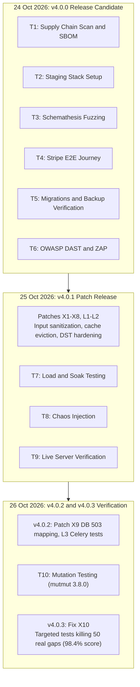

# Final Test Campaign: Release v4.0.0 to v4.0.3

This report documents the final testing campaign conducted from 24 to 26 October 2026 for the FastAPI e-commerce backend. The campaign began against release candidate v4.0.0. Identified defects were remediated across patch releases v4.0.1 and v4.0.2, followed by v4.0.3 which added test cases for mutation coverage gaps without changing application code. The current stable release is **v4.0.3** (commit `76e10e3`), with all 16 CI jobs passing, 0 Dependabot alerts, and 0 CodeQL alerts.

All seven exit criteria groups were met. The long-duration soak test met its stability target with a caveat regarding allocator warm-up, and all findings were resolved and released.

## Campaign Plan and Strategic Foundation

The test campaign was structured based on targeted research into industry testing standards and library documentation:
- **Test Pyramid:** In line with Martin Fowler's "The Practical Test Pyramid", the repository relies on a large foundation of unit and service tests (~4800 tests, 98.9% branch coverage), complemented by contract tests via Schemathesis and a focused black-box end-to-end suite.
- **Load Profiles:** Load tests followed k6 performance archetypes (smoke, average, stress, spike, breakpoint, and soak).
- **Chaos Engineering:** Resilience experiments adhered to Principles of Chaos Engineering (steady-state hypothesis, blast radius containment) and Google SRE overload handling practices.
- **Security:** Static and dynamic analysis followed OWASP API Security Top 10 2023, OWASP ZAP API scanning, Trivy image scanning, gitleaks, and pip-audit.
- **Data Integrity:** Database migration testing and disaster recovery drills followed PostgreSQL 18 guidance (verifying restore fidelity and row counts).
- **Payment Verification:** Webhook processing, retry mechanics, and edge cases were tested with real Stripe test mode and the Stripe CLI.

## Campaign Timeline and Milestone Progression

## Exit Criteria and Verification Results

The exit criteria were defined prior to testing in the pre-test plan. The table below lists each criterion and the final outcome after orchestrator review.

| # | Criterion | Stage | Outcome |
|---|---|---|---|
| 1 | Schemathesis: zero 5xx responses, all responses conform to OpenAPI schema | T3 | PASS after fixes. Initial run failed due to NUL byte and lone surrogate 500 errors. Fixed in v4.0.1 (X4). Schema aligned with business rules. Known lax types deferred to 5.0. |
| 1 | End-to-end black-box tests with real Stripe test mode and webhooks via Stripe CLI | T4 | PASS. Two consecutive runs: 20 passed, 0 failed, 209 webhooks processed by Celery, zero reconciliation discrepancies. Found 2 bugs (stale cache, unpaid order delivery), fixed in v4.0.1 (X5). |
| 2 | Database migrations up/down/up, backup and restore data match exactly | T5 | PASS. Schema diff empty, row counts and MD5 hashes match across all 13 tables, application verified healthy on restored database. |
| 3 | Average load: p95 latency within 25% of 3.x baseline, zero 5xx responses | T7 | PASS. p95 was 68 ms via TLS and 57 ms direct (compared to 66/69 ms in 3.x baseline). Zero 5xx errors. |
| 3 | Overload protection: rapid 503 with Retry-After, no hangs or 500/502 errors | T7 | PASS. Spike (800 users), stress600, and breakpoint shed excess load with fast 503 `service-overloaded` responses carrying Retry-After; zero 500 or 502 errors. |
| 3 | 1-hour soak test: memory and database connections reach a stable plateau | T7 | PASS with caveat. DB connections remained constant at 43. Celery worker RSS was flat. API process RSS rose 6.4 MiB (+1%) over the final 40 minutes with a decelerating trend (allocator warm-up). |
| 4 | Chaos and fault recovery: 503 with Retry-After during outages, auto-recovery, zero lost webhooks | T8 | PASS after fixes. Initial run failed because stopped PostgreSQL returned 500 instead of 503. Fixed in v4.0.2 (X9). Worker killed mid-burst: 50/50 events processed, zero duplicate payments. |
| 5 | Security: ZAP 0 unexplained High/Medium; Trivy 0 fixable CRITICAL/HIGH; pip-audit 0; gitleaks 0 | T1, T6 | PASS after fixes. System pip removed from image, Redis repinned, gosu findings proven unreachable via govulncheck. ZAP alerts justified. Product creation bug fixed in v4.0.1 (X7). |
| 6 | Mutation testing: surviving mutants killed or proven equivalent | T10 | PASS after tests. 3165 mutants generated. Score on v4.0.2 was 96.8% (102 survivors: 52 equivalent, 50 real gaps). All 50 gaps killed by tests in v4.0.3; final score 98.4%. |
| 7 | Live server test: smoke, E2E, load pass without impacting neighbouring services | T9 | PASS. Deployed in isolated containers on a shared VPS. Smoke 22/22, E2E 10 passed, load clean, minimum available RAM 1691 MB. Neighbouring services unimpacted. |

## Process, Agent Roles, and Review Corrections

The campaign was conducted with autonomous specialized agents coordinated by an orchestrator:
- **Agent roles:** Code analysis, test script creation, execution, and initial triage were performed by automated agents.
- **Independent review:** The orchestrator reviewed commit histories, verified primary sources, and cross-checked raw execution data against defined criteria.

Two material corrections were made by the orchestrator during review where agent conclusions diverged from the established criteria:
1. **T8 Experiment E3 (PostgreSQL stopped):** The executing agent scored this experiment as PASS because the database connection pool self-healed after the database restarted. The orchestrator corrected the verdict to **FAIL**. The pre-agreed exit criterion explicitly required that all requests during an outage receive 503 with `Retry-After`. In E3, 56% of requests returned 500 Internal Server Error without `Retry-After`. This finding was addressed in v4.0.2 via fix X9.
2. **T7 Soak Test Memory Evaluation:** The executing agent reported an unqualified "plateau" for API memory. The orchestrator recalculated the process RSS across 20-minute windows (607.7 -> 612.1 -> 614.1 MiB, an increase of 6.4 MiB or ~1% over 40 minutes). While the growth decelerated and consistent with Python memory allocator warm-up, the orchestrator recorded the verdict as **PASS with caveat**, noting that a longer soak (4 to 6 hours) is required to establish a permanent plateau.

In addition, an initial regression in the orchestrator's verification script ran timing-sensitive tests on PostgreSQL in parallel (`-n 2`), causing transient noise failures (pauses of 0.87 s and 0.97 s vs the 1.0 s threshold). When executed sequentially as intended, all 21 timing tests passed cleanly (21/21).

## Final Verification Numbers at v4.0.3

Final verification on release v4.0.3 confirms:
- **Automated Test Suite:**
  - SQLite: 5214 passed
  - PostgreSQL: 5259 passed, plus 21 timing tests passed sequentially
  - Live Stripe test mode: 406 passed
  - Payment layer test gate: 100% line and branch coverage
  - Overall code coverage: 98.8%
  - Test warnings: 0
- **Mutation Score:** 98.4% (3113 of 3165 mutants killed; all 52 surviving mutants verified equivalent).
- **Continuous Integration:** 16 workflow jobs passing in ~5 minutes (linting, test suite across Python 3.13, 7 timezones, PostgreSQL 15, 16, and 18, live Redis, pip-audit, gitleaks, Docker build, and Trivy container scan).
- **Performance (4 CPU, 200 users, ~41 rps):** Median latency p50 11 to 24 ms, p95 57 to 68 ms. Throughput knee at 85 to 100 rps (450 to 500 users).
- **Chaos Recovery:** Self-healing time for `/readyz` is 1 to 26 s after Redis recovery, and 1 to 8 s after PostgreSQL recovery, without API restart.
- **Live Server (shared VPS, SSH tunnel):** p95 latency 135 to 148 ms with ~49 ms median round-trip network time.

## Stage Reports and Fix Documentation

Detailed documentation for each stage of the campaign:
- [T1: Supply Chain and Static Security](T1-supply-chain.md)
- [T2: Test Polygon and Staging Environment](T2-test-environment.md)
- [T3: Contract and Fuzz Testing (Schemathesis)](T3-schemathesis.md)
- [T4: End-to-End Black-Box Verification](T4-e2e.md)
- [T5: Migrations and Disaster Recovery](T5-migrations-backup.md)
- [T6: Dynamic Security Testing (DAST & OWASP Top 10)](T6-dast-owasp.md)
- [T7: Load, Stress, and Soak Testing](T7-load.md)
- [T8: Chaos and Resilience Testing](T8-chaos.md)
- [T9: Live Server Verification](T9-live-server.md)
- [T10: Mutation Testing](T10-mutation.md)
- [Daylight Saving Time Verification](daylight-saving-time.md)
- [Testing Practice Research](research.md)
- [Remediated Defects across Releases 4.0.x](fixes-4.0.x.md)

---

See also: [fixes-4.0.x.md](fixes-4.0.x.md), [README.md](README.md), [../TESTING.md](../TESTING.md), [../RESILIENCE.md](../RESILIENCE.md).
