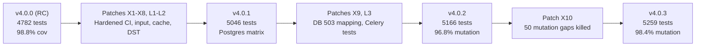

# Remediation Packages and Test Hardening: Releases v4.0.1 to v4.0.3

This report provides the complete engineering record of every bug fix and test hardening package implemented during the final testing campaign across patch releases v4.0.1, v4.0.2, and v4.0.3. Each entry documents the discovering stage, root cause analysis, modified files, test methodology (verifying red before green), cited standards, and corresponding git commit identifiers.

## Overview of Remediation Packages

| Package | Category | Primary Concern | Discovered In | Release | Key Commits |
|---|---|---|---|---|---|
| **X1** | Supply Chain & Build | Runtime image minimization, pip removal, and gitleaks secret scanning | Stage T1 | 4.0.1 | `86bf331`, `588acbb`, `359a56c` |
| **L1** | Test Hygiene | Deterministic CI profiles, OpenAPI diff snapshots, and model round-trips | Stage L1 | 4.0.1 | `3d961bd`, `589eb74`, `387f7e2`, `cf1b9a1`, `da181d1`, `3235436`, `1cd7f44`, `42d8c0b` |
| **L2** | Real Service Parity | PostgreSQL 15/16/18 CI matrix, real Redis parity, and connection pool recovery | Stage L2 | 4.0.1 | `666fc99`, `47ac349`, `7eb114d`, `f98e3d8`, `423d76d`, `5feb0b7`, `65bd21d`, `757b934` |
| **X2** | Resilience & Auth | Returning 503 instead of 401 when Redis is unavailable during token checks | Stage L2 | 4.0.1 | `3558db3` |
| **X3** | Input & State | Unicode normalization case-folding, probe route cleanup, and atomic token rotation | Stage L1/L2 | 4.0.1 | `41be915`, `5c3a8b6`, `8ad4af8`, `bf0c59b` |
| **X4** | Robustness & Schema | Rejecting NUL/surrogates as 422, OpenAPI schema accuracy, and 405 Allow headers | Stage T3 | 4.0.1 | `b323430`, `55daed6`, `e1d9483`, `7aa419f`, `9c2287e` |
| **X5** | Business Logic | Product cache invalidation on stock change, and blocking shipment of unpaid orders | Stage T4 | 4.0.1 | `34fbf52`, `ec7e98c` |
| **X6** | Time & Invariants | Daylight saving time verification, UTC email dates, and tolerant database reads | Stage DST / T6 | 4.0.1 | `acc6e6d`, `c112037`, `83d80cd` |
| **X7** | Data Validation | Requiring product images on creation, flush before commit, and mandatory token jti | Stage T6 | 4.0.1 | `3eef892`, `ab1ace9` |
| **X8** | Vulnerability Analysis | Redis 7.4.11 security exception repin, govulncheck proof for gosu, and Trivy gate | Stage T1 | 4.0.1 | `4a0a595`, `209000c`, `9e96d28` |
| **L3** | Worker & Auth Tests | Embedded Celery testing, Stripe rate limits, beat schedule check, and JWT algorithm allowlist | Stage L3 | 4.0.2 | `c0c7944`, `acdb220`, `1fdedd7`, `fc71030`, `3ca5bca`, `9525e21`, `8157da7` |
| **X9** | Chaos Remediation | Mapping unreachable database errors to 503 with Retry-After and compact broker logs | Stage T8 | 4.0.2 | `0ff2a05`, `5e93477` |
| **X10** | Mutation Testing | Adding targeted test cases to eliminate 50 surviving mutation gaps (mutmut 3.8.0) | Stage T10 | 4.0.3 | `0fffe4c`, `f22e4ec`, `ba6346a`, `3de64ae`, `b225d5d`, `5812b0e` |

---

## Detailed Records: Release 4.0.1

### X1: Image Supply Chain Hardening and Secret Scanning
- **Finding (Stage T1):** Trivy container analysis identified 1 CRITICAL and 4 HIGH vulnerabilities in the application image, caused by bundled packages (certifi, urllib3, setuptools) inside the Python base image system pip installation. Furthermore, `COPY . .` copied test suites, documentation, and compose manifests into the runtime container, and gitleaks scanning was absent from CI.
- **Root cause:** The base `python:3.13-slim` image pre-installs pip, even though the application runs purely through virtual environment packages installed by `uv`.
- **Change:**
  - `Dockerfile`: Added `python -m pip uninstall -y pip` in the runtime stage; limited `COPY` to `app/`, `migrations/`, `main.py`, `alembic.ini`, and `pyproject.toml`; added explicit `EXPOSE 8000`.
  - `.gitleaks.toml`: Configured base detection with explicit allowlists for synthetic test keys and CI mocks.
  - `.github/workflows/ci.yml`: Added automated `secrets` workflow job scanning all commits.
- **Tests (Red then Green):** Pre-change Trivy reported 1 CRITICAL and 4 HIGH alerts. Post-change scan verified 0 fixable CRITICAL/HIGH. Gitleaks scanned 384 git commits, reporting 0 real leaks.
- **Standards:** OWASP Container Security Top 10, NIST SP 800-190.
- **Release:** 4.0.1
- **Commits:** `86bf331`, `588acbb`, `359a56c`

### L1: Test Suite Hygiene and Property Profiles
- **Finding (Stage L1):** Test executions showed non-deterministic run times in CI due to unconstrained Hypothesis iteration budgets. Shrunk property failure cases were not captured as deterministic regression tests.
- **Root cause:** Hypothesis settings were shared across development and CI without explicit deterministic profiles.
- **Change:**
  - `tests/conftest.py`: Defined `dev` (default), `ci` (200 deterministic iterations, disabled deadlines, `print_blob`), and `explore` (random seed exploration) profiles.
  - `tests/integration/test_payment_state_machine.py`: Added explicit regression test replaying shrunk seed 6 from v4.0.0 (3 orders, cancellations, pay, and refund exceeding remaining balance). Documented why `PaymentChain` requires no teardown.
  - `tests/snapshots/openapi.json`: Added OpenAPI snapshot test that outputs structured diffs upon contract drift.
  - `tests/unit/test_response_round_trip.py`: Added round-trip serialization tests for all 31 response schemas.
  - `tests/integration/test_async_client.py`: Added 3 tests validating runtime execution over `httpx2.AsyncClient` with `ASGITransport` on anyio.
  - `tests/unit/test_overload.py`: Added ASGI-level tests verifying in-flight limiter slot return upon client cancellation.
- **Tests (Red then Green):** Seed 6 regression failed on pre-fix commit and passed on 4.0.1. Random ordering via `pytest-randomly` across seeds 101, 20260, and 777777 verified 4825 passed tests with zero ordering dependencies.
- **Standards:** Hypothesis Testing Guidelines, Starlette ASGI specifications.
- **Release:** 4.0.1
- **Commits:** `3d961bd`, `589eb74`, `387f7e2`, `cf1b9a1`, `da181d1`, `3235436`, `1cd7f44`, `42d8c0b`

### L2: Real Service Parity and Database Resilience
- **Finding (Stage L2 & Stage T1):** Integration tests were run against SQLite and fakeredis. In addition, `alembic upgrade head --sql` failed on migration `3f6c2a9d1b7e` because offline execution attempted live database queries.
- **Root cause:** Absence of automated CI jobs testing genuine PostgreSQL instances and live Redis servers. Data migrations lacked offline SQL branch handling.
- **Change:**
  - `.github/workflows/ci.yml`: Added parallel CI matrix for PostgreSQL 15, 16.14, and 18.4, plus a standalone `test-redis` job.
  - `tests/integration/test_real_redis_parity.py`: Added 28 dual-mode tests (56 scenarios) for Lua rate limiting, token revocation, WATCH transactions, and TTLs against fakeredis and real Redis.
  - `tests/integration/test_redis_hung_server.py`: Added socket timeout tests verifying fail-closed behavior on silent Redis instances.
  - `tests/integration/test_postgres_pool_recovery.py` and `tests/integration/test_postgres_statement_timeout.py`: Added pool recovery assertions using `pool_pre_ping` following `pg_terminate_backend`, and verified `statement_timeout` query cancellation.
  - `migrations/versions/2026_10_20_1200-3f6c2a9d1b7e_unique_index_on_lower_email.py` and `2026_10_24_1000-c5e2a8f4b196_constraint_naming_convention.py`: Wrapped offline SQL data transformations in anonymous `DO $$ ... $$` blocks (verified via `tests/unit/test_migrations_offline.py` and `tests/integration/test_postgres_data_migrations.py`).
  - `tests/integration/test_query_counts.py`: Added query count assertions across 6 list endpoints to prevent N+1 query regressions.
- **Tests (Red then Green):** `alembic upgrade head --sql` initially exited with errors, then generated the full migration chain cleanly. List endpoints executed identical statement counts (<= 12 queries) for 1 and 20 items.
- **Standards:** PostgreSQL 18 Documentation, SQLAlchemy 2.0 Connection Pooling, Alembic Offline Scripting.
- **Release:** 4.0.1
- **Commits:** `666fc99`, `47ac349`, `7eb114d`, `f98e3d8`, `423d76d`, `5feb0b7`, `65bd21d`, `757b934`

### X2: Fail-Closed Redis Outage Semantics on Token Checks
- **Finding (Stage L2):** When Redis was unreachable or timed out, authenticated requests bearing valid JWT access tokens returned 401 Unauthorized, falsely logging out users.
- **Root cause:** `app/core/security.py` treated any Redis communication failure during token blacklist checking as confirmation of token revocation.
- **Change:**
  - `app/core/security.py` and `app/core/dependencies.py`: Updated exception handling so that Redis connectivity errors return 503 Service Unavailable, `Retry-After: 30`, problem media type `application/problem+json`, and detail "Token verification is temporarily unavailable".
  - `app/api/v1/cart.py`: Authenticated callers encountering Redis failures receive 503 rather than silent downgrade to a guest cart.
  - `app/api/v1/users.py`: Token refresh failures caused by Redis outages return 503 without revoking the existing refresh token family.
- **Tests (Red then Green):** Pre-fix tests returned 401 on Redis connection errors; post-fix tests verified 503 with `Retry-After: 30` across protected routes, while genuinely revoked tokens continue to receive 401.
- **Standards:** RFC 9110 §15.5.2 (401 Unauthorized) and §15.6.4 (503 Service Unavailable), RFC 6750 §3.1.
- **Release:** 4.0.1
- **Commit:** `3558db3`

### X3: Normalization Case-Folding, State Isolation, and Atomic Rotation
- **Finding (Stage L1/L2 Property Testing):** Property-based fuzzing identified that storing an address with country `"0ß"` produced `"0SS"` in the database, which subsequent reads formatted as `"0Ss"`. In addition, dynamic OpenAPI probe routes leaked into subsequent tests, and a Redis failure during login handed out unrevokable refresh tokens.
- **Root cause:** Python's `"ß".upper()` evaluates to `"SS"` (length expands from 1 to 2 characters). Re-evaluating a 3-character string triggered title-case conversion. FastAPI only resets OpenAPI cache when routes are added, not when removed. In token refresh, the old token was revoked prior to storing the new token.
- **Change:**
  - `app/schemas/address.py`: Unified country normalization; if `upper()` expands beyond 2 characters, title-case logic is applied immediately.
  - `tests/conftest.py`: Introduced `probe_routes()` fixture to restore route state and clear cached OpenAPI documents.
  - `app/api/v1/users.py`: Reversed rotation ordering: the new refresh token is saved to Redis before invalidating the old token; on failure, the user receives 503 and retains their old token.
  - `app/services/redis_async.py`: Removed dead code `AsyncRedisService.is_blacklisted`.
- **Tests (Red then Green):** Added explicit `@example("0ß")` and `@example("ß1")` property checks. Added sequence tests proving isolation between dynamic routes and OpenAPI snapshots. Verified failure handling during token rotation.
- **Standards:** Unicode Standard Annex #44 (Case Folding), RFC 6749.
- **Release:** 4.0.1
- **Commits:** `41be915`, `5c3a8b6`, `8ad4af8`, `bf0c59b`

### X4: String Input Sanitization and OpenAPI Contract Alignment
- **Finding (Stage T3 Schemathesis):** Contract fuzzing with Schemathesis revealed that string inputs containing NUL bytes (`\x00`) or unpaired surrogates caused unhandled 500 Internal Server Errors. Additionally, 405 Method Not Allowed responses failed to advertise all available HTTP methods in the `Allow` header.
- **Root cause:** PostgreSQL text columns reject NUL bytes, and UTF-8 string encoding fails on lone surrogates. In `app/main.py`, the 405 handler inspected only the first route matching a URL path.
- **Change:**
  - `app/schemas/common.py`: Added `RequestBody` base model with recursive validation checking all strings, dictionary keys, and nested collections for NUL characters and lone surrogates.
  - `app/core/text_input.py`: Added `reject_unusable_text` dependency to sanitize query parameters, path variables, and form inputs.
  - `app/core/security.py`: Caught `UnicodeError` during token decoding to return 401 `invalid_token`.
  - `app/main.py`: Updated 405 exception handler to iterate over all routes matching the requested path and aggregate all unique HTTP methods into the `Allow` header.
  - `app/schemas/*.py`: Updated OpenAPI schema definitions for update models, `images` minItems, phone patterns, and decimal strings.
- **Tests (Red then Green):** Pre-fix fuzzing generated 500 responses; post-fix fuzzing verified 422 `validation-error` with redacted error structures. Automated tests verified `Allow` headers across all paths declared in OpenAPI.
- **Standards:** RFC 9110 §15.5.6 (405 Method Not Allowed and Allow header), RFC 9457 Problem Details.
- **Release:** 4.0.1
- **Commits:** `b323430`, `55daed6`, `e1d9483`, `7aa419f`, `9c2287e`

### X5: Cache Invalidation on Stock Mutation & Unpaid Order Transition Guards
- **Finding (Stage T4 E2E):** The product detail cache served stale inventory counts for up to one hour following orders or cancellations. Additionally, administrative users could advance unpaid orders to `confirmed`, `processing`, `sent`, or `delivered`.
- **Root cause:** Cached product details were not invalidated during stock modification workflows. Order status transitions did not enforce `payment_status == PaymentStatus.PAID`.
- **Change:**
  - `app/services/redis.py` and `app/api/v1/orders.py`: Lowered product detail cache TTL from 1 hour to 5 minutes (`PRODUCT_CACHE_TTL = 300`). Hooked post-commit cache invalidation into order placement, cancellations, and Celery `expire_unpaid_orders`.
  - `app/services/orders.py`: Added explicit payment check: advancing an order to `confirmed`, `processing`, `sent`, or `delivered` requires `order.payment_status == PaymentStatus.PAID`. Non-paid orders receive 409 Conflict with detail "Order is not paid: it cannot be confirmed, processed, sent or delivered".
- **Tests (Red then Green):** 10 cache tests verified cache eviction, ETag regeneration, and response consistency across order creation, admin cancellation, customer cancellation, and background expiration. Verified 12 prohibited status transitions across unpaid, pending, and refunded orders.
- **Standards:** RFC 9110 §15.5.10 (409 Conflict), RFC 9111 HTTP Caching.
- **Release:** 4.0.1
- **Commits:** `34fbf52`, `ec7e98c`

### X6: Daylight Saving Time Invariants and Tolerant Read Schemas
- **Finding (Stage DST-check & Stage T6):** Order emails printed timestamps without UTC timezone identifiers. In addition, existing database rows containing short strings crashed read operations with 500 errors because response schemas reused input validation rules.
- **Root cause:** Pydantic response models enforced client-input constraints (min lengths, regex patterns). Database rows populated by earlier releases caused validation failures on GET requests.
- **Change:**
  - `app/schemas/*.py`: Moved input formatting constraints (min length, regex patterns) to request models only; response models enforce only domain constraints (such as non-negative stock and price).
  - `app/api/v1/admin.py`: Category and variant responses are constructed and validated before the database transaction commits.
  - `app/services/email/messages.py`: Order dates are explicitly formatted as `YYYY-MM-DD HH:MM:SS UTC`.
  - `tests/integration/test_dst_clock.py`, `tests/unit/test_dst_beat_schedule.py`, and `tests/unit/test_dst_zones.py`: Added comprehensive DST transition tests covering Celery crontab execution, datetime filters with offsets, and timezone matrix runs.
- **Tests (Red then Green):** Directly inserted database rows breaking input length rules; list and detail endpoints returned 200 OK across products, categories, variants, and users. Beat schedules verified to fire exactly once per 24-hour period across autumn and spring clock shifts.
- **Standards:** PEP 495 (Local Time Disambiguation), RFC 3339 (Date and Time on the Internet).
- **Release:** 4.0.1
- **Commits:** `acc6e6d`, `c112037`, `83d80cd`

### X7: Product Image Requirements and Mandatory JTI Validation
- **Finding (Stage T6 DAST):** Creating a product without images committed the row to PostgreSQL but crashed during response serialization with 500, corrupting catalog listings. Furthermore, access tokens without a `jti` claim were accepted.
- **Root cause:** Pydantic does not validate default values unless configured. An access token lacking a `jti` claim cannot be tracked or revoked in Redis.
- **Change:**
  - `app/schemas/product.py`: Set `images` as a required field with `min_length=1` on creation (`ProductCreate`), returning 422 if empty or missing.
  - `app/api/v1/admin.py`: Updated product creation and update operations to flush, build the response schema and ETag, and commit only after successful validation.
  - `app/core/security.py`: Rejected access tokens lacking the `jti` claim with 401 `invalid_token`. Existing database rows with empty images continue to read safely as `images: []`.
- **Tests (Red then Green):** Pre-fix product creation with `images: []` returned 500 and persisted orphaned rows; post-fix returns 422 without writing to the database. Tokens without `jti` verified to return 401.
- **Standards:** RFC 7519 §4.1.7 (JWT ID), RFC 8725 (JWT Best Current Practices).
- **Release:** 4.0.1
- **Commits:** `3eef892`, `ab1ace9`

### X8: Security Exception Repinning and Upstream Reachability Analysis
- **Finding (Stage T1):** The project maintains a strict rule requiring base image digests to be at least two weeks old. However, Trivy identified 2 HIGH vulnerabilities in `redis:7-alpine` (CVE-2026-84782 in libssl3) and 26 vulnerabilities in `postgres:15-alpine` (gosu compiled with Go 1.24.6).
- **Root cause:** Upstream image releases lagged behind patched dependencies.
- **Change:**
  - `docker-compose.yml`: Approved a security exception to repin Redis to `7.4.11` (digest `57e4255c...`).
  - `.trivyignore.yaml`: Extracted the `gosu` 1.19 binary from the PostgreSQL image and ran Go's official `govulncheck` v1.9.0 in binary mode. Proved that none of the 26 vulnerable functions in Go's standard library are invoked by `gosu`. Recorded all 26 CVE IDs with path bindings and justifications.
  - `.github/workflows/ci.yml`: Integrated automated Trivy scans across application, Redis, and PostgreSQL images using `--ignorefile .trivyignore.yaml` and `--exit-code 1`.
- **Tests (Red then Green):** Without `.trivyignore.yaml`, Trivy scan exited 1 on PostgreSQL; with the verified exception file, all container images exit 0.
- **Standards:** NIST SP 800-161 (Supply Chain Risk Management), OpenSSF Vulnerability Disclosure.
- **Release:** 4.0.1
- **Commits:** `4a0a595`, `209000c`, `9e96d28`

---

## Detailed Records: Release 4.0.2

### L3: Celery Embedded Worker, Stripe Error Mappings, and JWT Algorithm Restriction
- **Finding (Stage L3, from the library testing guides):** Celery tasks were tested by calling them directly, never through a real worker and broker (the Celery testing guide warns that `task_always_eager` is not a substitute, and the project did not use it either); `JWT_ALGORITHM` was an unconstrained string; the worker settings that protect against lost tasks were not pinned by any test.
- **Root cause:** Missing integration-level coverage, plus one unvalidated setting.
- **Change:**
  - `tests/integration/test_tasks_worker.py`: an embedded worker (`celery.contrib.testing.worker.start_worker`, in-memory broker `memory://`) runs `send_order_confirmation` and `process_stripe_event` against the test database.
  - `tests/unit/test_celery_config.py`: pins `task_acks_late=True` and `task_reject_on_worker_lost=True` (already configured in `app/tasks.py`) and proves the retry bound of Stripe event processing (`STRIPE_EVENT_MAX_RETRIES`, then status `failed`, which the sweeper ignores), so a poison event cannot loop forever.
  - `tests/integration/test_webhook_signature_sdk.py`: signature headers built with the Stripe SDK's own helper `stripe.WebhookSignature.generate_signature_header` (valid, tampered payload, stale timestamp, several `v1` signatures).
  - `tests/unit/test_stripe_rate_limit_mapping.py`: pins the existing mapping of `stripe.RateLimitError` to 503 with `Retry-After: 5` on pay, checkout session and refund.
  - `tests/unit/test_beat_schedule.py`: every `beat_schedule` entry names a registered task.
  - `app/core/config.py` (the one code change): `JWT_ALGORITHM` is `Literal["HS256", "HS384", "HS512"]`; anything else fails at startup.
  - `tests/integration/test_auth.py`: pins the OAuth2 password login `grant_type` behaviour (absent or `"password"` accepted, anything else 422).
- **Tests (Red then Green):** the `JWT_ALGORITHM` tests were red first (7 values accepted that must be refused) and green after the change; the other items pin behaviour that was already correct.
- **Standards:** RFC 6749 §4.3.2 (Password Credentials Grant), RFC 8725 §2.1 (Algorithm Allowlist), Stripe Webhook Security documentation.
- **Release:** 4.0.2
- **Commits:** `c0c7944`, `acdb220`, `1fdedd7`, `fc71030`, `3ca5bca`, `9525e21`, `8157da7`

### X9: Unreachable Database Error Mapping and Concise Broker Logging
- **Finding (Stage T8 Chaos E3 & E6):** When PostgreSQL was stopped, API routes returned 500 Internal Server Error without a `Retry-After` header. When the Redis broker was down, Stripe webhook processing logged an 80-line kombu connection traceback even though the webhook event was safely recorded in PostgreSQL for background retry.
- **Root cause:** `app/core/database.py` caught all `SQLAlchemyError` instances and converted them into generic 500 `HTTPException` responses without differentiating between connection outages and query syntax errors.
- **Change:**
  - `app/core/database.py` and `app/core/security_headers.py`: Database connectivity failures (detected via `sqlalchemy.exc.OperationalError`, `InterfaceError`, connection checkout `TimeoutError`, and `DBAPIError.connection_invalidated`) are caught and mapped to 503 Service Unavailable with `Retry-After: 5`, standard RFC 9457 problem details, and detail "The database is temporarily unavailable, please retry". Genuine application bugs (such as unhandled `IntegrityError` or `ProgrammingError`) remain 500 without details. Stripe webhook endpoints return 503 during database outages, signalling Stripe to retry delivery.
  - `app/services/stripe_events.py`: Broker connection failures during queueing log a single-line warning without a stack trace, noting that the sweeper task will re-queue the event.
- **Tests (Red then Green):** Mocked database operational errors, pool timeouts, and connection invalidations to verify 503 responses with `Retry-After: 5`. Tested closed PostgreSQL ports to confirm 503 responses on live engines. Verified caplog output confirms absence of tracebacks during broker outages.
- **Standards:** RFC 9110 §15.6.4 (503 Service Unavailable), RFC 9457 Problem Details.
- **Release:** 4.0.2
- **Commits:** `0ff2a05`, `5e93477`

---

## Detailed Records: Release 4.0.3

### X10: Targeted Tests for Mutation Coverage Gaps
- **Finding (Stage T10 Mutation Testing):** Running `mutmut` 3.8.0 against the payment layer, Stripe event handling, reconciliation, orders, idempotency, rate limiting, and error handling produced 3165 mutants. Release 4.0.2 killed 3063 mutants (96.8%). Analysis of the 102 survivors identified 52 equivalent mutants and 50 real testing gaps.
- **Root cause:** Existing tests asserted happy paths or generic error codes without checking specific error messages, boundary constants, or edge-case branches.
- **Change:** Added targeted test cases killing all 50 non-equivalent surviving mutants across six modules without modifying application code:
  - `tests/unit/test_idempotency.py`: Asserted exact response status, header preservation, and error payloads for concurrent key access.
  - `tests/unit/test_rate_limit.py`: Pinned rate limit key generation when tokens are unresolvable or lack Bearer formatting.
  - `tests/unit/test_errors.py`: Asserted 405 Method Not Allowed and 415 Unsupported Media Type problem detail properties.
  - `tests/unit/test_live_stripe_provider.py`: Tested rare Stripe refund listing failures, webhook tolerance boundaries, and specific card error codes.
  - `tests/unit/test_stripe_events.py`: Verified GDPR redaction rules for stored event payloads and edge-case status transitions.
  - `tests/integration/test_reconciliation.py` and `tests/unit/test_reconciliation_compare.py`: Pinned discrepancy counter math, paging limits, and batch size boundaries.
- **Tests (Red then Green):** Each new test was proven by running `mutmut run "<mutant_name>"` in an isolated environment, confirming transition from survived to killed. Mutation score increased from 96.8% (3063/3165) to 98.4% (3113/3165), with 100% of remaining survivors verified as equivalent.
- **Standards:** IEEE 1008-1987 (Standard for Software Unit Testing), Mutation Testing Best Practices.
- **Release:** 4.0.3
- **Commits:** `0fffe4c`, `f22e4ec`, `ba6346a`, `3de64ae`, `b225d5d`, `5812b0e`

---

## Test Suite Evolution Across Releases

| Metric | v4.0.0 | v4.0.1 | v4.0.2 | v4.0.3 |
|---|---|---|---|---|
| Automated Tests (SQLite) | 4,782 | 5,046 | 5,166 | 5,214 |
| Automated Tests (PostgreSQL) | 4,782 | 5,091 | 5,211 | 5,259 (+ 21 timing) |
| Live Stripe Test Mode Tests | 380 | 390 | 406 | 406 |
| Mutation Score (Core Modules) | Not measured | Not measured | 96.8% (3063/3165) | 98.4% (3113/3165) |
| Branch Coverage (Payment Layer) | 100% | 100% | 100% | 100% |
| Overall Branch Coverage | 98.8% | 98.8% | 98.8% | 98.9% |
| Active CI Workflow Jobs | 11 | 14 | 16 | 16 |

---

See also: [Final Test Campaign Overview](final-test-campaign.md), [Contract Testing with Schemathesis](T3-schemathesis.md), [Chaos and Fault Recovery](T8-chaos.md), [Mutation Testing Report](T10-mutation.md), [Daylight Saving Time Verification](daylight-saving-time.md).
