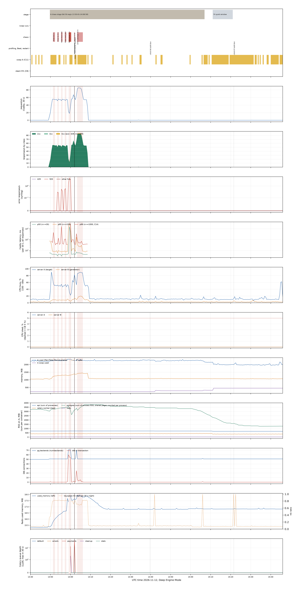
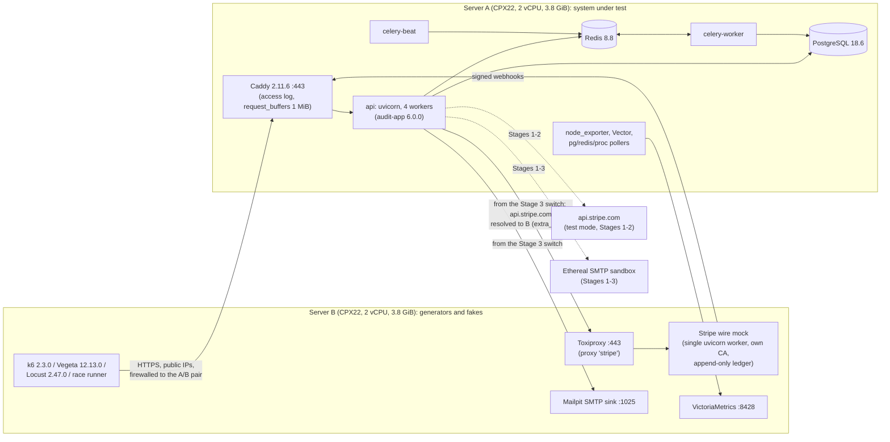
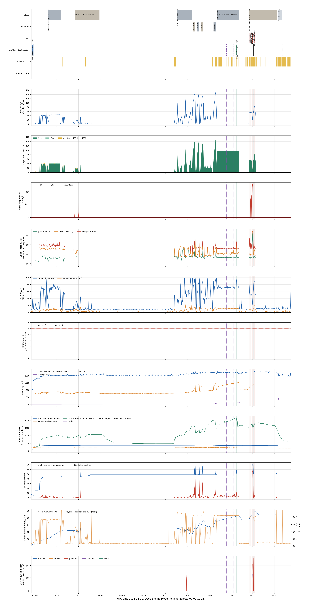
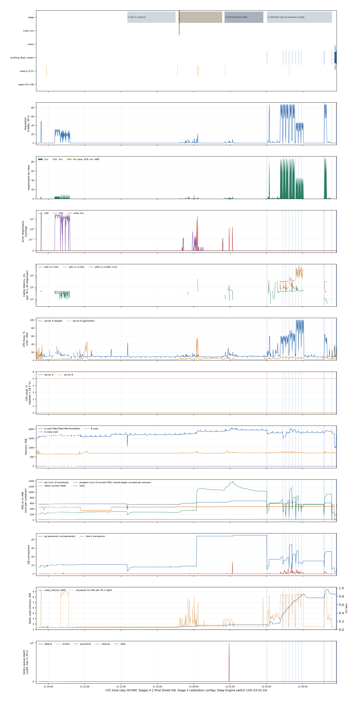
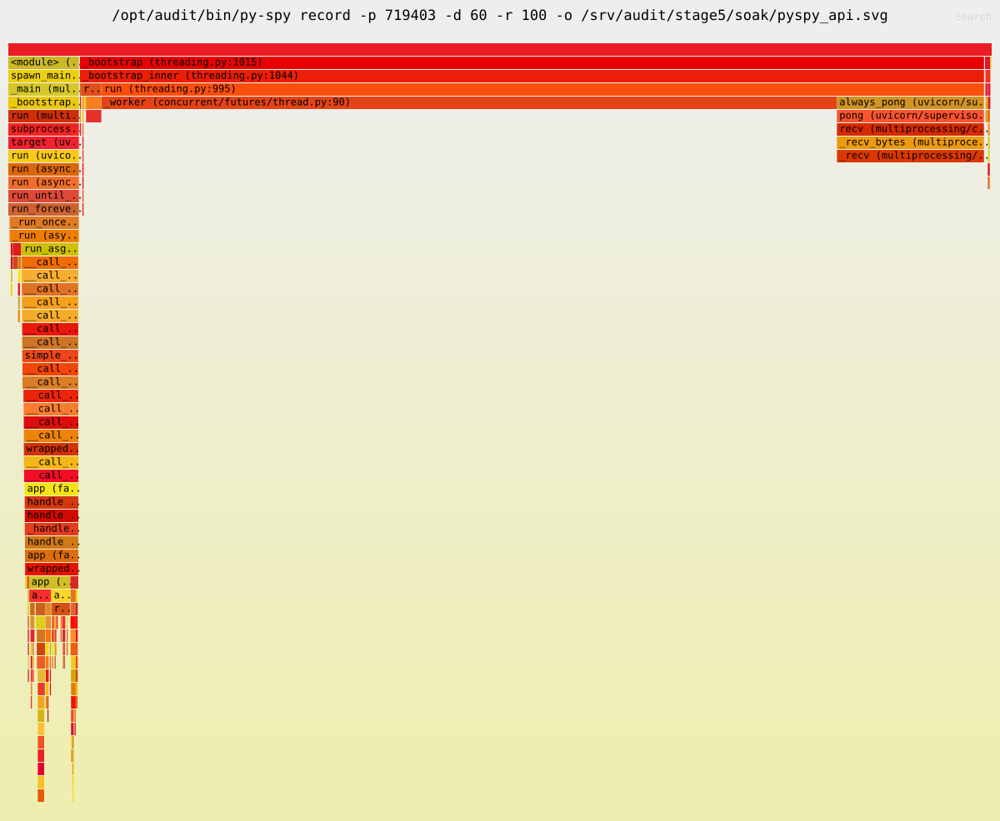
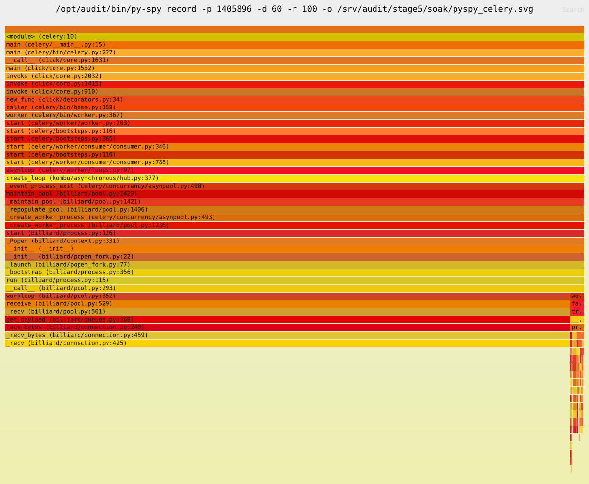
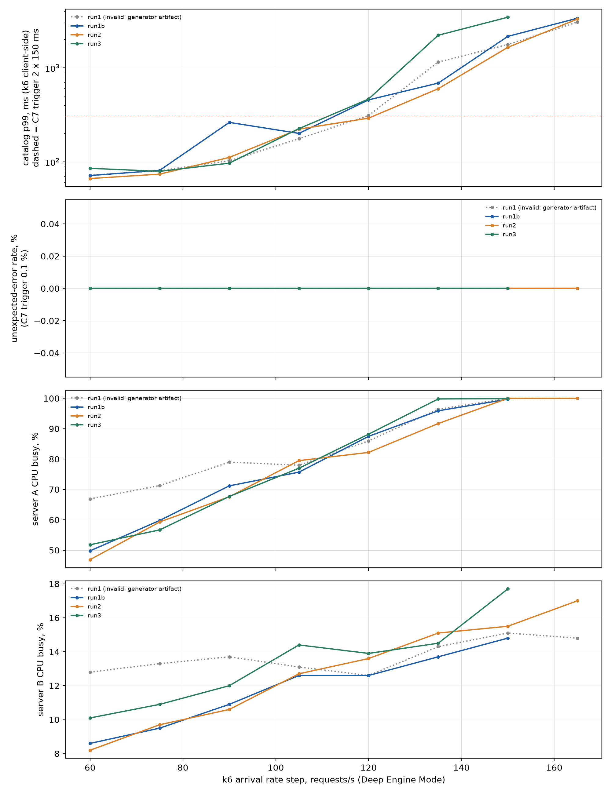
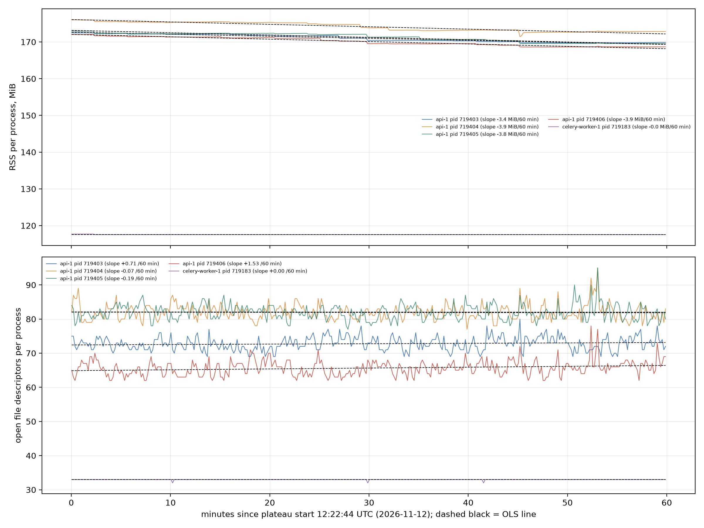
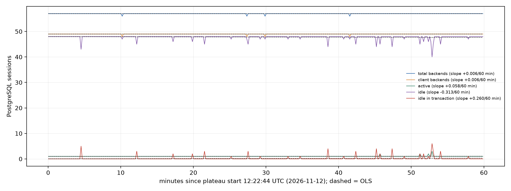

# Load, Concurrency, Chaos and Perimeter Audit: v6.0.0 on Two 2-vCPU Servers (November 2026)

This report records an external audit of the FastAPI e-commerce backend at release **6.0.0** (commit `37e82970440502e4c7b090cb59a290ad11536940`), run on two Hetzner CPX22 servers between 2026-11-11 19:23 UTC and 2026-11-12 15:30 UTC. The audit drove the shipped container images through a perimeter and authorization pass, a real Stripe test-mode series, calibration, a 34-minute behavioural swarm, barrier races, open-model load (Vegeta, a k6 saturation-knee search and a 60-minute Soak), fault injection, and a final invariant audit of stock and money.

How to read it: [The short version](#the-short-version) is for everyone. [Section 1](#1-results-for-engineers) gives the scorecard and the key numbers, [section 2](#2-three-stories-from-the-audit) tells the three findings that mattered most as the investigations ran, and [section 3](#3-findings-register) lists every finding. Sections 4 to 11 and the appendices hold the method, the threats to validity and the full measurements. Each section opens with its result, so a reader can stop after any of them.

> [!NOTE]
> **Evidence paths.** Every number below is followed by, or listed under, the local artifact it was read from. Paths without a prefix are relative to the audit workspace `scripts/audit-2026-11/`; paths prefixed `dump:` are inside the evidence dump `loadtest-results/audit-2026-11/`. Both are kept by the maintainer and are **not published**; the paths identify where each figure came from so that it can be re-derived on request. File and line references into `app/` and `main.py` point at the audited 6.0.0 tree (commit `37e8297`); the 6.1.0 changes moved several of them. Public IP addresses, account identifiers and secrets are omitted or replaced with placeholders.

> [!IMPORTANT]
> **Read every latency figure with F-PERF-1 in mind.** With the shipped 4-worker uvicorn, each request that Caddy sends on a reused upstream connection waits about 38-40 ms for a delayed TCP ACK (Nagle's algorithm is left on, see [section 2.1](#21-the-40-ms-toll-f-perf-1)). This applies to all loaded measurements in Stages 3-7. It does not affect throughput or CPU.

> [!NOTE]
> **Changes in 6.1.0 after this audit.** All measurements in this report are of 6.0.0. Release 6.1.0 changed the code behind these findings: F-BUG-1 (dispute status correlated to its own order, with regression tests), F-PERF-1 (TCP_NODELAY set on every accepted connection; verified by a socket-level test only, the latency was not re-measured end to end), F-CHAOS-1 (Redis socket and connect timeouts, default 1 s), F-OBS-1 and F-OBS-2 (JSON access line per request, Celery task and beat lines), F-OBS-3 (one log line with the Stripe error class and Request-Id when an attempt is left `unknown`), F-API-1 (order shipping snapshot no longer shows live address fields), F-API-2 (409 for the loser of two concurrent refunds), F-PERIM-3 (RateLimit fields on counted 4xx responses), F-PERIM-5 (probe HEAD carries the GET Content-Length; no `Server` header), F-MAIL-1 (Date, Message-ID and a text/plain part). F-CHAOS-2, F-OPS-1, F-PAY-4 and F-DOC-1 were addressed in the documentation (F-PAY-4 also in the configuration comment of `app/core/config.py`). F-PERIM-1, F-PERIM-2, F-PERIM-4, F-PERIM-6b, F-MAIL-2, F-PRIV-1 and F-PAY-1 are design trade-offs left as they are. The fixes were not re-audited on the servers.

## Contents

- [The short version](#the-short-version)
- [1. Results for engineers](#1-results-for-engineers)
- [2. Three stories from the audit](#2-three-stories-from-the-audit): [the 40 ms toll](#21-the-40-ms-toll-f-perf-1), [one dispute, every order](#22-one-dispute-every-order-f-bug-1), [seventy-five seconds of frozen Redis](#23-seventy-five-seconds-of-frozen-redis-f-chaos-1)
- [3. Findings register](#3-findings-register)
- [4. Methodology and threats to validity](#4-methodology-and-threats-to-validity)
- [5. Master timeline](#5-master-timeline)
- [6. Where request time went](#6-where-request-time-went)
- [7. Cache, TTL, limiters, emails and Celery](#7-cache-ttl-limiters-emails-and-celery)
- [8. Open model vs closed model, knee and Soak](#8-open-model-vs-closed-model-knee-and-soak)
- [9. Payment layer and invariant accounting](#9-payment-layer-and-invariant-accounting)
- [10. End-to-end log and trace chains](#10-end-to-end-log-and-trace-chains)
- [11. Bottlenecks, recommendations, INCONCLUSIVE and NOT TESTED](#11-bottlenecks-recommendations-inconclusive-and-not-tested)
- [Appendix A. Per-operation results, 4A swarm](#appendix-a-per-operation-results-4a-swarm)
- [Appendix B. Local evidence dump (not published)](#appendix-b-local-evidence-dump-not-published)

---

## The short version

**What was tested.** For about twenty hours, one small rented server ran the shop's backend from its shipped container images, with its database (PostgreSQL), its cache (Redis) and its background workers (Celery). A second server of the same size attacked it; in all, about 1.06 million HTTP requests reached the shop: simulated shoppers who browse, fill carts, log in and pay; fixed-rate floods that raise the load step by step until the shop can no longer keep its promised response times (the "knee"); one hour at three quarters of that load (the "Soak"); and volleys of requests released at the same instant to try to sell the last item twice or charge a card twice. Then it broke things on purpose: it made the payment provider slow, then silent, then cut its connections (a stand-in for Stripe behind a fault proxy in this stage); it froze Redis for 75 seconds; it killed the background worker in the middle of a payment burst. At the end, every unit of stock and every cent was counted again.

**The worst things found.**
- **Every order showed the same chargeback status** (F-BUG-1, the one BUG). As soon as one order in the shop had a payment dispute, every order of every customer reported that dispute's status, for example "lost". At the end, 19,911 of 19,911 orders showed it while 14 orders really had a dispute. Customers would have seen a chargeback they never had, and the status of another customer's dispute. Money, stock and the dispute records themselves were correct; the wrong value was only in what the API showed.
- **About 40 ms added to almost every request under load** (F-PERF-1). A TCP setting left at its default made the server hold the last few bytes of each response until the other side acknowledged the first part. A catalog page that takes about 6 ms took about 44 ms. Capacity was not affected; response time was.
- **A frozen Redis made the shop wait instead of fail** (F-CHAOS-1). The shop did the right things when Redis stopped answering (catalog served from the database, logins refused, webhooks accepted), but each answer took seconds to tens of seconds (webhooks 5 to 11 s, logins 10 to 17 s, the catalog 15 s at the median and up to 34 s), because no timeout was set for Redis commands.
- Smaller items: a payment whose Stripe call is cut and which the customer never retries waits 60 minutes for expiry, and in 3 cases the provider kept an unconfirmed payment the shop never learned about (no money moved, F-CHAOS-2); under overload the request limiter also refuses Stripe webhooks (F-PERIM-6b); several logging gaps, perimeter details and email headers. All are in [section 3](#3-findings-register).

**What held.**
- **No HTTP 500 in 1,062,668 requests**, and no PostgreSQL deadlock.
- **Stock and money balanced exactly.** 501,036 product units and 1,173,037 variant units matched the books with a difference of 0; 479,673,979 cents of successful payments were each traced to their source; a reviewer who wrote none of the tooling re-derived the mock-scope payments with their own scripts and found no unexplained mismatch.
- **The races were lost by the attackers.** 335 synchronised volleys (all arriving within 6 ms of each other) tried to oversell scarce stock, reuse idempotency keys, pay and cancel at once, refund twice and deliver webhooks before the payment they belong to. No oversell, no double order; every order with two successful charges (10) was flagged for manual review.
- **Every webhook that was stored was processed**: 74,974 events, 0 failed, including the ones that arrived before their payment, during the Redis freeze and while the worker was dead. (Webhooks the overload limiter refused with 503 in the production-configuration stages were not stored; real Stripe retries those, see F-PERIM-6b.)
- **Capacity on 2 vCPU**: about 120 requests per second of a realistic mix before the catalog's 99th-percentile latency passed 300 ms, at about 90 % CPU, measured with the production limiters made unreachable (Deep Engine Mode). Past that, the shop slowed down to seconds but still returned no 5xx; with the production limiters on, the overload limiter answers 503 well before that point.
- **Authorization**: 99 checks over 9 groups (admin routes, forged and expired tokens, token rotation, access to other customers' objects, mass assignment, webhook signatures) all passed.

**What it means.** None of the findings lost money or stock. The worst one put wrong and partly private information in front of customers, and it had shipped since v5.0.0. The code changes made after the audit (6.1.0, summarised in the note above) were not re-audited on the servers.

A few terms used throughout: **p50, p95, p99** are the response times that 50 %, 95 % and 99 % of requests stayed under; **Prod Shield ON** is the production configuration with its rate limits and overload limiter, **Deep Engine Mode** the same application with those shields made unreachable, Stripe replaced by a wire mock and SMTP by a local sink, so that the engine underneath could be measured ([section 4.4](#44-prod-shield-on-vs-deep-engine-mode)); verdicts follow frozen criteria ([section 4.6](#46-frozen-verdict-criteria-as-applied)): **PASS**, **CAVEAT** (works, with a named, concrete reservation), **BUG**, **LIMITATION** (a ceiling of the setup, not a defect), **INCONCLUSIVE** and **NOT TESTED**.

---

## 1. Results for engineers

### 1.1 Result in one paragraph

One application defect was found and confirmed independently: **F-BUG-1**, the order field `dispute_status` is computed by an uncorrelated SQL subquery, so as soon as any dispute exists, every order of every customer shows the status of the newest dispute in the whole table (19,911 of 19,911 orders at the end of the audit, against 14 orders that really had a dispute). No stock or money invariant was violated in any auditor run ([section 9.7](#97-invariant-accounting)); the final audit balanced stock to the unit and money to the cent. No HTTP 500 and no PostgreSQL deadlock (40P01) appeared in 1,062,668 logged requests; no stored webhook was lost or applied twice, and no double charge went unflagged (webhooks refused by the in-flight limiter with Prod Shield ON were never stored, F-PERIM-6b). The main performance finding (**F-PERF-1**) is a missing `TCP_NODELAY` in multi-worker uvicorn that adds about 38-40 ms to every request on a reused upstream connection. Under a Redis freeze the documented fail-open and fail-closed semantics held, but latency rose to 15.4 s at p50 because the app sets no Redis socket timeout (**F-CHAOS-1**). The rest are caveats about logging, perimeter details, emails and documentation.

### 1.2 Scorecard by subsystem

Verdicts are those of the stage results and the findings register, applied per `VERDICT_CRITERIA.md`; this report does not change them. Where a subsystem has mixed results, each verdict is listed with its item.

| Subsystem | Verdict(s) | Basis | Criteria applied |
|---|---|---|---|
| Order API: `dispute_status` field | **BUG** (F-BUG-1) | wrong value on every order once any dispute exists; another customer's dispute status disclosed | BUG definition (data leak, wrong money-related state) |
| Stock and money invariants | **PASS** | 0 violations in every complete auditor run; independent re-derivation not refuted (WP-R2) | C1 |
| Unhandled errors | **PASS** | 0 x 500 in the whole log, 0 x 40P01, 0 request-handling Tracebacks | C2, BUG definition |
| Newcomer path end to end (Stage 1, 14 items, 17 verdicts) | 13 PASS, 2 CAVEAT, 2 NOT TESTED | emails (E12: F-MAIL-1, F-MAIL-2); no API to abandon a Checkout or 3DS attempt (E14: F-PAY-1); 3DS and hosted Checkout completion need a browser | Stage 1 |
| Perimeter (Stage 1, 11 groups, 13 verdicts) | 9 PASS, 3 CAVEAT, 1 NOT TESTED | F-PERIM-1 (P2b), F-PERIM-5 (P3, P4) | Stage 1 |
| Authorization (9 groups, 99 checks) | **PASS** 9 of 9 | admin routes, forged and expired tokens, rotation, IDOR, mass assignment, webhook signatures | Stage 1 |
| Cache and TTL (Stage 1, 8 items, 9 verdicts) | 6 PASS, 2 CAVEAT, 1 NOT TESTED | F-PERIM-5 (validators), F-PERIM-2 (PATCH media type) | Stage 1 |
| Rate limiter (Stage 1, 11 items, 13 verdicts) | 8 PASS, 2 CAVEAT, 3 NOT TESTED | F-PERIM-3, F-PERIM-4 | Stage 1 |
| In-flight limiter | 2 PASS, 1 LIMITATION, 1 INCONCLUSIVE; webhook shedding raised to CAVEAT | F-PERIM-6, F-PERIM-6b | Stage 1, Stage 2 |
| Real Stripe test mode (Stage 2) | 23 PASS, 5 CAVEAT, 1 LIMITATION, 1 INCONCLUSIVE, 3 NOT TESTED | F-PAY-2, F-OBS-3, F-OPS-1 | Stage 2 |
| Barrier races (4B) | 18 PASS + 1 CAVEAT (F-API-1); F-API-2 noted as CAVEAT inside a PASS | | C1, C12, C13 |
| Behavioural swarm (4A) | PASS (invariants, coverage); CAVEAT login p99 (F-PERF-2); INCONCLUSIVE load level (F-4A-5) | | C1, C4 (informational), C9 |
| Soak C2 / C3 | PASS / **CAVEAT** (2 dropped iterations) | | C2, C3 |
| Soak C4 per class | catalog PASS, cart write CAVEAT, login **LIMITATION**, order create PASS, pay PASS | | C4, C11 |
| Soak C5 / C6 | RSS PASS (Celery pool children CAVEAT); DB connections PASS; open FDs CAVEAT | | C5, C6 |
| Saturation knee | **LIMITATION** (2-vCPU CPU ceiling at 120 req/s) | | C7, C9 |
| Steal / generator / swap | PASS / PASS after re-runs / CAVEAT (marked) | | C8, C9, C11 |
| Stripe faults (latency, black hole, reset) | PASS; unretried attempts CAVEAT (F-CHAOS-2) | | Stage 6 |
| Redis freeze | semantics PASS; latency and DB side effects **CAVEAT** (F-CHAOS-1) | | Stage 6 |
| Celery worker SIGKILL | PASS (in-flight redelivery not demonstrated) | | Stage 6 |
| Admin sabotage (ETag, price at order time, deactivation) | PASS | | Stage 6 |
| Celery and Beat tasks | PASS (manual triggers under load); CAVEAT no task-level logs (F-OBS-2) | | Stage 5 |
| Email templates | 11 of 12 delivered; `gdpr_deletion_completed` **NOT TESTED**; CAVEAT F-MAIL-1, F-MAIL-2 | | Stage 7 |
| Observability overhead | PASS (C10: +4.19 to +4.34 pp of Server A CPU, limit 5 %) | | C10 |
| Request latency | **CAVEAT** (F-PERF-1, high impact) | | C4 note |

Evidence: `stage1/RESULTS.md` Summary, `stage2/RESULTS.md` Summary, `stage4/RESULTS_4A.md` section 10, `stage4/races/RESULTS_4B.md` section 2, `stage5/RESULTS.md` section 1, `stage6/RESULTS.md` section 1, `stage7/RESULTS_7A.md`, `wp2/REPORT.md` (Overhead), `FINDINGS_REGISTER.md`.

### 1.3 Key figures

| Figure | Value | Configuration | Evidence |
|---|---|---|---|
| Saturation knee (C7) | **120 req/s** median (min-max 120-135, 3 valid runs); trigger: cached-catalog p99 > 300 ms at Server A CPU 87.5-91.7 %, Server B CPU <= 15.1 % | Deep Engine | `stage5/RESULTS.md` section 4, `stage5/knee/run*/knee.json` |
| Soak | 90 req/s (75 % of the knee) for **3,600 s**, one run, not stitched; 342,896 requests at Caddy on the plateau, all 2xx | Deep Engine | `stage5/RESULTS.md` section 5, `wp11/out/tables/endpoint_matrix_modules.md` |
| Soak 5xx (C2) | **0** | Deep Engine | `stage5/soak/caddy_soak.json` |
| Behavioural swarm | 65 users, 1,800 s plateau, 89,675 requests (Locust), mean 47 req/s, 0 scenario failures, 0 5xx, 69 of 69 operations exercised | Deep Engine | `stage4/RESULTS_4A.md` |
| Barrier races | 19 scenarios, 18 PASS + 1 CAVEAT, 0 BUG; every counted volley arrived at Caddy within 20 ms (max 5.92 ms, see [4.9](#49-disagreements-between-stage-files)) | Deep Engine | `stage4/races/RESULTS_4B.md`, `FINDINGS_REGISTER.md` F-RACE-0 |
| Requests in the whole Caddy log | 1,062,668 (2026-11-11 19:23:19Z to 2026-11-12 15:30:42Z); 0 x 500, 13 x 502 (oversized bodies, F-PERIM-1), 1,258 x 503 (779 Stage 1 in-flight bursts, 87 Stage 2 Stripe-limit waves, 3 pre-run and 15 injected in 4B, 374 injected in Stage 6) | both | `wp11/out/INDEX.md`, `wp11/out/tables/endpoint_matrix_modules.md`, `wp-r2/REVIEW.md` 2c |
| Final stock identity | products 501,036 = 501,036; variants 1,173,037 = 1,173,037; 0 negative | | `stage7/RESULTS_7A.md` section 3 |
| Final money identity | 479,673,979 cents of succeeded payments fully attributed; refunds identity difference 0 | | `stage7/RESULTS_7A.md` section 3 |
| Invariant auditor | 0 violations in the 7 runs from 4A (explained and final) to 07-total; the Stage 2 run flagged 7 harness-created PaymentIntents and the first 4A run 2 harness items, all explained ([section 9.7](#97-invariant-accounting)) | | stage RESULTS files |

---

## 2. Three stories from the audit

Three findings shaped how every other number in this report has to be read. Each is told in the order it was investigated, with the evidence at the point where it mattered.

### 2.1 The 40 ms toll (F-PERF-1)

**Result: CAVEAT (performance defect, high impact).** Under load almost every request waited about 38-40 ms for a TCP acknowledgement, in the uvicorn layer and not in the application. Throughput and CPU were not affected. 6.1.0 sets `TCP_NODELAY` on every accepted connection (`app/core/http_protocol.py`, used from `main.py`); that was verified by a socket-level test only, not re-measured end to end.

**The first clue: a cache that was too slow to be a cache.** Stage 1 (23:50 UTC, Prod Shield ON) timed `GET /products/{id}` cold and warm. Back-to-back on one keep-alive connection, the cold path took a median of 49.7 ms and the warm Redis path 45.8 ms. With 50 ms between requests the same two paths took 9.55 ms and 5.5 ms. The cache saved its 4 ms either way; what did not fit was the 40 ms that disappeared when the client simply waited before asking. A follow-up sweep made the switch sharp: the stall was present at pauses of 0, 10 and 30 ms and gone at 50 ms and more, on HTTP/1.1 and HTTP/2, from either server. Caddy's own redirect on a reused connection took 0.3 ms, which put the stall on the Caddy-to-uvicorn hop. Stage 1 recorded it as a bench LIMITATION with the cause not proven. The calibration that later set the C4 latency thresholds ran at 1 req/s, and its 1 s idle gaps kept it out of the delay.

**The packet capture.** A capture on the live api container's loopback (20 s, `GET /livez`, no restart) shows the pattern on every request after the first (abridged):

```text
.634095 C->S  72 B   request 2
.635079 S->C  566 B  headers      (+1.0 ms after the request)
.675282 C->S  0 B    pure ACK     (40.2 ms later: the client's delayed ACK)
.675306 S->C  15 B   body         (sent 24 us after that ACK)
```

The response leaves in two writes. The 15-byte body waits until the 566 bytes of headers are acknowledged, and the client's kernel delays that acknowledgement by its 40 ms minimum. That is Nagle's algorithm meeting delayed ACK: a 15-byte body spent 40 ms waiting for permission to leave. The first request on a fresh connection is fast because the kernel starts in quick-ACK mode, and a client that pauses 50 ms has already sent its ACK, which is why the gaps made the delay vanish.

**Why Nagle was on.** Four links, each verified:
1. `main.py` runs uvicorn 0.54.0 with `workers=4`. With more than one worker, uvicorn binds the shared listener in the parent with `socket.socket(family=family)`, so `sock.proto == 0`.
2. CPython 3.13's `asyncio.base_events._set_nodelay` sets `TCP_NODELAY` only when `sock.proto == IPPROTO_TCP`, so the accepted sockets in the workers keep Nagle on.
3. h11 writes headers and body in two `transport.write` calls.
4. Caddy reuses its upstream connections with gaps well under 40 ms, so under load almost every request pays.

A single uvicorn process never calls `bind_socket` and is not affected, which is why a quick local test shows nothing. A controlled matrix on throwaway processes (trivial ASGI app with the real `/livez` headers, p50 of 35 back-to-back requests) isolates the cause:

| Loop | HTTP | Workers | Note | p50, no gap | TCP_NODELAY |
|---|---|---|---|---|---|
| asyncio | h11 | 1 | | 1.0 ms | yes |
| asyncio | h11 | 4 | production configuration | 41.9 ms | no |
| asyncio | h11 | 4 | listener created with `proto=6` | 1.2 ms | yes |
| asyncio | httptools | 4 | | 41.9 ms | no |
| uvloop | h11 | 4 | | 0.5 ms | yes |
| uvloop | httptools | 4 | | 0.4 ms | yes |

Changing only the listener's protocol number removes the delay, which proves the link between `proto` and `_set_nodelay`. Application code and middleware are not involved: the trivial app shows the same 41.9 ms.

**What it cost the shop.** Through Caddy with Vegeta, `/livez` p50 was 43.6 ms at 50 req/s and 42.8 ms at 150 req/s, against a floor of 2-4 ms. In the application workload (Stage 3, a NODELAY-patched test image used only to quantify the cost): catalog p50 44.3 ms shipped vs 6.4 ms patched at 86 req/s; order create p50 86.8 vs 40.4 ms. The delay is about 38 ms of p50 on GETs and on order create (two upstream writes) and invisible where the response is one write or CPU-bound (cart write, login). Throughput and CPU were unchanged. Because the calibration ran without the delay, the 5 x p50 part of the C4 rule could not absorb it under load; the C4 floors did ([section 4.6](#46-frozen-verdict-criteria-as-applied)).

**Fix options at the time of the audit (not applied in the system under test):** run the workers on uvloop; or give uvicorn a listener with `IPPROTO_TCP`; or one worker per container behind Caddy; and report the `bind_socket` behaviour upstream. Verify with back-to-back keep-alive requests against the api (expect about 1-2 ms). The system under test was deliberately left as shipped, so every loaded Stage 3-7 latency in this report includes the toll, except the labelled NODELAY calibration block; the 1 req/s calibration ran without it.

Evidence: `stage1/RESULTS.md` C1 and X1, `stage1/perimeter/latency_40ms.txt`, `diag-40ms/REPORT.md` (Q1 capture, Q2 matrix, Q4 load), `diag-40ms/live_lo_client_conn.pcap`, `stage3/CALIBRATION.md` section 7, `DECISIONS.md` 2026-11-12 01:16.

### 2.2 One dispute, every order (F-BUG-1)

**Result: BUG, confirmed independently.** The order field `dispute_status` showed the newest dispute of the whole shop on every order. Money, stock and the dispute records were correct. 6.1.0 correlates the subquery to its own order (`correlate_except` in `app/models/order.py`) and adds regression tests (`tests/integration/test_order_dispute_status.py`); not re-audited on the servers.

**How it surfaced.** At 04:03 UTC, early in Stage 4A (the behavioural swarm), a probe read three freshly created orders (2051-2053). Order 2052 was new, unpaid and had never been near a dispute; the API returned `dispute_status: "lost"` (request id `dc6cf0c5f32d4c9286c83d7e1013cdef`). At that moment the shop had exactly two disputes, both from the real Stripe series of Stage 2: order 426 (won) and order 427 (lost). The admin filter `has_dispute=true` returned exactly one order, as it should (it lists open or lost disputes only; 426 was won). The swarm then made the pattern impossible to miss: 979 of 979 order responses of the 30-minute run (472 creates and 507 reads) carried `lost`, and so did 400 of 400 sampled orders in the admin list. For one lost chargeback, every order in the shop wore the same badge.

**Why.** `Order.dispute_status` is a `column_property` built from a scalar subquery (`app/models/order.py:79-99`). The inner `max(latest_dispute.id)` select filters `Payment.order_id == cls.id`, but it is nested inside a middle select whose FROM list is only `payment_disputes`. SQLAlchemy correlates a subquery only against its immediately enclosing select; `orders` is not there, so the inner select adds its own `orders` to its FROM. The inner subquery then means "the newest dispute of any order", a constant.

Compiled SQL (PostgreSQL dialect, as used for `select(Order)`, list and detail endpoints):

```sql
SELECT orders.id, (SELECT payment_disputes.status FROM payment_disputes
  WHERE payment_disputes.id = (SELECT max(latest_dispute.id) AS max_1
     FROM payment_disputes AS latest_dispute JOIN payments ON payments.id = latest_dispute.payment_id, orders
     WHERE payments.order_id = orders.id)) AS anon_1
FROM orders WHERE orders.user_id = %(user_id_1)s::INTEGER
```

Note the `, orders` in the innermost FROM.

**Impact (live stand).** At 05:20 UTC 2,822 of 2,822 orders returned a non-null `dispute_status` while 2 orders had a dispute; at the end of the audit **19,911 of 19,911** orders did, while **14** orders had a dispute (the correctly correlated expression is non-null for exactly 14). Every order of every customer, including new unpaid orders, shows the status of the newest dispute in the table: customers see "lost chargeback" or "on hold" on orders that have none, and another customer's dispute state is disclosed to all. Admin views show the same wrong field; the admin `has_dispute` filter (`app/api/v1/admin.py:543-557`) is a single-level `EXISTS` and is correct. The statements that carry this subquery account for about 14 % of the top-40 SQL time ([section 6.5](#65-top-sql-by-total-time-pg_stat_statements)). Money, stock and the `payment_disputes` rows themselves are correct.

Seen from the API by the independent reviewer on the live stand: customer user id 2 (8 orders, all paid, 0 dispute rows in the DB) got `dispute_status: "lost"` on every order from `GET /users/orders` (request id `545768ef...`) and from `GET /orders/11760` (request id `bff2afce...`): the status of dispute 14 on order 4379 of another customer ([section 10.3](#103-chain-3-f-bug-1-seen-from-the-api-independent-review-live-stand)).

**Why the invariant auditor did not catch it.** The auditor checks stock, money and the dispute rows against the provider, and all of those were right (MONEY-08 PASS). No check looked at the API-visible `dispute_status`, which is an acknowledged blind spot ([section 9.7](#97-invariant-accounting)). The swarm found it because it read order responses the way a customer would.

**Introduced by** commit `46945e3` (2026-11-03, "fix(payments): settle Checkout from the PaymentIntent, flag disputed orders, hide provider text"); first tag containing it v5.0.0, also in v5.1.0 and v6.0.0 (`git log -S"latest_dispute" -- app/models/order.py`).

**Reproduction.** (1) Two customers each place and pay an order through `POST /orders/{id}/pay`. (2) A signed `charge.dispute.created` webhook is delivered for the first order only. (3) The second customer calls `GET /orders/{id}` and `GET /users/orders`. Expected `dispute_status: null`; observed the first order's status (`needs_response`). A minimal failing test written this way against the project's own test fixtures fails with `assert ('needs_response', ['needs_response']) == (None, [None])` (run on the suite's SQLite path; the defect is in the SQL shape and was shown on PostgreSQL on the live stand). Status: reproduced by the swarm, by the audit lead (compiled SQL, DB counts) and independently by a reviewer who wrote none of the tooling (compiled SQL, failing test, live API and DB, introducing commit).

**Fix direction given by the audit (not applied during it).** Correlate the inner subquery to `orders` explicitly (for example `.correlate(cls)` on the inner select, or `correlate_except` on the alias), or compute the latest dispute with a lateral join; add a regression test with two orders of which only one is disputed, and an assertion on the API-visible field.

Evidence: `FINDINGS_REGISTER.md` F-BUG-1, `stage4/RESULTS_4A.md` F-4A-1, `wp-r2/REVIEW.md` section 1 (`compiled_dispute_sql.txt`, `test_dispute_status_correlation.py`, `test_run.txt`, `q1_disputes.out.txt`, `api_dispute_check.out.txt`), `app/models/order.py:79-99`.

### 2.3 Seventy-five seconds of frozen Redis (F-CHAOS-1)

**Result: semantics PASS; latency and database side effects CAVEAT.** Every documented fail-open and fail-closed rule held, but each took seconds to tens of seconds to apply, and requests held database transactions while they waited. 6.1.0 sets Redis socket and connect timeouts (`REDIS_SOCKET_TIMEOUT`, `REDIS_SOCKET_CONNECT_TIMEOUT`, default 1 s) on both application pools; not re-run on the servers.

**The experiment.** At 13:59:07 UTC, with a 50 req/s k6 background mix running, the Redis container was paused (`docker pause`) for 75 s and resumed at 14:00:22. A crashed Redis refuses connections at once; a frozen one neither answers nor refuses, so a client without its own timeout waits for the library default. The app set no `socket_timeout` (`app/services/redis_async.py:89-99`, `app/services/redis.py:54`), so redis-py 8.1.0's default of 5 s applied to every command, and a request that touches Redis several times waited 10-35 s.

**What held.**

| # | Check | Observed | Verdict |
|---|---|---|---|
| E3a | `/readyz` | 74/75 answered 503 `Retry-After: 5`, each after 2.0 s (the probe's own timeout); first 503 0.3 s after the pause; in 14/75 the database check failed as well (E3e) | PASS |
| E3b | Webhooks accepted, swept later | 50/50 signed events accepted 200 `received` (5.0-11.2 s); 28 could not be enqueued; the 5-minute sweeper re-queued 29 stuck events at 14:20:22 and all 50 were `processed` by 14:20:23 | PASS |
| E3c | Login fails closed | 22/22 probe logins 503 `Retry-After: 30`; no login 200 while Redis was frozen; each 503 only after 10.0-16.9 s | PASS with CAVEAT |
| E3d | Catalog fails open | 75/75 probe GETs 200, served from the database; cart writes 503 `Retry-After: 5` ("cart store unavailable", as documented); but catalog p50 15.4 s (below) | CAVEAT (F-CHAOS-1) |
| E3e | Side effects on the DB pool | requests hold a DB transaction while they wait on Redis (below) | CAVEAT (F-CHAOS-1) |
| E3f | Recovery | `/readyz` stable 1.1 s after the unpause; queues drained by 14:00:39; Redis not restarted; no data lost | PASS |

**What did not.** The catalog, which falls back to the database by design, had p50 **15.4 s** and max 34.3 s; 23 catalog requests hit k6's 30 s client timeout and the generator dropped 2,413 iterations (virtual users exhausted in the stall; inferred, k6 does not time-stamp drops). Logins were refused only after 10.0-16.9 s. Requests waiting on Redis held their database transactions: up to 60 sessions idle in transaction, the oldest 10.8 s, PostgreSQL client backends 49 -> 69, and the `/readyz` **database** check timed out in 14 of 75 probes, listed by the stage as a side effect on the database pool (E3e). In the whole Stage 6 window the injected faults account for every 5xx: 374 x 503 (76 `/pay` in the Stripe windows, 210 cart writes and 88 logins during the freeze), 0 x 500.



In the zoom above, the 503 burst and the latency spike to tens of seconds at 13:59-14:00 are the freeze; the Celery `payments` queue spike at 14:02 is the planned worker SIGKILL ([section 9.6](#96-chaos-on-the-payment-path-stage-6)). SVG: [zoom_stage6_chaos_stage7.svg](assets/load-chaos-audit-2026-11/zoom_stage6_chaos_stage7.svg).

**Recommendation from the audit:** set explicit, short `socket_timeout` and `socket_connect_timeout` on both Redis pools; once one Redis call of a request has failed, skip the remaining ones; avoid holding a DB transaction while waiting on Redis. The 6.1.0 note covers the first of the three.

Evidence: `stage6/RESULTS.md` E3a-E3f and section 1, `stage6/HYPOTHESES.md` (written before the first injection), `stage6/raw/probe.jsonl`, `stage6/raw/pg_1hz.txt`, `stage6/raw/webhooks.jsonl`, `FINDINGS_REGISTER.md` F-CHAOS-1.

---

## 3. Findings register

**Result:** one BUG (F-BUG-1), one high-impact performance CAVEAT (F-PERF-1), and CAVEATs on resilience, payments edge cases, logging, perimeter details, emails and documentation; no finding involved lost money or stock. Ordered from worst to mildest. The last column summarises the 6.1.0 note at the top; none of those changes was re-audited on the servers.

| ID | Verdict | Summary | Evidence | After the audit (6.1.0) |
|---|---|---|---|---|
| F-BUG-1 | **BUG** | `Order.dispute_status` is computed by an uncorrelated subquery, so every order shows the status of the newest dispute in the shop (19,911 of 19,911 orders against 14 with a dispute) and another customer's dispute state is disclosed; money, stock and the dispute rows are correct. Full account in [section 2.2](#22-one-dispute-every-order-f-bug-1) | `FINDINGS_REGISTER.md` F-BUG-1, `stage4/RESULTS_4A.md` F-4A-1, `wp-r2/REVIEW.md` section 1 | code: subquery correlated to its order, regression tests |
| F-PERF-1 | CAVEAT (performance defect, high impact) | Multi-worker uvicorn leaves Nagle's algorithm on; about 38-40 ms on every request Caddy sends on a reused upstream connection; throughput and CPU unaffected. Full account in [section 2.1](#21-the-40-ms-toll-f-perf-1) | `diag-40ms/REPORT.md`, `stage3/CALIBRATION.md` section 7 | code: TCP_NODELAY on every accepted connection; socket-level test only |
| F-CHAOS-1 | CAVEAT | Redis frozen 75 s: the app sets no Redis `socket_timeout` (`app/services/redis_async.py:89-99`, `app/services/redis.py:54`), so redis-py 8.1.0's default 5 s applies per command. Semantics correct (catalog served from DB, login 503 `Retry-After: 30`, cart 503 `Retry-After: 5`, webhooks accepted), but catalog p50 15.4 s, max 34.3 s; 23 catalog requests hit the 30 s client timeout; 2,413 dropped iterations; requests hold DB transactions while waiting (up to 60 idle in transaction, oldest 10.8 s, PostgreSQL clients 49 -> 69); `/readyz` reported the database down 14 of 75 times; logins refused only after 10.0-16.9 s. Recovery within 1.1 s of unpause; no data loss. Full account in [section 2.3](#23-seventy-five-seconds-of-frozen-redis-f-chaos-1) | `stage6/RESULTS.md` E3 | code: Redis socket and connect timeouts (default 1 s) |
| F-CHAOS-2 | CAVEAT | A `/pay` attempt left `unknown` that the client never retries is resolved only by order expiry after 60 minutes (stock returned). When the create reached Stripe but the response was lost, the app never learns the PaymentIntent id (the row keeps its `pending-` placeholder), so it can neither cancel it at expiry nor reconcile it (`checked: 0`), although the provider's `payment_intent.created` event carries the id and `metadata.order_id`. 3 such PaymentIntents left in `requires_confirmation`; no money moved | `stage6/RESULTS.md` E1/E2, section 7 | documentation |
| F-PERIM-6b | CAVEAT | Webhooks share the in-flight limit: under overload, signed webhook POSTs get 503 and are not stored (5 in Stage 1, 13 real Stripe events in Stage 2). Real Stripe retries delivery, so in production this is a delay, with the sweeper and reconciliation as backstops; `stripe listen` does not retry | `stage1/RESULTS.md` I3, `stage2/RESULTS.md` 1.13 | left as designed (trade-off) |
| F-OBS-3 | CAVEAT | When a provider call fails and the attempt becomes `unknown` (503 `Retry-After: 5`), the app logs nothing about the cause: 49 of 49 in Stage 2, 82 of 82 in Stage 6. A provider 429 could therefore not be proven from the app side | `stage2/RESULTS.md` 1.15, `stage6/RESULTS.md` F-OBS-3 row | code: one WARNING line with the Stripe error class and Request-Id |
| F-API-1 | CAVEAT | The order's `shipping_address`, documented as an immutable snapshot, includes the live address row's `is_default`, `created_at`, `updated_at` (`app/models/order.py:119-121`); a later default-address change shows through on past orders. The snapshot columns themselves are unchanged | `stage4/races/RESULTS_4B.md` default_address_race (30 repeats) | code: snapshot no longer shows live address fields |
| F-API-2 | CAVEAT | Two concurrent refunds on a flagged double-charge payment: the loser gets a generic 400 "provider refused" instead of the documented 409; the provider refunded exactly once | `stage4/races/RESULTS_4B.md` double_charge_manual_review (10 repeats) | code: 409 for the loser |
| F-PERF-2 / Soak login | CAVEAT (swarm) / LIMITATION (Soak) | Login p99 2,233 ms in the swarm at about 2.7 logins/s with Server A at 70 %; 1,602 ms in the Soak at 1.1 logins/s (1,527 ms outside marked windows) against 1,500 ms. bcrypt-bound on 2 vCPU with `BCRYPT_MAX_CONCURRENCY=1` | `stage4/RESULTS_4A.md` 3.1, `stage5/RESULTS.md` | none stated |
| Soak cart write | CAVEAT | p99 306.6 ms > 300 ms over the whole plateau; 251.3 ms outside swap/Beat/py-spy windows | `stage5/RESULTS.md` | none stated |
| F-PERIM-1 | CAVEAT | Oversized bodies through Caddy: about half answered 502 (empty) instead of the app's 413 (13 x 502 in the whole log). The app answers 413 before reading the body and closes the connection (`app/core/body_limit.py:43-45, 53-56`) while Caddy is still sending the buffered body | `stage1/RESULTS.md` P2b, `wp-r2/REVIEW.md` 2c | left as designed (trade-off) |
| F-MAIL-1 | CAVEAT | Outgoing emails carry no `Date` and no `Message-ID` header and are HTML-only inside multipart/alternative (`app/services/email/smtp_provider.py:39-44`); deliverability risk with real providers. Reproduced on every inspected message | `stage1/smtp-live-headers.txt`, `stage1/RESULTS.md` E12 | code: Date, Message-ID and a text/plain part |
| F-MAIL-2 | CAVEAT | The order confirmation is sent at order creation (status new), also for orders whose payment then fails or needs 3DS | `stage1/RESULTS.md` E12 | left as designed (trade-off) |
| F-PAY-1 | CAVEAT | No API to abandon an open Checkout Session or 3DS attempt: order cancel returns 409 `Retry-After: 60` for up to 60 minutes (`app/services/orders.py:102-115`); the cycle ends correctly by expiry and sweep | `stage1/RESULTS.md` E14, `stage2/RESULTS.md` 1.5 | left as designed (trade-off) |
| F-PRIV-1 | CAVEAT | Email-link tokens (verify, reset) are JWTs whose payload carries the user's email in clear inside the URL query string (browser history, proxy and analytics logs). The reset token's password fingerprint correctly invalidates it on password change | `stage1/email-token-checks.txt` | left as designed (trade-off) |
| F-PERIM-4 | CAVEAT (design) | With a bearer token a route uses a separate per-user bucket, so one address multiplies its budget by the number of accounts it holds (AUTH routes excepted) | `stage1/ratelimit/summary_default.json` | left as designed (trade-off) |
| F-PERIM-3 | CAVEAT | `RateLimit*` headers missing on counted 4xx responses (`app/core/rate_limit.py:19-22, 343-344` says every counted response carries them) | `stage1/perimeter/perimeter.jsonl` | code: RateLimit fields on counted 4xx |
| F-PERIM-2 | CAVEAT | PATCH accepts `application/json` besides `application/merge-patch+json` (`app/core/errors.py:251-255`); OpenAPI declares merge-patch only | `stage1/RESULTS.md` C4 | left as designed (trade-off) |
| F-PERIM-5 | CAVEAT (low) | HEAD on probes returns `Content-Length: 0` while GET has a body (`app/core/probes.py:130-131`); `Server: uvicorn` discloses the stack; ETag only on product detail and admin variant | `stage1/RESULTS.md` P3, P4, C2 | code: probe HEAD carries the GET Content-Length; no `Server` header |
| F-OBS-1 | CAVEAT | uvicorn access lines are plain text (client port 0, no request id); the app emits no per-request JSON line, so request correlation depends on Caddy's access log | `wp1b/REPORT.md`, section 10 | code: JSON access line per request |
| F-OBS-2 | CAVEAT | Celery worker and beat print no task-level INFO lines although started with `--loglevel=info`; periodic execution is not provable from logs | `wp1b/REPORT.md` F5 | code: Celery task and beat lines |
| Soak FDs / C3 / Celery children | CAVEAT | see section 8.5 | `stage5/RESULTS.md` | none stated |
| F-OPS-1 | CAVEAT (docs) | The docs do not say which webhook API version the Stripe endpoint should use; behaviour identical on acacia and endive for the exercised types | `stage2/RESULTS.md` task 2 | documentation |
| F-DOC-1 | CAVEAT (audit notes) | The audit's own pre-study notes had three Redis TTLs wrong; the code and Redis agree with each other | `stage1/RESULTS.md` X3 | documentation |
| F-PAY-2 | PASS (behaviour) + INCONCLUSIVE (cause) | Stripe sandbox limit: 25 x 200 per 62-request wave, provider failures answered 503 `Retry-After: 5`, 74/74 same-key retries paid, no duplicate PaymentIntents; that the errors were 429 is consistent but not proven | `stage2/RESULTS.md` task 3 | none stated |
| F-PAY-3 | PASS (as designed) | Lost dispute flags the order only (payment_status refunded, `amount_refunded` 0, no restock, no cancel) | `stage2/RESULTS.md` task 1 | none stated |
| F-PAY-4 | INFO | A hung Stripe fails a call in about 16 s (new connections) or about 31 s (kept-alive), not the configuration comment's worst case (`app/core/config.py:467-478`) | `stage6/RESULTS.md` section 2 | documentation |
| F-PERIM-0 | fact | Default rate limit 300/min per client IP: one source at 50 req/s for 60 s got 300 x 200 and 2,700 x 429 | `wp2/REPORT.md` | none stated |
| F-SCEN-1 | harness note | Zipf-hot items sell out under the swarm (52 % cart-add 409, no oversell) | `stage4/RESULTS_4A.md` section 5 | none stated |
| F-SEC-0 | process note | During Stage 1 a prefix of the shared test-customer password and the `stripe listen` signing secret (written in clear by the CLI in its own log) were printed in the audit's working notes; both are test-mode values; the dump scan redacted the secret | `FINDINGS_REGISTER.md`, `dump:MANIFEST.md` | none stated |

---

## 4. Methodology and threats to validity

**Result:** two identical 2-vCPU servers, one under test and one generating load; verdict criteria frozen before any load run; 17 threats to validity, each with its measured or residual effect (4.7), and the disagreements between stage files listed rather than smoothed over (4.9).

### 4.1 Topology



### 4.2 Hardware and software

| Item | Server A (target) | Server B (generators, mock) |
|---|---|---|
| Plan | Hetzner CPX22 (shared vCPU), location hel1 | same |
| CPU / RAM / disk | 2 vCPU / 3,809 MiB / 75 GB | same |
| OS / kernel | Ubuntu 26.04.1 LTS / 7.0.0-30-generic | same |
| Docker / Compose | 29.9.3 / 5.7.1 | 29.9.2 / 5.6.1 |
| Network | public IPv4 only, no private network; port 443 on A open only to B and the operator; service ports on B open only to A | |
| Application | image built from 6.0.0; Python 3.13, uvicorn 0.54.0 (asyncio loop, h11), 4 workers; PostgreSQL 18.6; Redis 8.8; Caddy 2.11.6; redis-py 8.1.0 | Stripe wire mock (audit-built), Toxiproxy, Mailpit, VictoriaMetrics v1.155.0 |

Evidence: `ENV.md`, `DECISIONS.md` (2026-11-11 19:00, 19:21), `diag-40ms/REPORT.md`, `stage6/RESULTS.md` section 3, `wp11/out/INDEX.md`, `docker-compose.yml` (image tags).

### 4.3 Stages

| Stage | UTC window | Configuration | What ran |
|---|---|---|---|
| 0 | 2026-11-11 19:21 to about 22:10 (pre-seed snapshot) | Prod Shield ON | stand build, seed (deterministic, checked twice), observability, overhead measurement (C10) |
| 1 | 11-11 23:35 to 11-12 00:47 | Prod Shield ON, real Stripe test mode, Ethereal SMTP | newcomer path, perimeter, authorization, cache/TTL, rate limiter, in-flight limiter |
| 2 | 00:51-01:55 | Prod Shield ON, real Stripe test mode | realistic payment series, refunds, `refund.failed`, disputes, two webhook API versions, controlled Stripe rate-limit break, export, golden fixtures |
| 3 | 02:04-03:56 (measured runs from 02:04:49; operator pause 03:01:33-03:34:45 between blocks) | calibration configs, then the Deep Engine switch at 03:55:20 | C4 calibration, workers 2 vs 4, OTel overhead, bcrypt cap, F-PERF-1 cost |
| 4A | 04:00-05:22 | Deep Engine | Locust Markov swarm (acceptance, 30-minute plateau, follow-ups) |
| 4B | 05:49-06:58 | Deep Engine | 19 barrier-race and payment-anomaly scenarios |
| pause | about 07:00-10:25 | | no traffic (operator pause; visible as the flat region of the timeline) |
| 5 | 10:20-13:30 | Deep Engine | pay calibration, Vegeta per class, k6 knee, 60-minute Soak, py-spy, manual daily Beat tasks |
| 6 | 13:49-15:07 | Deep Engine | Stripe latency/black hole/reset, Redis freeze, Celery SIGKILL, admin sabotage |
| 7 | 15:10-15:25 | Deep Engine, no load | 10-minute quiet window, total invariant audit, final health |

From 2026-11-12 03:55:20 UTC to the end of Stage 7 no manual restart of api, db, redis or the mock was allowed; the final health check confirms RestartCount 0 for all of them, and 1 for celery-worker from the planned SIGKILL.

Evidence: `DECISIONS.md`, `stage1/RESULTS.md`, `stage2/RESULTS.md`, `stage3/CALIBRATION.md`, `stage4/RESULTS_4A.md`, `stage4/races/RESULTS_4B.md`, `stage5/RESULTS.md`, `stage6/RESULTS.md`, `stage7/RESULTS_7A.md` section 4, `wp11/out/INDEX.md` (pause).

### 4.4 Prod Shield ON vs Deep Engine Mode

Stages 0-2 ran the production configuration (**Prod Shield ON**): in-flight limiter at 15 per worker, production rate limits, real Stripe test mode, real SMTP sandbox. To measure the engine rather than the shields, everything from the Stage 3 switch (03:55:20) to Stage 7 ran **Deep Engine Mode**: the limiters were made unreachable (still enabled), Stripe was redirected to a wire mock on Server B, SMTP to Mailpit, and `BCRYPT_MAX_CONCURRENCY=1` was set from the calibration result. `ENVIRONMENT=production` and its startup validation stayed on; no file under `app/` was changed. The mock's CA was added to the stripe package's CA bundle and to the system store in a derived image (`audit-app:6.0.0-mockca-sysca`), because the SDK passes its own `verify=` bundle and ignores `REQUESTS_CA_BUNDLE`.

Effective-configuration diff for the `api` service (the two Celery services differ the same way in SMTP and image; secrets were redacted at capture, the sandbox user and Server B address are replaced here):

```diff
+      BCRYPT_MAX_CONCURRENCY: "1"
-      MAX_IN_FLIGHT_REQUESTS: "15"
+      MAX_IN_FLIGHT_REQUESTS: "10000"
-      RATE_LIMIT_AUTH: 20/minute
-      RATE_LIMIT_CHECKOUT: 10/minute
-      RATE_LIMIT_CONSENT: 10/hour
-      RATE_LIMIT_DEFAULT: 300/minute
+      RATE_LIMIT_AUTH: 1000000/minute
+      RATE_LIMIT_CHECKOUT: 1000000/minute
+      RATE_LIMIT_CONSENT: 1000000/hour
+      RATE_LIMIT_DEFAULT: 1000000/minute
       RATE_LIMIT_ENABLED: "true"
-      RATE_LIMIT_GUEST_CART: 100/hour
-      RATE_LIMIT_LOGIN_FAILURES_PER_EMAIL: 100/hour
-      RATE_LIMIT_LOGIN_FAILURES_PER_EMAIL_AND_ADDRESS: 10/15 minutes
-      RATE_LIMIT_SEARCH: 60/minute
+      RATE_LIMIT_GUEST_CART: 1000000/hour
+      RATE_LIMIT_LOGIN_FAILURES_PER_EMAIL: 1000000/hour
+      RATE_LIMIT_LOGIN_FAILURES_PER_EMAIL_AND_ADDRESS: 1000000/hour
+      RATE_LIMIT_SEARCH: 1000000/minute
-      SMTP_HOST: smtp.ethereal.email
+      SMTP_HOST: <server B>
-      SMTP_PORT: "587"
+      SMTP_PORT: "1025"
       SMTP_TLS_VERIFY: "true"
-      SMTP_USER: <sandbox user>
+      SMTP_USER: audit-sink
-    image: audit-app:6.0.0
+    extra_hosts:
+      - api.stripe.com=<server B>
+    image: audit-app:6.0.0-mockca-sysca
```

Consequences: Deep Engine ceilings are not production capacity; with Prod Shield ON the in-flight limiter would shed load (503 `Retry-After: 1`) long before the knee, as Stage 1 shows (exactly 63 = 4 x 15 + 3 admitted out of 300 and of 600 concurrent requests). OpenTelemetry was off from the switch onward (the collector was stopped).

Evidence: `stage3/configs/diff-prod-to-deep.patch`, `stage3/configs/effective-*.yml`, `DECISIONS.md` (2026-11-11 19:00, 2026-11-12 03:55), `stage1/RESULTS.md` I1.

### 4.5 Tools and repetitions

| Tool | Version | Model | Used for |
|---|---|---|---|
| k6 | 2.3.0 | open (constant-arrival-rate) | calibration, knee, Soak, chaos background |
| Vegeta | 12.13.0 | open | per-class runs, F-PERF-1 under load |
| Locust | 2.47.0 (`FastHttpUser`, 2 processes) | closed (users with think time) | behavioural swarm |
| race runner | audit-built (asyncio, pre-opened connections, barrier release) | burst | 4B |
| py-spy | 0.4.2 | sampling profiler | 60 s on the Soak plateau |
| Toxiproxy | (on B) | fault injection | Stripe latency, black hole, reset |

Repetitions: calibration 3 x 60 s per configuration; Vegeta 3 valid runs per class; knee 3 valid runs; races 10-50 repeats per scenario (335 counted volleys; 348 including the acceptance and superseded runs, see [4.9](#49-disagreements-between-stage-files)); Soak once, full length. Medians are given with min-max.

Evidence: `stage3/CALIBRATION.md` section 2, `stage5/RESULTS.md` sections 3-5, `stage4/races/RESULTS_4B.md`.

### 4.6 Frozen verdict criteria (as applied)

The criteria were frozen on 2026-11-11 before any load run; the C4 thresholds were filled in after calibration and before the stage they judge.

| # | Rule (abridged from `VERDICT_CRITERIA.md`) |
|---|---|
| C1 | Stock and money invariants: zero tolerance, one violation is a BUG. |
| C2 | Unexpected 5xx on the Soak plateau: 0 (503 from the in-flight limiter in Prod Shield and injected provider 503 are exempt). |
| C3 | k6 `dropped_iterations` on the Soak: 0. |
| C4 | p99 per class <= max(5 x calibrated single-request p50, floor). |
| C5 | RSS slope x 60 min <= 5 % of median plateau RSS, per API and Celery process. |
| C6 | DB connections and open FDs: slope x 60 min <= 1. |
| C7 | Knee: first k6 step where for 60 s catalog p99 > 2 x its C4 threshold, or unexpected errors > 0.1 %, or dropped iterations > 0; counted only with Server B CPU < 70 %. |
| C8 | Steal: a 30 s window above 5 % is marked; conclusions from it are INCONCLUSIVE. |
| C9 | Generator validity: Server B CPU > 70 % over 30 s, or growing mock queue, invalidates the run. |
| C10 | Observability overhead <= 5 % of Server A CPU. |
| C11 | Swap activity on Server A is marked; latency from those windows is not baseline. |
| C12 | A race volley counts only if its arrival spread at Caddy is <= 20 ms. |
| C13 | >= 3 runs for calibration, knee, Vegeta; Soak once, full length. |
| C14 | p99.9 only with >= 10,000 samples, p99 only with >= 1,000. |

C4 thresholds (single-request calibration at 1 req/s, 4 workers, OTel off; p50 = median of 3 run p50s):

| Class | Calibrated p50 | 5 x p50 | Floor | Threshold p99 |
|---|---|---|---|---|
| Cached catalog | 5.7 ms | 28.5 ms | 150 ms | 150 ms |
| Cart write | 11.4 ms | 57 ms | 300 ms | 300 ms |
| Login (bcrypt) | 258.3 ms | 1,291 ms | 1,500 ms | 1,500 ms |
| Order create | 63.7 ms | 318 ms | 800 ms | 800 ms |
| Pay (minus mock) | 40.2 ms (mock about 6.8 ms per pay subtracted) | 201 ms | 1,000 ms | 1,000 ms + measured mock latency |

In every class the floor is binding. The calibration ran in a regime without the F-PERF-1 delay (1 s idle gaps reset the kernel's quick-ACK state), so the 5 x p50 rule would not absorb the +38-40 ms under load; the floors do.

Evidence: `VERDICT_CRITERIA.md`, `stage3/C4_thresholds.md`, `stage3/tables_c4.md`, `stage5/C4_pay.md`, `stage5/paycal/mocklat.json`.

### 4.7 Threats to validity

| # | Threat | What was measured or done | Residual effect on conclusions |
|---|---|---|---|
| T1 | **Shared vCPU and steal** (CPX22 is a shared plan) | node_exporter steal on both servers in 30 s windows over the whole range: max **0.000 %**; no C8 window | none observed; a shared host can still change between runs |
| T2 | **Swap on Server A** (3.8 GiB RAM, four api workers at about 174-178 MB, PostgreSQL, Redis, Celery, Caddy, page cache of a 1.38 GB access log) | 182 30 s bins with swap-in/out on A over the whole range, mostly in Stages 5-7; A swap used grew to about 450 MiB; Soak: 37 of 120 windows (12,115 pages, about 47 MiB) | swap windows are marked (C11); every Soak C4 number is also given with the marked windows removed |
| T3 | **Generator validity** (C9) | Server B CPU max over 30 s: calibration 9.8 %, swarm 13.8 %, Vegeta 12.1 %, knee 17.7 %, Soak 14.0 %. Invalidated and repeated: knee run 1 (too few pre-allocated VUs), pay at 20/s (mock webhook queue reached 3,939-5,710), Vegeta runs overlapping a mock drain | the valid runs are not generator-bound |
| T4 | **Deep Engine vs Prod Shield** | diff in [4.4](#44-prod-shield-on-vs-deep-engine-mode) | knee and Soak describe the engine without its shields |
| T5 | **Stripe wire mock fidelity** | independent review against golden real-Stripe bodies: 0 JSON type mismatches over 19 object/error shapes and 12 event types; 8 behavioural class-A differences (refund failure sequence, event set, dispute close, replay snapshot, re-confirm, decline tokens, 429 headers) fixed and re-confirmed before use; one more (refund after a won dispute) fixed; 20 class-B field differences remain (fields the app does not read). The mock cannot make a webhook overtake `/pay` on its own (40 concurrent pays with 120 GET connections: 0 overtakes), so the overtake races were **staged**. The mock's 429 headers are doc-based, not golden. Mock state is in memory and was never restarted | money checks against the mock are valid for what the app reads; overtake timing in production is not reproduced |
| T6 | **Observability overhead** (C10) | Stage 0, interleaved on/off, 3 runs each: +4.34 pp idle, +4.19 pp under load of total Server A CPU (limit 5 %); +150 MB RAM. OTel tracing was measured separately and kept off: +8 pp CPU at ratio 0.1, +13-15 pp always-on with tail sampling, p99 1.4-7x | within C10; the audit's own pollers are visible in `pg_stat_statements` (section 6.5): 14 of the top 40 statements, 513,607 ms of the top-40 total of 2,256,401 ms |
| T7 | **F-PERF-1** | all loaded latencies carry about +38-40 ms on reused Caddy-to-api connections; NODELAY-patched test image used only to quantify it (catalog p50 6.4 ms instead of 44.3 ms at 86 req/s) | numbers describe the shipped runtime, not the application logic alone |
| T8 | **Operator pause** | about 07:00-10:25 UTC, no traffic, nothing restarted; a second pause 03:01:33-03:34:45 fell between calibration blocks | none on runs (no run was cut or stitched) |
| T9 | **Stray wait loop on Server A** | a shell loop (`until docker logs app-celery-beat-1 \| grep 'sending due'; sleep 5`) left by the stand set-up ran from 2026-11-11 19:26 to 2026-11-12 14:37 UTC (about 19 h); `ps` showed 0.0 % cumulative CPU | considered negligible; disclosed |
| T10 | **Harness defects** | found and fixed live: 28 in the swarm (`wp7/FIXES.md`), 31 in the race runner (`wp8/FIXES.md`; all 19 scenarios had to be rewritten because the first versions passed vacuously), 13 in the load scripts (`wp9/FIXES.md`). Early swarm runs damaged seed data (two variants on a scarce product, one password, a few profile names); repaired or recorded. An audit probe at 04:03 created 157 `payment_missing` discrepancies for the pre-switch real-Stripe history, carried as expected discrepancies from then on | verdicts come only from runs after the fixes |
| T11 | **`order_expiry_paid` verdict source** | the race runner's tokens expired after 15 minutes (harness fix 31, not re-run), so the runner reported INCONCLUSIVE; the PASS was taken from the database and the Celery log | evidence is DB state and log lines, not the runner |
| T12 | **4A Caddy vs Locust counts** | Locust 89,675, Caddy 83,407 from Server B in the same window. Stage 4A explains the gap by the 8,058 probe requests Caddy does not log (`log_skip`) and the 1,790 signed webhook deliveries Caddy sees but Locust does not send (89,675 - 8,058 + 1,790 = 83,407), and states per-operation agreement for the 66 logged operations. The chart build (WP-11) did **not** reconcile the totals request by request | the arithmetic closes; no request-level reconciliation exists |
| T13 | **Daily Beat tasks** | the Soak was not placed in the 02:30-03:15 UTC Beat window; the four daily tasks were triggered with `celery call` under load at recorded times; the 5-minute and 4-hour tasks fired live | trigger differs from production; task code and queue are the same |
| T14 | **Real Stripe rate limit** | the 429 behind 49 provider failures is inferred (exactly 25 successes per 62 concurrent pays = the documented 25 req/s sandbox limit), not proven, because the app logs no provider error (F-OBS-3) | INCONCLUSIVE for cause |
| T15 | **Per-request time breakdown** | not measurable from the data (section 6.1) | no waterfall is claimed |
| T16 | **Load ordering** | calibration blocks ran in a fixed order; the W4 a/b pair bounds drift, order effects are not excluded for other pairs | small |
| T17 | **pg_stat_statements scope** | one export taken at the end (`stage7/pg_stat_statements_top40.csv`), cumulative since the last statistics reset at 2026-11-11 22:10:31 UTC (after the Stage 0 overhead runs and the seed, before Stage 1) with no entry evicted (`stage7/pg_stat_statements_info.txt`: dealloc 0); includes Stage 1-3 traffic and the audit pollers; the chart build had no snapshot and used the slow-statement log instead | totals mix configurations; used only for ranking |

Evidence: `wp11/out/tables/swap_and_steal_windows.csv`, `wp11/out/INDEX.md`, `stage5/RESULTS.md` (C8, C9, C11), `stage3/CALIBRATION.md` sections 2, 5, 7, `wp-r1/REVIEW.md` (including "Re-review 2026-11-12"), `DECISIONS.md` (2026-11-12 04:55, 14:37, 2026-11-11 23:42), `wp2/REPORT.md` Overhead, `stage4/RESULTS_4A.md` sections 2-3, 7-9, `stage4/races/RESULTS_4B.md` section 2, `wp7/FIXES.md`, `wp8/FIXES.md`, `wp9/FIXES.md`, `stage2/RESULTS.md` 3.5.

### 4.8 Deviations from the original plan

All recorded in `DECISIONS.md`:
- Tail sampling of traces in the collector instead of SDK head sampling (head sampling cannot know status or duration). OTel was then kept off for every measured stage because of its cost (section 4.7, T6).
- Soak not forced into the Beat window; daily tasks triggered manually under load (T13).
- F-PERF-1 not worked around in the system under test; a NODELAY-patched image was used only in one labelled calibration block.
- Seed run as the schema owner (it calls `setval()` on sequences); the app kept running as the runtime role.
- Final Stripe money check excludes 7 PaymentIntents by id with reasons (3 created directly for golden error fixtures, 4 from a pre-check before the re-seed).
- `unattended-upgrades` and apt timers disabled on both servers.
- Owner decision (2026-11-12 14:45 UTC): raw logs and the dump are not published; only this report is.

### 4.9 Disagreements between stage files

Recorded as found, not resolved here:

| Topic | One source | Other source |
|---|---|---|
| Counted race volleys and max spread | `RESULTS_4B.md`: 335 counted volleys, max 5.92 ms | `FINDINGS_REGISTER.md` F-RACE-0: 348 volleys over all run directories, i.e. the 335 counted plus the acceptance run (3) and the superseded first `webhook_overtake_pay` run (10); all <= 20 ms. The register gives max 5.97 ms; `runs/*/spread.json` gives 5.92 ms for all 348 (5.97 ms is the runner's client-side spread of the superseded run). This report uses 335 and 5.92 ms |
| 4A Caddy vs Locust | `RESULTS_4A.md`: gap explained by probes and webhooks | `wp11/out/INDEX.md`: "not reconciled request by request" (T12) |
| ID F-PAY-3 | register: lost-dispute behaviour (PASS) | `stage6/RESULTS.md` section 7 proposes F-PAY-3 for the Stripe timeout observation; the register files that as F-PAY-4 (INFO). This report uses the register IDs |
| Webhook shedding verdict | `stage1/RESULTS.md` I3 and `stage2/RESULTS.md` 1.13: LIMITATION | register F-PERIM-6b: raised to CAVEAT |
| `gdpr_deletion_completed` timing | `stage4/RESULTS_4A.md` and `stage6/RESULTS.md`: grace period `DATA_DELETION_GRACE_PERIOD_DAYS` = 1 day, daily job at 02:30 UTC | `stage7/RESULTS_7A.md`: "the 30-day purge never ran in the audit window" |
| pg_stat_statements availability | `wp11/out/tables/top_sql_and_lock_waits.md`: no snapshot in the dump | `stage7/pg_stat_statements_top40.csv` exported from the live server afterwards |
| Direct back-to-back latency of the api container | `stage1/RESULTS.md` X1: 1.4 ms when called directly from A, so the stall was placed on the Caddy-to-uvicorn hop | `diag-40ms/REPORT.md` Q1: `curl` with several URLs on one connection to the api 2.4 ms for the first request, then 41.3-41.9 ms; the packet capture shows the server holding the body. This report follows the diagnosis |
| F-PERF-1 verdict | `stage1/RESULTS.md` X1: LIMITATION (bench, cause not proven) | register F-PERF-1: CAVEAT (performance defect, high impact) after the root cause was found |
| Items not in any stage file | `wp-r2/REVIEW.md` 2c: 3 x 503 on `/pay` at 05:48:26-30 (a pre-run of `provider_timeout_retry`, each order later paid with one PaymentIntent) and 2,418 `SMTPRecipientsRefused` errors at 02:20-03:39 (Stage 3, real SMTP sandbox refusing recipients, no 5xx) | not mentioned in `RESULTS_4B.md` / `CALIBRATION.md` |

---

## 5. Master timeline

**Result:** on one UTC axis for the Deep Engine period, steal stays at 0, the only 5xx are injected 503s, and the visible events (swarm, knee runs, Soak, Redis freeze, worker kill) line up with the stage logs.

The chart covers the Deep Engine period from the Stage 3 switch to the end of Stage 7 on one UTC axis: marker lanes (stages, knee runs, chaos injections, py-spy window, the four manual Beat triggers, the planned Celery SIGKILL at 14:02:02, swap bins on A, steal > 5 % lane, empty); RPS; responses by class; 429/503/other 5xx (symlog); Caddy latency p50/p95/p99 per 30 s (p99 only where a bin has >= 1,000 samples); CPU busy and steal on both servers; memory and swap; RSS per container on A; PostgreSQL backends and idle-in-transaction; Redis used memory and hit ratio; Celery queue depth.



SVG: [master_timeline_stage3_to_stage7.svg](assets/load-chaos-audit-2026-11/master_timeline_stage3_to_stage7.svg)

Reading the timeline:
- **04:36-05:11** swarm plateau: about 45-49 req/s, Server A CPU 67.3-74.3 % in the 3-minute checkpoints.
- **07:00-10:25** no traffic (operator pause).
- **10:30-12:20** Vegeta and knee runs: short spikes to about 150 req/s with CPU near 100 % in the overload steps; the backend count and idle-in-transaction peaks (up to about 70 backends) coincide with the knee overload steps.
- **12:22-13:22** Soak plateau at 90 req/s: flat RPS, CPU about 72 %, swap bins accumulating, Server A swap used rising.
- **13:50-14:09** chaos under 50 req/s background: the 503 burst and the latency spike to tens of seconds are the Redis freeze (13:59:07-14:00:22); the Celery `payments` queue spike is the SIGKILL burst (14:02).
- Steal stays at 0 for the whole range; there is no 5xx other than the injected 503s.

Stages 0-3 (Prod Shield ON with real Stripe, then calibration configurations) are drawn separately:



Zooms of the same panels: [Stage 4 swarm and races](assets/load-chaos-audit-2026-11/zoom_stage4_swarm_races.png) ([SVG](assets/load-chaos-audit-2026-11/zoom_stage4_swarm_races.svg)), [Stage 5 Vegeta, knee and Soak](assets/load-chaos-audit-2026-11/zoom_stage5_vegeta_knee_soak.png) ([SVG](assets/load-chaos-audit-2026-11/zoom_stage5_vegeta_knee_soak.svg)), [Stage 6 chaos and Stage 7](assets/load-chaos-audit-2026-11/zoom_stage6_chaos_stage7.png) ([SVG](assets/load-chaos-audit-2026-11/zoom_stage6_chaos_stage7.svg)); Stages 0-3 [SVG](assets/load-chaos-audit-2026-11/stages0_to_3_prod_shield_real_stripe.svg).

Restarts in the period: api recreated during calibration (Stage 3) and at the Deep Engine switch (03:55:06); celery-worker restarted by its restart policy after the planned SIGKILL (14:02:02.6). No other container restarted. Latency panels are Caddy server-side and include error responses; the knee chart in section 8.3 is client-side (k6).

Method notes: 30 s bins; malformed or partial poller samples were skipped (pg 17, redis 26) and appear as gaps; PostgreSQL RSS is a per-process sum that counts shared pages once per process, so it overstates real memory (use the host memory panel).

Evidence: `wp11/out/charts/*.query.txt` (PromQL and SQL for every series), `wp11/out/scripts/s04a_collect_timeline.py`, `s04b_plot_timeline.py`, `wp11/out/INDEX.md` "Limits", `stage4/swarm_checkpoints.md`, `stage6/RESULTS.md` E3, E4, `stage7/RESULTS_7A.md` section 4.

---

## 6. Where request time went

**Result:** a per-request waterfall cannot be built from this data. What can be said: on the Soak plateau the catalog's median server time was 43.7 ms against 5.7 ms unloaded, and a NODELAY experiment at 86 req/s (Stage 3) attributes about 38 ms of the catalog median to F-PERF-1; bcrypt sets the login time; the two catalog-list statements lead the SQL time.

### 6.1 What could and could not be measured

A per-request waterfall (Caddy TLS/proxy, ASGI middleware, Redis, bcrypt, PostgreSQL, Stripe, serialization, Celery) **cannot be built** from this audit's data, and none is claimed:
- Caddy's `duration` is the whole handler time including the upstream; there is no upstream-only field, so proxy work and api work are not separable. The TLS handshake is excluded from `duration` and not logged.
- In Deep Engine Mode OTel was off, uvicorn access lines carry no timing and no request id, and the app writes no per-request JSON line (F-OBS-1). Middleware, Redis round trips, SQL time and serialization per request are therefore not observable.
- `pg_stat_statements` gives per-statement totals, not per request.
- The mock's latency is known per pay from a packet capture at 1 req/s (about 6.8 ms), not joined per request under load.
- Celery processing is asynchronous and not part of any response time.

What can be stated is below: server-side totals per class, the loaded/unloaded ratio, the components that were isolated by experiment, CPU profile shares and SQL rankings.

Evidence: `wp11/out/tables/breakdown_not_measurable.md`.

### 6.2 Server-side time per class on the Soak plateau vs single-request calibration

90 req/s Deep Engine, Server A CPU about 72 %; Caddy `duration` in ms.

| Class | n | Caddy p50 | Caddy p95 | Caddy p99 | Calibration p50 (1 req/s) | p50 ratio |
|---|---|---|---|---|---|---|
| catalog_cached | 226,800 | 43.7 | 74.9 | 145.8 | 5.7 | 7.7x |
| search | 45,361 | 58.8 | 114.1 | 204.4 | not calibrated | |
| cart_write | 42,839 | 23.4 | 123.4 | 304.2 | 11.4 | 2.1x |
| login | 4,136 | 432.7 | 1,003.2 | 1,645.6 | 258.3 | 1.7x |
| order_create | 3,960 | 102.5 | 239.6 | 475.8 | 63.7 | 1.6x |
| pay | 3,960 | 156.7 | 320.4 | 594.0 | 40.2 (minus mock) | 3.9x |
| webhook (mock deliveries) | 15,840 | 59.5 | 109.4 | 179.5 | not calibrated | |

Caddy times (p50, p95, p99, max) are 0.3-3.3 ms below the generators' client-side numbers in 14 of 15 comparisons (Soak and Vegeta), an upper bound for TLS, network and client time on reused connections. The exception is Soak login p95/p99 (+17.5 / +43.1 ms), explained by 175 re-login requests Caddy counts and k6 does not time.

Evidence: `wp11/out/tables/where_time_went_inputs.md` (a)(b), `wp11/out/tables/control_sample_caddy_vs_generator.md`.

### 6.3 Components isolated by experiment

| Component | Size | How it was isolated | Evidence |
|---|---|---|---|
| Nagle / delayed ACK on reused upstream connections (F-PERF-1) | about 38 ms of p50 on GETs and on order create (two upstream writes); invisible where the response is one write or CPU-bound (cart write, login). Catalog p50 44.3 ms shipped vs 6.4 ms with the NODELAY-patched test image at 86 req/s; `/livez` back-to-back 42.0 ms vs 0.9 ms | same workload, only the listener socket protocol changed; packet capture shows the 15-byte body held for the client's ACK about 40 ms after the 566-byte headers | `stage3/CALIBRATION.md` section 7, `diag-40ms/REPORT.md` |
| bcrypt (12 rounds) | single-request login p50 258.3 ms; at 4 logins/s Vegeta p50 268.7 ms (Server A CPU 61.6 %) | 1 req/s calibration; dedicated login class | `stage3/C4_thresholds.md`, `stage5/RESULTS.md` section 3 |
| Stripe mock round trips | 6.7-7.0 ms per pay at 1 req/s (2 calls: create and confirm; mock's own processing p50 0.51 ms; A to B RTT 0.53 ms) | packet capture of A to B:443, rounds matched to each pay's Caddy window | `stage5/C4_pay.md` |
| Workers 2 vs 4 | same p50 and CPU at about 55 %; 4 workers lower the tail (order create p95 168-193 vs 291 ms; about 60 order creates per run, too few for p99 under C14) | interleaved blocks, 3 runs each | `stage3/CALIBRATION.md` section 4 |
| Tracing | +8 pp CPU (ratio 0.1), +13-15 pp (always-on + tail sampling); catalog p99 71-94 ms off vs 128 ms (ratio 0.1) vs 276 ms (always-on) | same workload, OTel env changed | `stage3/CALIBRATION.md` section 5 |
| Redis timeouts under a freeze | each Redis command fails after redis-py's default 5 s; several per request give 10-35 s | chaos E3 | `stage6/RESULTS.md` section 3 |

OTel span sample (Stage 3 calibration with tracing on, **not Deep Engine**, 32,530 spans in 4,110 traces, 02:37:34-02:47:48 UTC): SQLAlchemy `SELECT` mean 6.41 ms (n 6,280), `connect` mean 5.04 ms (n 2,959); Redis `EVALSHA` (rate limiter) mean 3.80 ms (n 3,916), `GET` 2.85 ms (n 3,477), `SET` 5.92 ms (n 927); FastAPI `GET` spans mean 9.01 ms, `POST` 44.29 ms. These are shares of a traced, tail-sampled population at about 55-70 % CPU, useful for proportions only.

Evidence: `wp11/out/tables/where_time_went_inputs.md` (d).

### 6.4 CPU profile on the Soak plateau (py-spy)

py-spy 0.4.2, `record -d 60 -r 100`, API worker and Celery pool process in parallel, 13:14:51-13:15:52 UTC. py-spy wrote 40,360 API samples and 5,999 Celery samples (40,108 API samples were parsed from the flamegraph; the shares below use those); py-spy reported falling up to 3.98 s behind. The profiler was intrusive at 100 Hz on 2 vCPU (watching a 2-vCPU server closely is not free): Server A CPU 93.5 % in that minute vs 70.9-73.0 % before and after, catalog p99 1,091 ms vs 106-133 ms in the minutes before and after (the minute in between, which still holds the window's last 8 s, 298 ms). Samples include threads waiting in the thread pool, so percentages are shares of samples, not CPU time.

| API function | inclusive % | self % |
|---|---|---|
| `concurrent/futures/thread.py:_worker` (thread-pool wait) | 74.8 | 74.8 |
| `fastapi/routing.py:app` | 20.4 | 0.7 |
| `multiprocessing/connection.py:_recv` (uvicorn supervisor ping) | 14.9 | 14.9 |
| `uvicorn/middleware/proxy_headers.py:__call__` | 5.6 | 5.6 |
| `app/core/security.py:_checkpw` / `verify_password` (bcrypt) | 1.6 | 1.6 |
| `app/core/rate_limit.py:_hit` | 0.8 | 0.8 |

Celery: 97.6 % of samples in `billiard/connection.py:_recv` (idle pool waiting for work); `process_stored_event` 2.4 % inclusive; no bcrypt frames.





Evidence: `stage5/soak/pyspy_api.svg`, `stage5/soak/pyspy_celery.svg`, `stage5/soak/pyspy_window.json`, `wp11/out/tables/where_time_went_inputs.md` (c), `stage5/RESULTS.md` section 1 (py-spy row).

### 6.5 Top SQL by total time (`pg_stat_statements`)

One export of the top 40 statements by `total_exec_time`, taken from the live server after Stage 7. Statistics window: from the last `pg_stat_statements` reset at 2026-11-11 22:10:31 UTC (after the Stage 0 overhead runs and the seed, before Stage 1) to the export; `dealloc` 0, so no statement entry was evicted (`stage7/pg_stat_statements_info.txt`). It therefore covers Stages 1-7, both configurations. Sum of the 40: 2,256,401 ms.

| Rank | Statement (abridged) | Calls | Total ms | Mean ms | Max ms | Origin |
|---|---|---|---|---|---|---|
| 1 | product list `SELECT products ... JOIN categories` | 112,603 | 555,775 | 4.94 | 170.9 | app (catalog list) |
| 2 | product list `SELECT count(*) FROM (SELECT products ...)` | 112,603 | 516,310 | 4.59 | 342.3 | app (catalog list count) |
| 3 | `pg_stat_user_tables` scrape | 12,951 | 126,163 | 9.74 | 142.7 | audit exporter |
| 4 | **order load with the `dispute_status` subquery** (F-BUG-1 shape) | 33,617 | 117,051 | 3.48 | 876.1 | app (orders) |
| 5 | same subquery, another statement variant | 33,181 | 95,365 | 2.87 | 179.7 | app (orders) |
| 6 | `webhook_events` status counts | 12,951 | 86,838 | 6.71 | 162.7 | audit poller |
| 7 | `pg_stat_activity` idle-in-transaction sampler | 276,869 | 85,800 | 0.31 | 101.8 | audit sampler |
| 8 | `pg_database_size` | 51,804 | 77,379 | 1.49 | 24.6 | audit exporter |
| 9-10 | users with a pending data deletion, joined to orders/payments (`_redact_if_owner_erased`, `app/services/stripe_events.py:741-781`, webhook processing path) | 32,801 / 33,245 | 68,118 / 67,963 | 2.08 / 2.04 | 46.8 / 90.6 | app (webhooks) |
| 11-12 | `dispute_status` subquery variants | 17,460 / 19,511 | 48,941 / 48,236 | 2.80 / 2.47 | 165.9 / 88.8 | app (orders) |
| 13 | `SELECT products.id ... FOR NO KEY UPDATE` (stock lock at order time) | 22,146 | 44,303 | 2.00 | 3,563.5 | app (orders) |

Six statements carrying the uncorrelated `dispute_status` subquery (ranks 4, 5, 11, 12, 29, 34) account for 322,610 ms, about 14 % of the top-40 total. Fourteen statements are the audit's own pollers and exporters (ranks 3, 6-8, 16-19, 21, 23, 25, 27, 28, 35), 513,607 ms in total; they are observability load, not application load.

### 6.6 Slow statements and lock waits

`log_min_duration_statement=250`: 44 statements >= 250 ms in the whole run, 7 distinct.

| Count | Total ms | Max ms | When (UTC) | Statement |
|---|---|---|---|---|
| 32 | 36,869 | 3,564 | 14:03:23-14:03:27 | `SELECT products.id ... FOR NO KEY UPDATE` (admin sabotage storm: price and stock PATCHes against concurrent orders) |
| 3 | 1,847 | 876 | 11:42:30-13:15:42 | order load with the `dispute_status` subquery |
| 2 | 1,764 | 905 | 15:44-15:46 | `COPY webhook_events` (the final dump) |
| 4 | 1,158 | 342 | 13:15:40 | product list count (py-spy minute) |
| 1 | 1,008 | 1,008 | 11:33:08 | `SELECT users.id ... FOR NO KEY UPDATE` (knee run 2 overload) |
| 1 | 482 | 482 | 13:15:40 | product list (py-spy minute) |
| 1 | 453 | 453 | 15:30:16 | the independent reviewer's read-only dispute query |

Lock waits (`log_lock_waits=on`, `deadlock_timeout=1s`): one line, 11:33:08.854, a `ShareLock` wait of 1,000 ms on a transaction holding a `users` row. Poller (14,191 samples at 5 s): blocked sessions in 6 samples, at most 16; deadlock counter 0 throughout; idle-in-transaction max 60 (during the Redis freeze, F-CHAOS-1, section 2.3). PostgreSQL errors: 230 unique-constraint violations (94 order idempotency key, 87 webhook event id, 33 user email, 16 active address), each the app's own concurrency guard with no matching 500; the rest are set-up or audit query typos.

Evidence: `stage7/pg_stat_statements_top40.csv`, `wp11/out/tables/top_sql_and_lock_waits.md`, `wp11/out/tables/slow_statements_ge250ms.csv`, `wp-r2/REVIEW.md` 2c, `stage7/pg_stat_statements_info.txt`, `app/services/stripe_events.py:741-781`.

---

## 7. Cache, TTL, limiters, emails and Celery

**Result:** caching, TTLs, validators, rate limits and the in-flight limiter behave as documented, with CAVEATs on missing headers and validators, the PATCH media type, per-user buckets and webhook shedding (some items NOT TESTED or INCONCLUSIVE, section 7.2); 11 of 12 email templates were delivered; the Celery queues were empty at the end of every stage (with a burst on `payments` during the worker kill, 7.5) and every stored webhook event was processed; task-level log lines were missing (F-OBS-2).

### 7.1 Cache behaviour (Stage 1, Prod Shield ON)

`GET /products/{id}` from Server B through Caddy, keys verified absent before the first request:

| Run | Cold (first request, DB path), n=20 | Warm (Redis), n=200 |
|---|---|---|
| back-to-back keep-alive | median 49.7 ms, p95 53.0 | median 45.8 ms, p95 47.4 |
| 50 ms between requests | median 9.55 ms, p95 11.5 | median 5.5 ms, p95 7.0 |

The back-to-back figures are dominated by F-PERF-1; with gaps the cache saves about 4 ms per request.

| Check | Observed | Verdict |
|---|---|---|
| Cold vs warm | warm faster by about 4 ms | PASS |
| ETag / If-None-Match on product detail | exact, weak, list and `*` give 304 with empty body; mismatch gives 200 | PASS for detail; CAVEAT (low): tree, categories, list and search carry no validators (F-PERIM-5) |
| If-Match on admin PATCH | stale, weak and garbage tags give 412 with the current ETag; current tag and `*` give 200 | PASS |
| Natural expiry (300 s) | key gone at expiry, next GET 10.6 ms cold, recreated with the same ETag | PASS |
| Invalidation after commit (admin price change) | `product:{id}` and `category:tree` deleted at once, next GET shows the new price, ETag equals the PATCH response's | PASS |
| PATCH media type | `application/merge-patch+json` 200; other `+json` and `text/plain` 415; `application/json` also accepted | CAVEAT (F-PERIM-2) |
| Idempotency records | stored in PostgreSQL columns, not Redis; daily cleanup at 03:00 UTC | NOT TESTED in Stage 1; the daily task ran in Stage 5 (cleared 0) |

TTL inventory (Redis `SCAN` + `TTL`, 23:54:43 and 00:07:11 UTC):

| Family | Key shape | Observed TTL | Configured | Result |
|---|---|---|---|---|
| product cache | `product:{id}` | 289-298 s after write | 5 min | match |
| category tree | `category:tree` | 3,595 s after rebuild | 1 h | match (the audit's own coverage notes said "no TTL": wrong, F-DOC-1) |
| account cart | `cart:{user_id}` | 2,591,998 s | 30 days | match |
| guest cart | `guest_cart:{id}` | 604,799 s; cookie `Max-Age` 604,800 | 7 days | match |
| token blacklist | `blacklist:jti:{jti}` | 419-484 s | remaining access-token life | match |
| password-change watermark | `pwd_changed:{user_id}` | 604,385 s | refresh-token life (7 days) | match (notes said 30 min) |
| refresh tokens | `refresh_active:{jti}`, `refresh_family:{id}`, `refresh_revoked:{id}` | 604,383-604,385 s | 7 days | match |
| refresh per user | `refresh_user:{uid}` | 604,384 s | 7 days | match (notes said 30 days) |
| rate-limit windows | `rl:{METHOD} {template}:{ip or user}` | <= 60 s | window of the class | match |
| consent counter | `rl:consent:{uid}` | 3,599 s | 10/hour | match |
| guest-cart creations | `rl:guest-cart-new:ip:{ip}` | 3,600 s window | 100/hour | match |
| failed logins | `rl:login-failures:{hash}:{ip}`, `rl:login-failures:{hash}` | 900 s and 3,600 s windows | 10/15 min, 100/h | match |

At the end of the audit Redis held 65,403 keys, all in temporary families with a TTL; queue depth and `unacked` were 0.

Evidence: `stage1/RESULTS.md` Block 4, `stage1/cache/*`, `stage1/cache/redis_ttl_inventory_*.txt`, `stage7/RESULTS_7A.md` (REDIS family).

### 7.2 Rate limiter and in-flight limiter (Stage 1, Prod Shield ON)

| Class | 429 starts at | Notes | Verdict |
|---|---|---|---|
| DEFAULT 300/min | request 301; `Retry-After: 46` | another route has its own counter; the same route with a bearer token gets a separate per-user counter | PASS; CAVEAT F-PERIM-4 |
| SEARCH 60/min | request 61 | | PASS |
| AUTH 20/min per address (8 routes) | request 21 on each | a token does not help on AUTH routes | PASS |
| CHECKOUT 10/min per user | request 11 | a second user is not limited | PASS (recovery coarse) |
| CONSENT 10/hour | request 11; `Retry-After: 3600` | shared with profile changes | PASS; recovery NOT TESTED |
| GUEST CART 100/hour per address | 101st creation | recovery observed after the window | PASS |
| Failed logins 10 per 15 min (email + address) | 11th attempt; correct password also refused while locked; neighbour account unaffected; success clears the counter | | PASS |
| Failed logins 100/hour per email | not reachable from one source address | | NOT TESTED |
| Login limiter with Redis down | tested in Stage 6 E3c: fails closed (503 `Retry-After: 30`) | | PASS with CAVEAT (slow, F-CHAOS-1) |
| `RateLimit*` headers | present on counted 2xx and on 429; absent on counted 4xx | | CAVEAT F-PERIM-3 |

In-flight limiter (`MAX_IN_FLIGHT_REQUESTS=15` x 4 workers): bursts of 300 and 600 concurrent requests got exactly 63 x 200 each and 237 / 537 x 503 `Retry-After: 1` with problem+json, request id and CORS headers; `/readyz` from a second client answered 200 in 215/215 and 261/261 probes (p50 9.0 / 9.3 ms, max 585 / 406 ms; too few probes for p99 under C14). Signed webhook POSTs during the bursts: 3 of 17 and 2 of 17 shed with 503 and no stored row (LIMITATION in Stage 1, raised to CAVEAT F-PERIM-6b after Stage 2). Generator-side latency under the burst was not interpretable (single Python event loop with 300-600 TLS connections): INCONCLUSIVE.

Evidence: `stage1/RESULTS.md` Blocks 5-6, `stage1/ratelimit/summary_*.json`, `stage1/inflight/`.

### 7.3 Per-module matrix (Caddy, server-side, all responses)

Latency in ms from Caddy `duration`. C14 applied: p99 needs n >= 1,000, p99.9 needs n >= 10,000; otherwise "ins." (insufficient sample).

**Soak plateau, 90 req/s Deep Engine (3,600 s):**

| Module | n | RPS | 2xx | 4xx | 5xx | min | p50 | p90 | p95 | p99 | p99.9 | max |
|---|---|---|---|---|---|---|---|---|---|---|---|---|
| All | 342,896 | 95.25 | 342,896 | 0 | 0 | 2.0 | 44.7 | 81.5 | 120.7 | 408.2 | 1,020.9 | 6,517.6 |
| Catalog | 272,161 | 75.60 | 272,161 | 0 | 0 | 2.0 | 44.5 | 69.2 | 86.3 | 159.4 | 438.4 | 6,517.6 |
| Cart | 42,839 | 11.90 | 42,839 | 0 | 0 | 7.7 | 23.4 | 79.8 | 123.4 | 304.2 | 1,096.5 | 2,591.5 |
| Orders & Payments | 23,760 | 6.60 | 23,760 | 0 | 0 | 6.4 | 71.2 | 164.8 | 202.7 | 349.4 | 843.7 | 4,027.5 |
| Users & Auth | 4,136 | 1.15 | 4,136 | 0 | 0 | 267.4 | 432.7 | 707.9 | 1,003.2 | 1,645.6 | ins. | 3,566.2 |

**4A swarm, 65 users (2,044 s window, all operations):**

| Module | n | RPS | 2xx | 3xx | 4xx | 5xx | min | p50 | p90 | p95 | p99 | p99.9 | max |
|---|---|---|---|---|---|---|---|---|---|---|---|---|---|
| All | 83,407 | 40.81 | 75,072 | 4,086 | 4,249 | 0 | 1.6 | 38.5 | 100.1 | 345.7 | 829.3 | 2,017.8 | 3,944.5 |
| Admin | 1,013 | 0.50 | 854 | 0 | 159 | 0 | 5.2 | 51.7 | 100.7 | 130.7 | 191.9 | ins. | 922.0 |
| Cart | 16,684 | 8.16 | 14,252 | 0 | 2,432 | 0 | 2.0 | 47.2 | 67.8 | 80.9 | 121.9 | 218.4 | 367.7 |
| Catalog | 45,764 | 22.39 | 41,678 | 4,086 | 0 | 0 | 1.7 | 22.6 | 58.5 | 73.3 | 116.1 | 200.2 | 688.9 |
| Legal & GDPR | 2,728 | 1.33 | 2,728 | 0 | 0 | 0 | 1.6 | 25.0 | 65.5 | 91.0 | 565.2 | ins. | 2,363.2 |
| Orders & Payments | 5,002 | 2.45 | 3,345 | 0 | 1,657 | 0 | 2.2 | 55.4 | 107.8 | 132.6 | 215.7 | ins. | 505.4 |
| Users & Auth | 12,216 | 5.98 | 12,215 | 0 | 1 | 0 | 5.2 | 154.8 | 688.5 | 938.0 | 1,771.1 | 3,215.7 | 3,944.5 |

**Stage 6 chaos window, 50 req/s background plus injections (2,673 s):**

| Module | n | 2xx | 4xx | 499 | 503 | min | p50 | p95 | p99 | max |
|---|---|---|---|---|---|---|---|---|---|---|
| All | 63,610 | 63,004 | 204 | 28 | 374 | 0.0 | 44.9 | 390.0 | 15,014.2 | 34,283.7 |
| Admin | 663 | 512 | 151 | 0 | 0 | 8.2 | 71.2 | 198.2 | ins. | 1,920.1 |
| Cart | 8,607 | 8,347 | 49 | 1 | 210 | 6.1 | 27.6 | 377.3 | 11,272.0 | 22,201.0 |
| Catalog | 44,742 | 44,715 | 3 | 24 | 0 | 1.9 | 43.9 | 108.7 | 15,029.0 | 34,283.7 |
| Orders & Payments | 7,270 | 7,190 | 1 | 3 | 76 | 6.0 | 65.8 | 570.0 | 7,172.2 | 31,255.4 |
| Users & Auth | 2,328 | 2,240 | 0 | 0 | 88 | 0.0 | 358.1 | 2,420.0 | 15,575.7 | 24,690.5 |

The chaos p99 values are the Redis freeze and the Stripe toxics, not steady-state behaviour.

**Whole Caddy log (both configurations):** 1,062,668 requests; 2xx 1,019,228; 3xx 5,594; 4xx 8,799; 429 26,839 (all in Prod Shield stages); 499 937; 503 1,258; other 5xx 13 (the 502s of F-PERIM-1); 0 x 500.

Evidence: `wp11/out/tables/endpoint_matrix_modules.md`, `wp11/out/tables/endpoint_matrix.csv` (536 rows, both populations), `wp11/out/tables/endpoint_matrix_routes_*.md`.

### 7.4 Email templates

12 templates. 11 were delivered during the audit (Mailpit held 37,776 messages at the end; 0 unknown subjects); `low_stock_alert` came from the 4-hourly Beat task at 07:55:09 and 11:55:09 UTC; `account_exists` was delivered after the swarm scenario was extended. `gdpr_deletion_completed`: **NOT TESTED** (no account passed the deletion grace period in the audit window; see [4.9](#49-disagreements-between-stage-files) for the differing wording of the reason). Real SMTP sandbox (Stages 1-3): all inspected messages lack `Date` and `Message-ID` headers and carry HTML only (F-MAIL-1); the order confirmation is sent at order creation, also for orders that are never paid (F-MAIL-2). In Stage 3 the external sandbox refused 2,418 recipients (likely a quota); the app logged the error and continued without a 5xx; whether it retries such sends was not checked.

Evidence: `stage7/RESULTS_7A.md` (EMAIL), `stage6/RESULTS.md` E6a-b, `stage4/RESULTS_4A.md` section 8, `stage1/RESULTS.md` E12, `stage1/smtp-live-headers.txt`, `wp-r2/REVIEW.md` 2c.

### 7.5 Celery queues and tasks

| Item | Result | Evidence |
|---|---|---|
| Queues `default`, `emails`, `cleanup`, `stats`, `payments` | depth 0 at every 5 s sample in the swarm (423 samples); 0 at the end of every stage; one `payments` spike in the SIGKILL burst | `stage4/RESULTS_4A.md` section 3, `stage7/RESULTS_7A.md` section 1 |
| `process_stripe_event` | 74,974 webhook events stored over the audit, all `processed`, 0 failed; out-of-order events retried by design (`PaymentAttemptNotRecorded`: 8 in 4A, 40 staged in 4B, 57 in Stage 5, 58 in Stage 6, all ended `processed`) | `stage7/RESULTS_7A.md`, stage RESULTS |
| `sweep_stripe_events` (5 min, live) | re-queued 29 events stuck `received` during the Redis freeze; all processed by 14:20:23 | `stage6/RESULTS.md` E3b |
| `cancel_expired_unpaid_orders` (5 min, live) | cancelled and restocked expired orders throughout; held 3DS/Checkout orders until the attempt expired (F-PAY-1) | `stage1/RESULTS.md` E14, `stage6/RESULTS.md` section 8 |
| `check_low_stock` (4 h, live) | fired at 07:55:09 and 11:55:09; email delivered | `stage6/RESULTS.md` E6a |
| Daily tasks (manual trigger under Soak load at 12:37:51, 12:47:51, 12:57:51, 13:07:51) | `cleanup_expired_idempotency_keys` cleared 0; `check_payment_reconciliation` checked 200 (capped), 0 errors, 0 opened; `cleanup_inactive_accounts` no log line (nothing purged); `cleanup_expired_retention` anonymised 0; return code 0 each | `stage5/soak/beat_manual.jsonl` |
| Task-level logging | worker and beat print no per-task INFO lines; periodic execution is visible only through side effects (F-OBS-2) | `wp1b/REPORT.md` |

---

## 8. Open model vs closed model, knee and Soak

**Result:** the saturation knee is 120 req/s (median of 3 valid runs) at about 90 % Server A CPU, a 2-vCPU LIMITATION with 0 x 5xx even in overload. The 60-minute Soak at 90 req/s had 0 x 5xx and no memory growth in the API processes or database-connection growth; it has CAVEATs on cart-write p99, 2 dropped iterations, one worker's FD slope and the recycled Celery pool children, and a login LIMITATION.

### 8.1 Three generators, three questions

- **Locust (closed model, 4A):** 65 users with think time; throughput adapts to latency, so a slow server lowers the offered load. Used for behavioural coverage and invariants, not for capacity.
- **k6 (open model, constant arrival rate):** the offered rate is fixed; when the server slows down, k6 needs more VUs, and when pre-allocated VUs run out it records `dropped_iterations`. Used for the knee (C7) and the Soak (C3).
- **Vegeta (open model, per class):** fixed rate per endpoint class, nearest-rank percentiles per run, 70 s attacks with 10 s warm-up discarded.

Agreement between generator and server: Caddy is 0.3-3.3 ms below k6 and Vegeta in 14 of 15 comparisons (section 6.2), so client-side and server-side numbers can be compared directly.

### 8.2 Vegeta per class (Deep Engine, median and min-max of 3 runs)

| Class | Rate | n per run | p50 | p95 | p99 | max | Codes | Server A CPU % |
|---|---|---|---|---|---|---|---|---|
| catalog_cached | 100/s | 6,000 | 43.9 (43.7-44.0) | 48.4 (47.8-48.4) | 50.9 (50.4-52.2) | 122.5 (75.6-198.8) | 200 x 17,999 | 38.6 |
| search | 30/s | 1,799 | 24.5 (22.0-52.7) | 57.9 (57.8-58.8) | 62.9 (62.6-64.1) | 115.2 | 200 x 5,397 | 31.9 |
| webhook (signed foreign events) | 30/s | 1,799-1,800 | 46.9 (33.1-47.8) | 50.8 | 53.8 | 69.7 | 200 x 5,398 | 35.4 |
| login | 4/s for 250 s | 1,000 / 999 / 1,000 | 268.7 (263.1-272.7) | 418.2 (321.2-511.9) | 505.2 (runs 1 and 3; run 2 n=999 is insufficient) | 761.1 | 200 x 2,999 | 61.6 |
| order_flow | 20 orders/s (+20 cart adds/s) | 1,200 | 64.4 (62.9-65.0) | 85.0 | 112.1 (103.5-213.1) | 228.4 | 201 x 3,600 | 60.1 |
| pay | 4/s for 280 s | 1,079 | 50.0 (48.2-51.0) | 101.8 | 128.9 (118.3-132.4) | 175.2 | 200 x 3,237 | 38.7 |

No run reached 10,000 measured requests, so no Vegeta p99.9 is reported. Pay at 20/s was INCONCLUSIVE (C9: the mock emits about 3.9 webhook events per pay and delivers about 20 per second, so its queue reached 3,939-5,710); for information, its p99 was 223.9 ms (132.2-284.9) with all 3,538 answered 200. The bimodal p50 of search and webhook across runs (22-53 ms, 33-48 ms) is consistent with F-PERF-1 depending on which upstream connections are reused; this was not separately proven. Swap windows (C11) in login run 1, order_flow run 2, pay runs 2-3 are marked; runs without swap give the same picture.

Evidence: `stage5/RESULTS.md` section 3, `stage5/vegeta/aggregate.md`, `stage5/vegeta/<class>/run<N>/digest.json`.

### 8.3 k6 saturation knee (C7)

Mix per total rate R: catalog 70 %, search 14 %, cart write 12 %, login 1.2 %, checkout 1.2 % (cart add, order create, pay). 60 s steps from 60 req/s in 15 req/s increments, one constant-arrival-rate scenario per class and step.

| Run | UTC | Knee step | Trigger | A CPU at knee | B CPU max30 | Swap at knee | Valid |
|---|---|---|---|---|---|---|---|
| run1 | 11:14-11:22 | 105 | dropped iterations (11) while k6 initialised VUs | 78.0 % | 13.9 % | 0 | **no** (generator artifact, overlapped a mock drain) |
| run1b | 12:12-12:19 | **120** | catalog p99 456 ms | 87.5 % | 12.8 % | 2,518 pages (marked) | yes |
| run2 | 11:26-11:33 | **135** | catalog p99 599 ms | 91.7 % | 15.1 % | 0 | yes |
| run3 | 11:37-11:43 | **120** | catalog p99 466 ms | 88.2 % | 14.0 % | 0 | yes |

**Knee: median 120 req/s (min-max 120-135).** Before the knee every step had 0 unexpected errors and 0 dropped iterations. At R=105 (all valid runs) Server A CPU was 75.7-79.5 % and catalog p99 201-226 ms. At the knee step, login p50 was 504-533 ms, order create p50 119-125 ms and pay p50 192-201 ms (84-97 requests per class and step, too few for p99 under C14). In overload steps (Server A CPU 96-100 %) latency grows to seconds and k6 drops iterations, with **0 x 5xx in every step of every run**; the only status-0 results are requests cut by the k6 abort itself. The trigger is the CPU ceiling of 2 vCPU: LIMITATION, not a defect.



SVG: [knee_runs_rate_vs_p99_errors_cpu.svg](assets/load-chaos-audit-2026-11/knee_runs_rate_vs_p99_errors_cpu.svg). Run 1 is dotted (invalid).

Evidence: `stage5/RESULTS.md` section 4, `stage5/knee/run*/knee.json`, `wp11/out/tables/knee_steps.csv`.

### 8.4 bcrypt on 2 vCPU

`BCRYPT_MAX_CONCURRENCY` is a per-worker semaphore around the threaded bcrypt call; unset it is 4 x cpu_count = 8 per worker, 32 concurrent hashes across 4 workers on 2 vCPU. Login storm (catalog 40/s + login 6/s, 4 workers, median of 3 runs):

| Class | Metric | Unset (8/worker) | Cap 1 | Cap 2 |
|---|---|---|---|---|
| catalog | p99 | 438.9 (235.8-632.9) | 103.5 (89.3-106.4) | 154.5 (133.3-184.1) |
| login | p50 | 2,445 | 1,777 | 1,639 |
| login | p95 | 3,368 (2,963-4,235) | 4,481 (3,450-6,454) | 4,043 (2,816-4,165) |
| Server A CPU % | | 94.4 | 95.9 | 98.2 |
| dropped (3 runs) | | 15 | 6 | 5 |

Login has 354-361 requests per run, so its p99 is not reported (C14). Six logins per second exceed what 2 vCPU can hash, so login is in overload in every configuration. The cap protects the rest of the shop (catalog p99 439 to 104 ms) at the price of a longer login tail. Cap 1 was used from the Deep Engine switch on. Consequences seen later: login p99 2,233 ms in the swarm at about 2.7 logins/s (F-PERF-2) and 1,602 ms in the Soak at 1.1 logins/s (C4 LIMITATION).

Evidence: `stage3/CALIBRATION.md` section 6, `stage4/RESULTS_4A.md` section 3.1, `stage5/RESULTS.md` section 5.

### 8.5 Soak (60 minutes at 90 req/s)

`mix5.js` at R = 90 req/s (75 % of the knee): catalog 63/s, search 12.6/s, cart write 10.8/s, login 1.1/s, checkout 1.1/s; the mock added about 4.4 webhook deliveries per second. 120 s warm-up, then plateau **12:22:44-13:22:44 UTC**; k6 exit 0. 400 customers; VUs log in again at a random 8-12 minute token age. Server A CPU mean 71.7 % (max30 94.6 % in the py-spy minute), Server B mean 11.5 % (max30 14.0 %), steal 0, mock webhook queue 0 at the end.

| Class | n | p50 | p95 | p99 | p99.9 | max | C4 threshold | p99 outside marked windows (Caddy) | Verdict |
|---|---|---|---|---|---|---|---|---|---|
| catalog_cached | 226,801 | 44.6 | 76.2 | **148.3** | 426.5 | 6,519 | 150 | 126.2 | PASS |
| search | 45,361 | 59.8 | 115.5 | 206.9 | 686.4 | 4,958 | none | 174.7 | reported |
| cart_write | 38,879 | 23.7 | 126.7 | **306.6** | 1,094.9 | 2,593 | 300 | 251.3 | CAVEAT |
| login | 3,961 | 433.0 | 985.7 | **1,602.5** | ins. | 3,596 | 1,500 | 1,527.3 | LIMITATION |
| order_create | 3,960 | 103.5 | 240.4 | 476.6 | ins. | 3,292 | 800 | 387.8 | PASS |
| pay | 3,960 | 157.7 | 321.2 | 594.8 | ins. | 4,029 | 1,000 + mock | 464.4 | PASS |
| webhook (Caddy only) | 15,840 | 59.5 | 109.4 | 179.6 | 320.2 | 965 | none | 165.5 | reported |

Client-side (k6) numbers; the "outside marked windows" column is Caddy server-side with the 37 swap windows, 120 s after each manual Beat task and the py-spy minute removed (134,591 of 342,896 plateau requests fall in marked windows). Per-minute catalog p99 (Caddy, minutes counted from 12:22:44) is 84-218 ms in 57 of 60 minutes; the exceptions are the py-spy minute (1,091 ms), the minute after it, which still holds the last 8 s of the py-spy window (298 ms), and 13:07:44-13:08:44 with the last manual Beat task and the largest swap window (294 ms).

Other Soak criteria:
- **C2 (unexpected 5xx): PASS**, 0. Caddy on the plateau: 338,936 x 200 + 3,960 x 201.
- **C3 (dropped iterations): CAVEAT**, 2, both `cart_write`, on the plateau. The only cart-write requests above 2 s started at 13:15:00-13:15:40, inside the py-spy window; drops are attributed to the profiler by inference (k6 does not time-stamp drops). The rule (0) is not met.
- **C5 (memory): PASS** for the API master, resource tracker, four workers (slope x 60 min 0 to -4,015 KiB; median RSS 169.6-173.8 MiB per worker) and the Celery main process (-33 KiB). Celery pool children were recycled by `worker_max_tasks_per_child=1000` (18 children, lifetimes about 4-33 min), so the per-process rule could not be applied: CAVEAT; at pool level the max child RSS slope was -6.7 MB per 60 min and the container total -7.1 MB.
- **C6 (DB connections): PASS**: total backends 56-57, slope +0.006 per 60 min; client backends 48-49, +0.006; idle in transaction 0-6, +0.26.
- **C6 (open FDs): CAVEAT**: three workers and the masters <= 1 (0.713, -0.075, -0.186, 0.0, 0.005); worker pid 719406 slope 1.525 (95 % CI half-width 0.78), range 62-78, 10-minute medians 65, 65, 64.5, 66, 66, 66: no monotone growth; the rule is exceeded by socket-count noise.
- **Post-Soak invariants (C1): PASS**, 0 violations.





SVG: [soak_rss_fd_ols.svg](assets/load-chaos-audit-2026-11/soak_rss_fd_ols.svg), [soak_db_connections_ols.svg](assets/load-chaos-audit-2026-11/soak_db_connections_ols.svg).

OLS method: value regressed on time over the plateau samples (sampler every 10 s, 360 samples), slope x 3,600 s; recomputed independently for the charts and in agreement with the stage file.

Evidence: `stage5/RESULTS.md` sections 1, 5, 6, `stage5/soak/soak.json`, `stage5/soak/caddy_soak.json`, `stage5/soak/ols.json`, `stage5/soak/marks.json`, `wp11/out/tables/soak_ols_per_process.csv`, `wp11/out/tables/soak_db_connections_ols.csv`.

---

## 9. Payment layer and invariant accounting

**Result:** the payment layer passed every race and fault scenario except the items marked otherwise in the tables below (CAVEAT: F-API-1, F-API-2, F-CHAOS-2, F-PERIM-6b, F-OBS-3, F-OPS-1; INCONCLUSIVE: the cause behind F-PAY-2 and the runner verdict of `order_expiry_paid`; INFO: F-PAY-4; NOT TESTED: see 11.5); the order responses showed F-BUG-1 (section 2.2); every complete invariant-auditor run found 0 violations, and the final count balanced stock to the unit and money to the cent.

### 9.1 Real Stripe test mode (Stage 2, Prod Shield ON)

| # | Check | Result | Verdict |
|---|---|---|---|
| 1.1 | 12 PaymentIntent payments, 12 customers | 12 x 200 `paid` | PASS |
| 1.2 | declined (`pm_card_chargeDeclined`, insufficient funds) then retry with a new key | 422 `payment-declined`, then 200 `paid`; the `charge.failed` event went `retrying` (overtake guard) then `processed` | PASS |
| 1.3 / 1.4 | 3DS `requires_action`; Checkout Session create | handled; completion needs a browser | PASS; completion NOT TESTED |
| 1.5 | session and 3DS intent end through expiry | Stripe expired both sessions at creation + 60 min; the sweep cancelled the 3DS intent; all 3 orders `cancelled`; 635/635 webhook rows `processed` | PASS; the app's own `expire_checkout_session` call not exercised |
| 1.6 | partial then full refund, replay of the key | same refund id on replay; DB `amount_refunded` = amount; 2 refund rows | PASS |
| 1.7 | asynchronous refund failure (`pm_card_refundFail`) | refund 200 `succeeded`, about 2 minutes later `refund.failed`: refund row `failed`, flagged for manual review, payment `amount_refunded` back to 0, order back to `paid` | PASS |
| 1.8-1.10 | disputes created, rules while open, won and lost | refund and status changes 409 while open; won: order stays `paid`; lost: payment_status `refunded`, `amount_refunded` 0, dispute `lost`, no restock, no cancel (as designed: "flag only") | PASS (F-PAY-3) |
| 1.11 | reconciliation per order and full run | 0 discrepancies; detection branches exercised later against the mock | PASS |
| 1.12-1.13 | every real webhook ends `processed` | 645 events in the listener logs; 632 processed, 0 failed; 13 forwarded during the rate-limit bursts got 503 from the in-flight cap and were never stored (`stripe listen` does not retry; real Stripe would) | LIMITATION in stage file, CAVEAT in register (F-PERIM-6b) |
| 2.1-2.4 | webhook API versions 2024-11-20.acacia and 2026-10-28.endive | signing secret unchanged; 23 endive events processed identically; payload differences only in unused fields; docs do not say which version to configure | PASS; CAVEAT (F-OPS-1, docs) |
| 3.1-3.4 | controlled Stripe rate-limit break: two waves of 62 concurrent `/pay` | each wave 25 x 200; wave 1: 8 x 503 in-flight + 29 x 503 provider (`Retry-After: 5`, attempt `unknown`, PaymentIntent created, confirm failed); wave 2: 17 + 20; 74/74 retries with the same key paid; 62 distinct PaymentIntents per 62 orders | PASS |
| 3.5 | was it a 429? | consistent with the documented 25 req/s sandbox limit; not provable because the app logs no provider error | INCONCLUSIVE (F-PAY-2); CAVEAT (F-OBS-3) |
| 4 | export | 161 PaymentIntents, 158 Charges, 6 Refunds, 2 Disputes, 4 Checkout Sessions, 674 Events; all `livemode:false` | PASS |
| 6 | invariant auditor vs export | 44 PASS; MONEYX-01 flagged 7 PaymentIntents unknown to the app: 3 golden-fixture probes created directly against Stripe, 4 from a pre-check before the re-seed; every one of the 154 app intents matched | explained harness artifact |

Evidence: `stage2/RESULTS.md`, `stage2/webhook_correlation.json`, `stage2/version_diff.json`, `stage2/stripe-export.json`, `stage2/caddy_burst_subset.jsonl`.

### 9.2 Barrier races and payment anomalies (Stage 4B, Deep Engine)

Every counted volley arrived at Caddy within 20 ms (C12): median spread about 0.12 ms, max 5.92 ms over the 335 counted volleys (and over all 348 in `runs/*/spread.json`); 0 volleys discarded.

| Scenario | Repeats | Outcome every time | Verdict |
|---|---|---|---|
| scarce_stock_product (stock 4, 7 buyers) | 30 | 201 x 4 + 409 x 3; stock 0; cancel restores | PASS |
| scarce_stock_variant | 30 | 201 x 2 + 409 x 3; parent untouched | PASS |
| crossed_carts (3-line crossed carts) | 30 | 201 x 2; no 5xx, no 40P01 | PASS |
| idempotency_same_body | 30 | 201 x 6, one order id, stock -1 | PASS |
| idempotency_different_body | 30 | 201 + 422 | PASS |
| cross_flow_collision (pay vs checkout, double submit) | 50 | 200 + 409 (key in use, `Retry-After: 5`); one payment row, one provider object | PASS |
| pending_order_cap | 15 | unpaid orders never above 10 | PASS |
| cancel_in_flight | 20 | simultaneous: pay won 4, cancel won 6; staggered: cancel 409 `Retry-After: 60` then paid | PASS |
| webhook_overtake_pay | 10 (40 staged overtakes) | 40 retried once, 40 processed | PASS (staged) |
| checkout_out_of_order | 15 | `payment_intent.succeeded` first in 7 of 15; paid once | PASS |
| webhook_idempotency_signatures | 15 | bad HMAC, old timestamp, no header: 400; duplicates stored once | PASS |
| double_charge_manual_review | 10 | second charge flagged; two concurrent admin refunds: 200 + 400; provider refunded exactly once | PASS; loser gets a generic 400 instead of 409 (F-API-2) |
| concurrent_refunds | 15 | app `amount_refunded` = provider's in all 15 (excess 200 + 400; exact 200 + 200; `refund.failed` both rolled back and flagged) | PASS |
| dispute_lifecycle | 10 | won x 5, lost x 5; while open all status, refund, cancel 409; lost: flag only, no restock | PASS; the order response showed the open dispute's status, as F-BUG-1 predicts |
| order_expiry_paid | 5 | controls cancelled by the sweep; targets (session paid at provider, events lost) kept with stock held while the sweep logged "was not closed, it is paid or being paid"; healed by re-delivering the lost event: all `confirmed/paid`, unflagged | **PASS from DB and log**, runner INCONCLUSIVE (T11) |
| reconciliation_discrepancies | 5 + phases | all 9 discrepancy kinds detected in 5 of 5 repeats; status, amount, currency, refund amount auto-resolved after repair; `refund_status` stays open by design; 3 full runs `checked 200, truncated True`; abort after 5 errors; list pagination 247 of 247 unique | PASS |
| provider_timeout_retry (429, 500, dropped connection x 5 each) | 15 | 503 `Retry-After: 5`; new key 409; same-key retry 200; one payment row and one PaymentIntent each | PASS |
| refresh_token_reuse | 30 | 200 + 401; family revoked | PASS |
| default_address_race | 30 | one default; order address snapshot carries live `is_default`, `created_at`, `updated_at` | **CAVEAT** (F-API-1) |

No DB transaction was held across a provider call: 0 of 94 `pg_stat_activity` samples showed `idle in transaction` during a 5 s delayed `/pay` and a 2.6 s delayed `/checkout-session`. Caddy 5xx in the window: 15, all injected `/pay` 503.

Evidence: `stage4/races/RESULTS_4B.md`, `stage4/races/runs/*/summary.json`, `spread.json`, `wp-r2/REVIEW.md` 2d (scarce_stock_product, concurrent_refunds and provider_timeout_retry re-checked against Caddy, DB and ledger: not refuted).

### 9.3 Webhook anomalies

| Anomaly | Observed | Verdict |
|---|---|---|
| Event overtakes the `/pay` commit | `PaymentAttemptNotRecorded`, bounded retry, then `processed` (8 in 4A, 40 staged in 4B, 57 in Stage 5, 58 in Stage 6) | PASS |
| Duplicates, replays | stored once; signed duplicate answers 200 `already_processed`, DB unchanged | PASS |
| Bad signature, timestamp outside 300 s, missing header | 400 with one uniform message | PASS |
| Shed by the in-flight cap (Prod Shield) | 5 in Stage 1, 13 real Stripe events in Stage 2, no row | CAVEAT (F-PERIM-6b) |
| Redis frozen during delivery | 50/50 accepted 200 `received` (5.0-11.2 s), 28 could not be enqueued, the sweeper re-queued them after 20 minutes, all processed | PASS |
| Worker killed (SIGKILL) during a burst | 123 events that arrived while the worker was down processed within 3.9 s of its restart; 2 unacked messages restored only after the 3,600 s visibility timeout, with no effect | PASS (at-least-once, late) |
| 40 deliberately invalid events (planted) | never stored, correctly | explained (MONEY-05) |

### 9.4 Refunds and `refund.failed`

Real Stripe (Stage 2): the "recorded as succeeded, later failed" path rolls the amount back and flags the refund for manual review (PASS). Mock (4B, after the mock was fixed to emit the real sequence): concurrent refunds and refund failures kept the app's `amount_refunded` equal to the provider's in 15 of 15 repeats. Final totals: `sum(payments.amount_refunded)` 350,974 cents equals the 127 counting refund rows; 150 refund rows in total, the rest failed or cancelled.

### 9.5 Disputes

Stage 2 (real): 2 disputes, won and lost, both as designed. 4B (mock): 10 more, 5 won and 5 lost; at the end 7 won (197,838 cents) and 7 lost (200,623 cents), 0 open. `payment_disputes` rows match the provider (MONEY-08 PASS). The displayed `dispute_status` on orders is wrong for every order (F-BUG-1); no auditor check covered that field (an acknowledged blind spot, section 2.2).

### 9.6 Chaos on the payment path (Stage 6)

| Experiment | Result | Verdict |
|---|---|---|
| Stripe latency 2,000 ms +/- 300 | 8/8 paid in 3.7-8.7 s; readyz 60/60 200 | PASS |
| Stripe latency 25,000 ms | 6/6 503 `Retry-After: 5` after 16.1-16.5 s (one 31.2 s); same-key retry 6/6 paid; 1 PaymentIntent per order | PASS |
| Black hole | identical: 503 after 16.2-16.5 s (one 31.3 s); 6/6 paid on retry | PASS |
| Connection reset after the create reached the provider | 6/6 503 in 1.1-1.5 s; retry replayed the create and confirmed it; 1 PaymentIntent per order | PASS |
| No DB transaction across the provider wait | oldest open transaction 0.0-0.1 s during 16-31 s provider waits | PASS |
| Attempts nobody retries | 61 k6 pays stayed `unknown`; orders held for 60 minutes (by design), then cancelled and restocked between 14:55:10 and 15:00:14; in 3 cases the PaymentIntent was created at the provider but the app never learned its id, so it can neither cancel nor reconcile it; no money moved | CAVEAT (F-CHAOS-2) |
| Celery worker SIGKILL under a 60-pay burst | back after 0.49 s, healthy after 8.9 s; 60/60 paid, 1 PaymentIntent each, 0 manual review; all 356 events of the window processed | PASS |
| Admin sabotage during a checkout storm (536 paid orders, 140 price changes) | stale If-Match 140/140 -> 412; price at order time correct in 502/502 checked lines; total = price x quantity 536/536; deactivated variants and a soft-deleted product not sold | PASS |
| Hung Stripe duration | about 16 s on new connections (TLS handshake bounded by the 5 s connect timeout x 3 tries), about 31 s on a kept-alive one, not the configuration comment's (connect + read) x (retries + 1) | INFO (F-PAY-4) |

Stage 6 5xx: 374, all 503 and all injected or expected (76 `/pay` in the Stripe windows, 210 cart writes and 88 logins during the Redis freeze); 0 x 500.

Evidence: `stage6/RESULTS.md` sections 1-4, 8, `stage6/HYPOTHESES.md` (written before the first injection), `stage6/raw/`.

### 9.7 Invariant accounting

Independent invariant auditor (read-only DB role, mock ledger, Stripe export, Mailpit), run after every stage:

| Run | When (UTC) | Violations | PASS | INFO | SKIPPED |
|---|---|---|---|---|---|
| check-02-after-stage2 | 01:54 | 1 (MONEYX-01: 7 harness intents, explained) | 44 | 13 | 4 |
| check-04a-after-swarm (as run) | 05:12:57 | 2 (DISC-02: 157 discrepancies created by an audit probe; EMAIL-01: templates not yet triggered), both explained | 46 | 18 | 2 |
| check-04a explained / 04a-final | 05:13:54 / 05:22:38 | 0 | 48 | 18 | 2 |
| check-04b-after-races | 10:09:21 | 0 | 48 | 18 | 2 |
| check-05-after-soak | 13:33:02 | 0 | 48 | 18 | 2 |
| check-06-after-chaos | 14:42 | 0 | 48 | 18 | 2 |
| check-06b-after-expiry | 15:06:00 | 0 | 48 | 18 | 2 |
| **check-07-total** (10-minute quiet window, Stripe export with 7 documented exclusions, 247 documented expected discrepancies) | 15:21:34 | **0** | **50** | **21** | **0** |

Stock (identity per row: now = zero snapshot + admin deltas + held at zero - held now):

| Counter | Zero snapshot | Admin deltas | Held at zero | Held now | Expected | Now | Difference | Negative rows |
|---|---|---|---|---|---|---|---|---|
| products (3,045 rows) | 513,356 | 4,797 | 901 | 18,018 | 501,036 | 501,036 | **0** | 0 |
| variants (4,502 rows) | 1,172,383 | 774 | 405 | 525 | 1,173,037 | 1,173,037 | **0** | 0 |

Adjustment lines for 25 products and 11 variants created and hard-deleted during the swarm (deltas 2,649 and 446) are reported apart; hard delete requires no order lines, so no sold stock left the books. A first summing script produced -2,649 / -446 by including those lines; the error was in the audit script and was corrected.

Money (cents):

| Part | Cents |
|---|---|
| seed history (`pi_hist_*`) | 37,505,984 |
| Stages 1-2 real Stripe (148 succeeded; export captured = app) | 3,969,659 |
| mock-scope captured (provider = app) | 438,117,336 |
| 10 intents removed from the mock by planted `payment_missing` mutations | 81,000 |
| **Total succeeded (16,724 unflagged + 10 flagged for manual review)** | **479,673,979, exact** |

- Real Stripe: captured 3,969,659 = app 3,969,659; refunded 119,697 = app 119,697; 154 app intents equal; 7 excluded intents found and listed.
- Mock scope: provider refunded 236,777 vs app 231,277; the 5,500 gap is exactly 35 intents that carry planted refund mutations (0 unexplained).
- 40 provider events never stored: all the deliberately invalid deliveries of the signature scenario.
- 83 "explained" money items: planted mutations plus the 3 F-CHAOS-2 orphan PaymentIntents (`requires_confirmation`, no money).
- Orders with more than one succeeded PaymentIntent: 10, all flagged for manual review; 0 unflagged double charges.
- Table growth over the audit: orders 400 -> 19,911; payments 360 -> 16,996; webhook events 0 -> 74,974; discrepancies 0 -> 297 (every open one in the expected list); users 3,063 -> 3,638.

Independent re-derivation (reviewer who wrote none of the tooling, own scripts): 16,479 DB payments vs 16,400 ledger PaymentIntents in the ledger window; **0 amount, currency, status, order-id or refund mismatches on the 16,310 non-mutated PaymentIntents**; 45 mismatches, each matching the kind of mutation planted on that PaymentIntent; stock identity recomputed with own SQL, 0 drift. Verdict: NOT REFUTED.

Known blind spots of the auditor: (1) a real defect on one of the 90 deliberately mutated PaymentIntents would be classed as "explained" (checked by hand for this run: nothing hidden); (2) a late `--money-since` would make MONEY-01/02 vacuous (checked: the independent comparison covers the whole ledger window); (3) no check on the API-visible `dispute_status`, which is how F-BUG-1 escaped it (found by the swarm instead).

Evidence: `stage7/RESULTS_7A.md` sections 2-3, `stage7/auditor/check-07-total.json`, `stage7/auditor/totals-07.json`, `stage7/auditor/refund_gap.json`, `stage7/exclusions.json`, `stage7/expected-merged.json`, `wp-r2/REVIEW.md` 2a, 2b, 2e, stage RESULTS files for each run.

---

## 10. End-to-end log and trace chains

**Result:** one request can be followed across Caddy, api, Celery and the Stripe mock, but for most hops only by time and path, because 6.0.0 wrote no per-request application line (F-OBS-1) and nothing about an `unknown` payment attempt (F-OBS-3).

Correlation limits: Caddy logs `X-Request-ID` per request; uvicorn access lines carry no request id (F-OBS-1), so API lines for HTTP requests are matched by path and time; application log lines that exist (webhook storage, Celery warnings) carry the request id of the webhook POST. Caddy timestamps are written when the response finishes.

### 10.1 Chain 1: webhook overtakes `/pay` (Stage 4B, order 4560)

| UTC | Source | Record |
|---|---|---|
| 06:18:34.686 | generator (B) | `POST /api/v1/orders/4560/pay` sent, request id `d03ce00baf4a4fb3bb9b0582598984e5` |
| 06:18:35.286 | api | Stripe event `payment_intent.succeeded` stored, request id `ec2f4a93...` |
| 06:18:35.292 | Caddy | `POST /orders/webhooks/stripe` 200 in 11.7 ms |
| 06:18:35.292 | mock ledger | seq 11915 webhook attempt 1 -> 200 |
| 06:18:35.305 | celery-worker | WARNING: event not applied (attempt 1), will retry: `PaymentAttemptNotRecorded`, request id `ec2f4a93...` |
| 06:18:36.218 | mock ledger | seq 11919 `POST /v1/payment_intents` (key `pay-order-4560:...`) -> `requires_confirmation` |
| 06:18:36.230 | mock ledger | seq 11928-11929 confirm -> `succeeded` |
| 06:18:36.291 | Caddy | `POST /orders/4560/pay` 200 in 1,601.6 ms |
| later | runner DB check | event `processed` after 1 retry |

The event-to-order mapping is inferred from ledger order (neither log line names the order or PaymentIntent). The retry that settled the event leaves no log line.

### 10.2 Chain 2: provider timeout, outcome `unknown`, settled by retry (Stage 6 E1b, order 19590)

Toxiproxy latency 25,000 ms on the Stripe path, 13:53:28.4-13:54:09.9.

| UTC | Source | Record |
|---|---|---|
| 13:53:28.445 | generator (B) | `POST /orders/19590/pay` -> 503 in 16,234 ms, request id `4dc11a01...`, body "Payment provider unavailable, please retry" |
| 13:53:44.678 | Caddy | 503 in 16,228.3 ms |
| (no line) | api, celery | no application log line records the timeout or the `unknown` state (F-OBS-3) |
| 13:54:14.872 | generator (B) | retry with the same key -> 200 in 133 ms, request id `6161190a...`, payment id 15870 |
| 13:54:14.897 | mock ledger | seq 139510 create (first create to reach the mock) |
| 13:54:14.907 | mock ledger | seq 139513-139514 confirm -> `succeeded` |
| 13:54:15.004 | Caddy | 200 in 127.7 ms |
| 13:54:15.005 | generator (B) | replay after settle -> 200 in 65 ms, same payment id |

Final DB state (read-only query): order 19590 `confirmed` / `paid`; payment 15870 `succeeded`, amount 31,372, `amount_refunded` 0, `requires_manual_review` false, created 13:53:28.47, updated 13:54:14.95, `reconciled_at` 14:34:15.49.

### 10.3 Chain 3: F-BUG-1 seen from the API (independent review, live stand)

Customer user id 2 (8 orders, all paid, 0 dispute rows in the DB): `GET /users/orders` 200, request id `545768ef...`, every order with `dispute_status: "lost"`; `GET /orders/11760` 200, request id `bff2afce...`, `dispute_status: "lost"`. The status is that of dispute 14 on order 4379 of another customer. First seen in the swarm: order 2052 (status new/pending, no dispute) returned `lost`, request id `dc6cf0c5f32d4c9286c83d7e1013cdef`.

### 10.4 Trace context in Stage 1

A valid `traceparent` header is adopted into the request's log records (`trace_id` matches) and not echoed; invalid, all-zero and upper-case values are ignored. With OTel on (Stage 3), 180 of 180 application JSON lines in a 60 s window carried both `request_id` and `trace_id`, in both sampling modes.

Evidence: `wp11/out/chains/chain1_webhook_overtake_b3_order4560.md`, `wp11/out/chains/chain2_provider_timeout_e1b_order19590.md`, `wp11/out/chains/chain2_db_state_order19590.txt`, `wp-r2/REVIEW.md` 1c, `stage4/RESULTS_4A.md` F-4A-1, `stage1/RESULTS.md` P9, `stage3/CALIBRATION.md` section 5.

---

## 11. Bottlenecks, recommendations, INCONCLUSIVE and NOT TESTED

**Result:** the capacity limit is CPU on 2 vCPU; no file under `app/` was changed during the audit; the main findings have a recommendation each (11.3); 6 items are INCONCLUSIVE and 15 NOT TESTED, each with its reason.

### 11.1 Bottlenecks

1. **CPU on 2 vCPU** is the capacity limit: knee 120 req/s at 87.5-91.7 % CPU; bcrypt dominates once logins exceed about 1-2 per second.
2. **F-PERF-1** dominates fast-path latency (catalog p50 44 ms instead of about 6 ms).
3. **Catalog list** queries are the largest SQL consumers (rank 1-2, about 1.07 M ms over 112,603 calls each).
4. **Stock row locks** (`FOR NO KEY UPDATE`) wait up to 3.6 s when admins edit hot products during a checkout storm (correct behaviour, visible cost).
5. **Memory on Server A** (3.8 GiB): swap activity in a third of the Soak windows.
6. **Shared in-flight limiter** also sheds webhooks under overload (F-PERIM-6b).

### 11.2 Forced hotfixes

None to the application: no file under `app/` was changed during the audit. Test-side changes: a derived image that trusts the mock's CA (no code change), a NODELAY-patched image used only in one labelled calibration block, and the harness fixes listed in T10. The Stripe mock was fixed before use (class-A differences A1-A8 and N1), verified by an independent reviewer.

### 11.3 Recommendations (tied to findings)

| For | Recommendation |
|---|---|
| F-BUG-1 | Correlate the inner dispute subquery to `orders` (or use a lateral join) and add a two-order regression test that asserts the API field; consider adding the API-visible field to invariant checks. |
| F-PERF-1 | Run uvicorn workers on uvloop, or create the listener with `IPPROTO_TCP`, or run one worker per container; re-measure catalog p50 and the C4 baselines afterwards. |
| F-CHAOS-1 | Set explicit, short `socket_timeout` and `socket_connect_timeout` on both Redis pools; once one Redis call of a request has failed, skip the remaining ones; avoid holding a DB transaction while waiting on Redis. |
| F-CHAOS-2 | When a provider call's outcome is unknown, record the PaymentIntent id from the `payment_intent.created` event (it carries `metadata.order_id`) so expiry can cancel it and reconciliation can see it. |
| F-PERIM-6b | Exempt the webhook path from the in-flight limiter, or document that delivery relies on the sender's retries and the sweeper. |
| F-OBS-3, F-OBS-1, F-OBS-2 | Log the provider exception class, HTTP status and Stripe request id on every `unknown` attempt; emit one structured line per request with request id and duration; make Celery task start/finish visible at INFO. |
| F-API-1 | Return only the snapshot columns in the order's address. |
| F-API-2 | Map the concurrent-refund loser to the documented 409. |
| F-PERIM-1 | Read or drain the body before answering 413, or let Caddy enforce the limit (`request_body max_size`) so clients receive the 413 problem document. |
| F-MAIL-1, F-MAIL-2 | Set `Date` and `Message-ID`, add a text/plain part; send the order confirmation after payment, or word it as "order received". |
| F-PAY-1 | Offer an API to abandon an open Checkout Session or 3DS attempt (expire the session, cancel the intent). |
| F-PRIV-1 | Use opaque tokens in email links, or keep the email out of the JWT payload. |
| Login capacity | On 2 vCPU, size `BCRYPT_MAX_CONCURRENCY` and login rate limits together; the login class exceeds its C4 threshold above about 1 login per second at 70 % CPU. |
| F-OPS-1 | State the expected webhook endpoint API version in SETUP/docs. |
| F-PERIM-2, -3, -5 | Refuse `application/json` on PATCH or document it; add `RateLimit*` headers on counted 4xx; drop `Server: uvicorn`; fix probe HEAD `Content-Length`. |

### 11.4 INCONCLUSIVE

| Item | Reason |
|---|---|
| Stage 1 in-flight burst latency (I4) | generator queueing (single event loop with 300-600 TLS connections) dominates; generator CPU not recorded |
| Stage 2 cause of the provider failures (F-PAY-2) | 429 consistent with the documented limit; not logged by the app |
| 4A load level (F-4A-5) | Server A CPU 70.3 % against the requested 50-65 % band; not a generator effect |
| Knee run 1 | generator artifact (pre-allocated VUs), repeated as run 1b |
| Pay at 20/s (Vegeta) | mock webhook queue grew (C9); re-measured at 4/s |
| `order_expiry_paid` runner verdict | runner tokens expired; PASS taken from DB and log |

### 11.5 NOT TESTED

| Item | Reason |
|---|---|
| `gdpr_deletion_completed` email | no account passed the deletion grace period within the audit window; manual triggering of the daily job in an app container was not permitted after the Deep Engine switch |
| Admin webhook replay, 200 path | no `failed` event existed (every event `processed`); creating one takes 10 retries over about 1.5 h |
| Admin refund of a flagged payment, 200 path, in Stage 4A and Stage 6 | no flagged payment with an unrefunded amount; the 200 path passed in Stage 4B |
| 3DS completion and hosted Checkout completion | need a browser; no supported test-mode API |
| App-initiated `expire_checkout_session` call | Stripe had already expired the sessions when the sweep ran |
| Login failures 100/hour per email across addresses | needs 10+ source addresses |
| Consent limiter recovery | 1-hour window |
| Stripe 429 error envelope (golden) | the SDK converts it; direct calls during the burst were out of scope |
| Webhook payload comparison for `checkout.session.completed`, `payment_intent.processing` | not produced in test mode without a browser |
| Celery task redelivery after being cut mid-execution | only 1 event in flight at the kill; finished 9 ms later |
| Fixed F-PERF-1 state on the live stack | no restart allowed; fixed-state numbers come from throwaway processes and the test image |
| Workers 2 vs 4 and bcrypt cap at saturation / at 1 login/s | measured at about 55 % CPU and in a storm only |
| Per-request time waterfall | not measurable (section 6.1) |
| Live firing of the daily Beat tasks under load | triggered manually (T13) |
| Signed webhooks from the load generators in 4A | secret not available to the generator; the mock's signed deliveries were processed |

---

## Appendix A. Per-operation results, 4A swarm

All 69 OpenAPI operations received traffic; Caddy confirms 66 (probes are not logged by Caddy; the api log shows them). Locust and Caddy agree per operation except the webhook route (Caddy sees 1,790 more: the mock's signed deliveries). Locust client-side latency in ms; p99 shown only with n >= 1,000.

| Operation | n | Statuses | p50 | p99 |
|---|---|---|---|---|
| GET /products/{product_id} | 16,440 | 200:12,354, 304:4,086 | 22.9 | 99.5 |
| GET /products | 11,151 | 200 | 25.4 | 144.6 |
| GET /cart | 6,485 | 200 | 47.7 | 114.1 |
| GET /products/search | 5,689 | 200 | 34.7 | 144.7 |
| POST /users/login | 5,575 | 200 | 424.0 | **2,233.4** |
| POST /cart/items | 4,644 | 200:2,212, 409:2,432 | 49.8 | 150.0 |
| GET /categories | 4,386 | 200 | 16.5 | 104.4 |
| GET /categories/tree | 4,386 | 200 | 11.4 | 75.8 |
| GET /categories/{category_id} | 3,712 | 200 | 45.3 | 105.5 |
| POST /cart/validate | 2,752 | 200 | 46.1 | 116.7 |
| GET /health, /livez, /readyz | 2,686 each | 200 | 44.3 / 45.3 / 48.7 | 110.4 / 77.6 / 107.3 |
| GET /users/addresses | 2,349 | 200 | 37.5 | 137.8 |
| DELETE /cart | 2,309 | 200 | 51.3 | 116.0 |
| POST /orders | 1,241 | 201:472, 400:503, 409:266 | 65.9 | 229.2 |
| GET /legal/terms-of-service, privacy-policy, cookie-policy | 709 / 640 / 692 | 200 | 43.7 / 9.6 / 35.5 | ins. |
| GET /users/orders | 681 | 200 | 51.6 | ins. |
| POST /orders/{order_id}/pay | 673 | 200:351, 409:267, 422:55 | 86.9 | ins. |
| GET /orders/{order_id} | 507 | 200 | 53.9 | ins. |
| POST /orders/webhooks/stripe (unsigned probes) | 409 | 400 | 43.7 | ins. |
| GET /users/me | 391 | 200 | 46.4 | ins. |
| POST /users/register | 314 | 202 | 449.5 | ins. |
| PUT /cart/items/{product_id} | 298 | 200 | 50.2 | ins. |
| POST /users/verify-email | 283 | 200 | 23.4 | ins. |
| PUT, PATCH, GET, DELETE /users/addresses/{address_id} | 278 / 190 / 276 / 107 | 200, 204 | 55.8 / 54.9 / 48.6 / 26.6 | ins. |
| POST /users/addresses/default | 257 | 200 | 54.7 | ins. |
| GET /admin/webhook-events | 232 | 200 | 55.4 | ins. |
| POST /users/password/reset | 228 | 200 | 49.7 | ins. |
| GET /legal/consent-status | 216 | 200 | 47.1 | ins. |
| PUT /users/me | 207 | 200 | 52.6 | ins. |
| POST /legal/data-request | 203 | 200 | 79.8 | ins. |
| DELETE /cart/items/{product_id} | 196 | 200 | 45.8 | ins. |
| POST /users/refresh | 191 | 200 | 53.3 | ins. |
| POST /users/addresses | 184 | 201:183, 409:1 | 56.8 | ins. |
| POST /users/password/reset-token/validate | 182 | 200 | 51.4 | ins. |
| POST /orders/{order_id}/checkout-session | 174 | 200:77, 409:97 | 61.0 | ins. |
| POST /users/logout | 170 | 200 | 58.2 | ins. |
| POST /users/password/reset/confirm | 161 | 200 | 443.0 | ins. |
| GET /legal/data-retention | 156 | 200 | 42.3 | ins. |
| PATCH /users/me | 152 | 200 | 54.0 | ins. |
| GET /admin/stats | 127 | 200 | 49.2 | ins. |
| GET /admin/payments | 114 | 200 | 55.9 | ins. |
| POST /legal/consent | 112 | 200 | 56.8 | ins. |
| GET /admin/orders | 96 | 200 | 62.9 | ins. |
| POST /orders/{order_id}/cancel | 91 | 200:31, 409:60 | 57.9 | ins. |
| GET /admin/reconciliation/discrepancies | 87 | 200 | 35.2 | ins. |
| POST /admin/payments/{payment_id}/refund | 83 | 404 (deliberate non-existent id) | 54.6 | ins. |
| POST /admin/webhook-events/{event_id}/replay | 69 | 409 (no failed event exists) | 52.5 | ins. |
| POST /admin/reconciliation/run | 52 | 202 | 52.8 | ins. |
| PUT /orders/{order_id}/status | 44 | 200 | 76.1 | ins. |
| POST /users/verify-email/resend | 40 | 200 | 17.8 | ins. |
| POST /orders/{order_id}/refund | 38 | 200 | 119.9 | ins. |
| POST /admin/products | 36 | 201 | 60.7 | ins. |
| GET /orders/{order_id}/payments | 35 | 200 | 65.7 | ins. |
| POST /admin/categories | 21 | 201 | 53.0 | ins. |
| PATCH /admin/products/{product_id} | 21 | 200:14, 412:7 (deliberate stale If-Match) | 71.7 | ins. |
| PUT /admin/products/{product_id} | 17 | 200 | 58.9 | ins. |
| DELETE /admin/products/{product_id} | 14 | 204 | 41.3 | ins. |
| POST /admin/products/{product_id}/variants | 14 | 201 | 94.0 | ins. |
| GET, PUT, PATCH admin variant | 5 / 9 / 7 | 200 | 77.2 / 67.4 / 65.3 | ins. |
| GET /admin/products/{product_id}/variants | 9 | 200 | 61.0 | ins. |

Expected non-2xx (scenario design, counted as successes): cart-add 409 "Not enough stock available" (Zipf-hot items sell out: 52 % of cart adds, no oversell, F-SCEN-1), order 400 "Cart is empty" following those, pay 409 "Order already paid" (scenario defect, fixed after the run), 422 deliberate decline. 0 x 5xx, 0 connection errors.

Evidence: `stage4/RESULTS_4A.md` sections 2-5, `stage4/swarm/swarm30/summary.json`, `stage4/swarm/swarm30/caddy_coverage.json`.

## Appendix B. Local evidence dump (not published)

`loadtest-results/audit-2026-11/`, created 2026-11-12 15:47 UTC:

| Archive | Size | Uncompressed | Contents |
|---|---|---|---|
| `a-audit.tar.zst` (Server A) | 217,300,087 B | 2,549,094,400 B | Caddy access log (1.38 GB, 1,062,668 lines), container logs, PostgreSQL logs, pollers, OTel spans (calibration), audit outputs, pre-seed SQL and final DB dump (pg_dump custom format), redacted `docker inspect` |
| `b-audit.tar.zst` (Server B) | 73,799,156 B | 590,735,360 B | generator run outputs (Stages 0-6), Stripe mock with its append-only ledger, VictoriaMetrics snapshot, Mailpit message list (37,776 messages), Toxiproxy state |

Integrity: `sha256sum -c` OK for both; full zstd decompression tested. Secret handling: matches were replaced in a staging copy (for example JWT patterns 3 files / 60 matches on A and 27 / 6,829 on B; webhook secrets 2 / 3 and 8 / 10); rescans of the staged tree and of the decompressed archives found 0 remaining. Excluded: credentials files, private keys, `.env` files, tool installs. Limits: the VictoriaMetrics snapshot is compressed binary and was not content-scanned; the DB dump was scanned through `pg_restore` text output (0 matches) but cannot be redacted.

Evidence: `dump:MANIFEST.md`.
