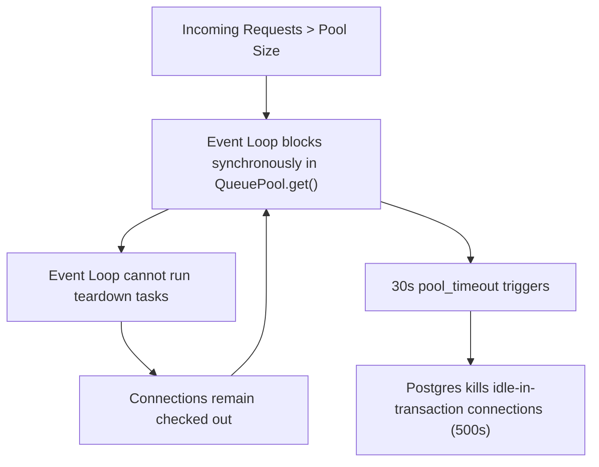

# Performance, Overload Dynamics, and Load Testing: Release 3.x Findings

This report documents the performance evaluation, capacity limits, overload dynamics, and architectural hardening conducted during the v3.x lifecycle (October 2026). Across approximately thirty instrumented test runs, the investigation uncovered a critical event-loop stall mechanism under heavy concurrency, diagnosed CPU bottlenecks, and established the architectural controls that guarantee stability under load.

> [!NOTE]
> The performance test harness, synthetic traffic generators, and internal tracing tools (`run_full.py`, `shop_journeys.py`, `tracing.py`, and `probe_server.py`) referenced in this record are internal development scripts and are not published in the application repository.

---

## 1. Test Environment and Baseline Workload

Tests were executed against a local desktop testbed configured to represent a single multi-core application host:
- **Compute Resources:** 4 CPU cores, local execution where API workers, PostgreSQL 18, Redis 7 (Memurai), and the traffic generator competed for available host cores.
- **Software Stack:** Python 3.13, uvicorn ASGI server, SQLAlchemy 2.1 on psycopg 3, `ENVIRONMENT=production`, and `BCRYPT_ROUNDS=12`.
- **Database Engine Pool:** Default `QueuePool` of 10 connections plus 20 overflow connections per engine per worker process.
- **Seeded Test Dataset:** Dedicated test database populated with 5,000 products, 20 categories, 400 pre-configured customer accounts, and 1 administrator.
- **Workload Scenarios:** Simulated realistic multi-step user shopping journeys: browsing catalog categories, viewing product details, adding items to cart, authenticating, and placing orders.
- **Traffic Multipliers:**
  - **1x (Expected Load):** 200 concurrent users with 2 to 8 second think times (~41 requests per second).
  - **2x Load:** 1 to 4 second think times (~80 requests per second).
  - **4x Load:** 0.5 to 2 second think times (~140 requests per second).
  - **8x Load:** 0.25 to 1 second think times (extreme overload).
- **Environment Note:** Tests identified that configuring `REDIS_HOST=localhost` on Windows hosts causes a one-off 2-second event-loop freeze per process due to IPv6 fallback timeouts before IPv4 connection. Using explicit numeric IP address `127.0.0.1` eliminated this latency artifact entirely.

---

## 2. Key Experimental Runs Index

The load test campaign progressed through approximately thirty targeted runs to diagnose issues and confirm remediations:

| Run Identifier | Experimental Setup | Primary Finding / Measured Outcome |
|---|---|---|
| **01-bench-abc** | Isolated list/search SQL: inline sync (a), threadpool (b), async (c); pool 30 | (a) stalled at 50 users, (b) stalled at 200 users, (c) never stalled |
| **03-apiuser-before** | Baseline APIUser scenario, 1 worker, all routes synchronous | Maintained 50 users; complete deadlock stall at 100 users |
| **04-apiuser-async** | Catalog router migrated to async engine, 1 worker | 200 users served at 83 req/s without stalls; p50 770 ms |
| **12-cfg-A** | 4x journey load, 1 worker, unconstrained defaults | Complete stall at 150 users; 406 dropped requests without reply |
| **14-cfg-C** | 4x journey load, 1 worker, `MAX_IN_FLIGHT_REQUESTS=15` | Stable execution; 25% shed load, zero process crashes |
| **16-cfg-E** | 4x journey load, 4 workers, `MAX_IN_FLIGHT_REQUESTS=15` | Highly stable; 135 req/s served, p95 359 ms, 5.5% shed |
| **25-e2e-live** | First end-to-end traced run with live Stripe and SMTP | 8 of 8 `/pay` calls failed; all 48 background emails crashed |
| **27-e2e-fixes** | Traced run following Stripe and Celery connection fixes | 1,466 requests, 0 failed, 81 emails sent, no open transactions |
| **30-e2e-guest** | Traced end-to-end run incorporating guest shopping carts | 1,563 requests, 0 failed, 56 of 56 operations successful |
| **32-4x-defaults** | 4x journey load, 4 workers, final defaults (pool 10+5, limit 15) | 140 req/s served, p95 508 ms, 8.5% shed with fast 503s |
| **34-1x-defaults** | Expected load (1x), 4 workers, full 8-minute duration | 41.8 req/s served, p50 10 ms, p95 43 ms, 0 shed requests |
| **35-variants** | Multi-variable analysis: limits, workers, bcrypt throttling | Mapped tradeoffs between request rejection and queue delay |

---

## 3. Diagnosis: The Event-Loop Overload Stall

### Mechanism of the Deadlock (Finding F1)
Prior to this investigation, all route handlers were declared as `async def`, yet invoked synchronous SQLAlchemy `Session` queries directly. Under normal load, queries resolved rapidly and the event loop remained responsive. However, under overload conditions where request arrival exceeded processing capacity, this architecture produced an unrecoverable event-loop deadlock rather than a graceful slowdown:

1. **Connection Holding:** Each authenticated request claimed two pooled connections: one during dependency resolution in `get_current_user`, and a second during route execution in `get_db`.
2. **Asynchronous Teardown Scheduling:** In Starlette and FastAPI, cleanup of synchronous generator dependencies (`get_db`) is scheduled onto worker threads by the event loop upon response delivery.
3. **Connection Starvation:** When all 30 pool connections were held by completed handlers awaiting dependency teardown, incoming requests entered `QueuePool.get()` on the event-loop thread.
4. **The Deadlock:** Because the event-loop thread was blocked synchronously waiting for a connection from the pool, it was unable to dispatch the threadpool tasks required to tear down finished requests and return connections to the pool.
5. **Cascading Failure:** The entire worker process hung for the full 30-second `pool_timeout`. During the freeze, PostgreSQL terminated connections left idle in transactions (`idle_in_transaction_session_timeout`), producing `server closed the connection unexpectedly` errors. Probes recorded event-loop freezes lasting up to 114 consecutive seconds.

### CPU Profiling: The Password Hashing Bottleneck (Finding F6)
Profiling all worker processes under load using `py-spy` revealed that database and application routing overhead was negligible compared to cryptographic hashing:

| Component | CPU Consumption Share | Operational Latency |
|---|---|---|
| **bcrypt password verification** | 26% to 38% | ~290 to 360 ms per call |
| **bcrypt password hashing** | 17% to 22% | ~290 to 360 ms per call |
| **Combined bcrypt operations** | **43% to 60%** | Consumed by < 5% of total requests |
| Catalog listing and search | 3% to 5% | Single-digit milliseconds |
| Rate limiting middleware | 2% to 4% | Sub-millisecond Redis calls |
| Dependency authentication (`get_current_user`) | 2% to 3% | Fast indexed query |
| Database engine setup and teardown | 2% to 3% | Fast pool checkout |
| PostgreSQL process utilization | 0.4 to 0.5 CPU cores | Operating well below saturation |
| Redis process utilization | ~0.05 CPU cores | Idle capacity |

Requests involving password operations (logins, registrations, password resets, account deletions) constituted under 5% of incoming traffic but consumed up to 60% of all available CPU cycles across all API workers.

### Real-Service Disconnects and Blocking I/O
Tracing requests end-to-end against live external services revealed critical failure points that simulated mocks failed to detect:
- **Synchronous External HTTP Calls:** Calls to the Stripe payment API inside `async def` routes ran synchronously, freezing the entire worker process for ~1 second per payment operation.
- **Celery Connection Leaks:** Background Celery tasks failed to close their SQLAlchemy database sessions, leaving idle connections open in perpetual transactions until PostgreSQL killed them.
- **Beat Schedule Configuration Drift:** The Celery beat schedule referenced obsolete task import paths, preventing periodic maintenance tasks from executing.

---

## 4. The Architectural Remediation

To eliminate stalls and guarantee deterministic overload behavior, the backend underwent major architectural changes:

| Component | Technical Change | File Locations | Verification Test |
|---|---|---|---|
| **In-Flight Concurrency Bound** | Added `MAX_IN_FLIGHT_REQUESTS` middleware; sheds excess requests with fast 503 and `Retry-After: 1` | `app/core/overload.py` | `test_overload_middleware_rejects_beyond_capacity` |
| **Off-Loop Payment Dispatch** | Stripe SDK operations executed in worker threads via `anyio.to_thread.run_sync` | `app/api/v1/orders.py` | `test_payment_provider_calls_run_off_the_event_loop` |
| **Async Authentication Dependency** | `get_current_user` migrated to `AsyncSession` and `AsyncRedisService`; yields detached models | `app/core/security.py` | `test_auth_dependencies.py` (20 tests) |
| **Live-Priced Cart Redesign** | Cart stores items and quantities; server prices dynamically in `Decimal` via `AsyncSession` | `app/api/v1/cart.py` | `test_cart_pricing_matches_catalog_at_checkout` |
| **Celery Session Management** | Background tasks wrapped in explicit context managers closing sessions upon completion | `app/tasks.py` | `test_celery_task_leaves_no_idle_transactions` |
| **Test Coverage Measurement** | Added `concurrency = ["greenlet", "thread"]` in `pyproject.toml` to accurately measure async coverage | `pyproject.toml` | Overall coverage increased from false 65% to 92.6% |

---

## 5. Measured Results: Before vs. After

### Performance Under Severe Overload (4x Expected Load, 200 Users)

| System Configuration | Before Remediation | After Architectural Remediation |
|---|---|---|
| **1 Worker, No In-Flight Limit** | Stalled completely at 150 users; 406 requests dropped without response; server dead (Run 12) | **122 req/s served**, p50 288 ms, p95 807 ms, p99 1259 ms, 0 dropped requests (Run 31) |
| **1 Worker, Mixed Overload with Probe** | Stalled completely; sync connection pool pinned at 30/30 (Runs 23, 24) | **74.5 req/s served**, 0 failed requests, sync pool averaged 2.4 / max 9 (Run 29) |
| **4 Workers with In-Flight Limit (15)** | 135 req/s served, p95 359 ms, 5.5% shed with pool 30 (Run 16) | **140 req/s served**, p95 508 ms, 8.5% shed with pool 10+5, 0 errors (Run 32) |

By migrating authentication and rate limiting off the synchronous engine pool, an overloaded worker claims only 2 or 3 synchronous connections instead of 30, permanently preventing connection pool exhaustion.

### Concurrency Surge Analysis (Run 35 Variants)
To evaluate the interaction between in-flight concurrency limits and bcrypt CPU contention, seven configurations were tested under steady load and sudden traffic spikes (200 users arriving within 4 seconds, 33% logging in simultaneously):

| Variant | Workers | Limit | bcrypt Concurrency | Steady p95 / p99 | Spike p95 / p99 | Spike Login p95 | Spike Shed Rate |
|---|---|---|---|---|---|---|---|
| **V1 (Adopted)** | 4 | 15 | 16 (default) | 44 ms / 309 ms | 322 ms / 1,626 ms | 2,294 ms | 3.6% shed |
| **V2** | 4 | 30 | 16 (default) | 50 ms / 311 ms | 502 ms / 1,444 ms | 2,365 ms | 0.9% shed |
| **V3** | 4 | 60 | 16 (default) | 46 ms / 312 ms | 944 ms / 2,164 ms | 3,000 ms | 0.0% shed |
| **V4** | 4 | none | 16 (default) | 47 ms / 308 ms | 649 ms / 2,366 ms | 2,702 ms | 0.0% shed |
| **V5** | 4 | 15 | 4 (throttled) | 47 ms / 311 ms | 478 ms / 1,269 ms | 2,464 ms | 1.3% shed |
| **V6** | 4 | 30 | 2 (throttled) | 89 ms / 354 ms | 843 ms / 1,848 ms | 2,639 ms | 11 requests |
| **V7** | 2 | 30 | 2 (throttled) | 168 ms / 687 ms | 542 ms / 1,800 ms | 3,114 ms | 29 requests |

Key takeaways from variant testing:
- **Steady-State Invariance:** In steady traffic, the in-flight limit introduces no overhead; V1 through V5 delivered identical latency (p95 ~45 ms, p99 ~310 ms).
- **Surge Tradeoffs:** During a login surge, the in-flight limiter functions as a predictable dial between fast refusal (503) and delayed queueing. Variant V1 shed 3.6% of requests to maintain non-login p99 under 650 ms, whereas unconstrained variants queued requests up to 2 seconds.
- **Bcrypt Throttling:** Restricting bcrypt concurrency to 2 per worker (V6, V7) degraded latency even in steady state, as login requests queued behind one another. Throttling was left unconstrained by default.

### Performance at Expected Operational Load (1x Load, 4 Workers, Default Settings)
Under standard production load (200 concurrent users, 4 workers, think time 2 to 8 seconds, 8-minute duration, Run 34):

| Concurrency Level | Throughput (req/s) | Median p50 (ms) | p95 Latency (ms) | p99 Latency (ms) | Dropped / Shed |
|---|---|---|---|---|---|
| **100 Active Users** | 20.7 req/s | 10 ms | 147 ms | 377 ms | 0 (0%) |
| **150 Active Users** | 30.4 req/s | 9 ms | 36 ms | 309 ms | 0 (0%) |
| **200 Active Users** | 41.8 req/s | 10 ms | 43 ms | 310 ms | 0 (0%) |

Across 13,929 requests during the steady-state plateau, zero requests were shed, zero server errors were logged, and not a single request exceeded 1.5 seconds. The architectural improvements introduced zero latency overhead during normal operation.

---

## 6. Capacity Planning and Operational Guidelines

1. **The Database Connection Invariant:**
   To guarantee that worker processes can never exhaust PostgreSQL connection limits, the pool configuration must obey:
   $$\text{WORKERS} \times (\text{DB\_POOL\_SIZE} + \text{DB\_MAX\_OVERFLOW}) < \text{PostgreSQL } \text{max\_connections}$$
   With 4 workers, a pool of 10+5 requires at least 60 available connections. In Docker Compose, PostgreSQL `max_connections` is sized to 200.
2. **In-Flight Limit Sizing:**
   The default `MAX_IN_FLIGHT_REQUESTS=15` is deliberately configured to equal the total synchronous pool size (10 + 5). This mathematical ceiling prevents the worker from ever asking the pool for more connections than exist. Raising this limit without increasing the pool reintroduces stall risks.
3. **Reverse Proxy Configuration:**
   Because rate limiting and concurrency throttling rely on client IP addresses, deployments behind reverse proxies or load balancers must configure `TRUSTED_PROXIES` (specifying proxy IP addresses or CIDR blocks) and ensure the proxy appends to `X-Forwarded-For`.
4. **Latency Measurement Warning:**
   Attaching sampling profilers like `py-spy` across multiple workers introduces significant process suspension artifacts. Profiler sampling in Run 33 caused synthetic 5-second stalls that disappeared completely when profiling was disabled.

---

See also: [Final Test Campaign Overview](final-test-campaign.md), [Remediated Defects across Releases 4.0.x](fixes-4.0.x.md), [Chaos and Fault Recovery](T8-chaos.md), [Load and Stress Testing (Stage T7)](T7-load.md).
